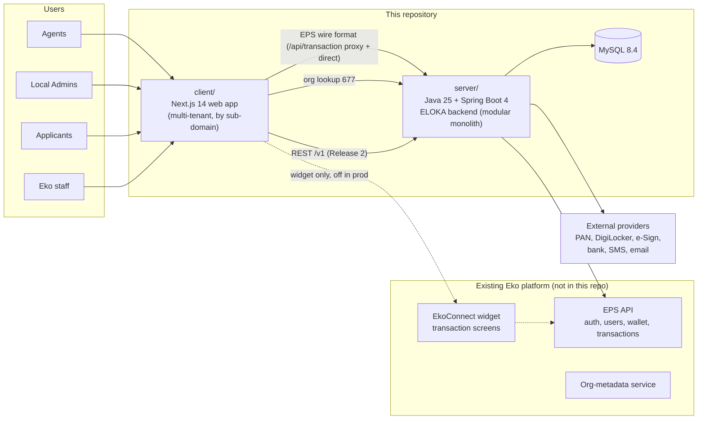
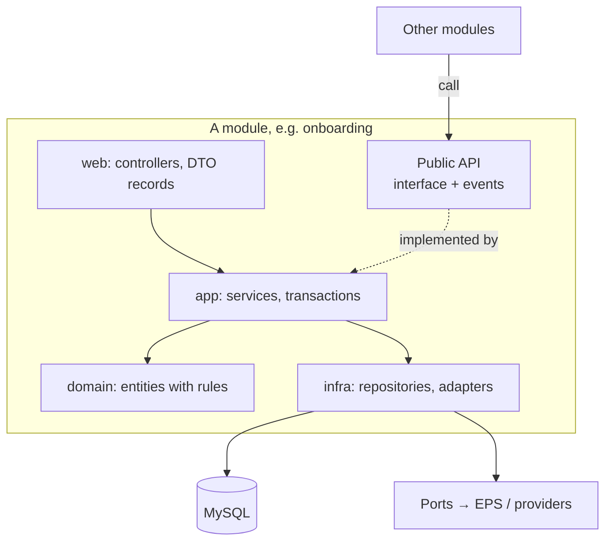
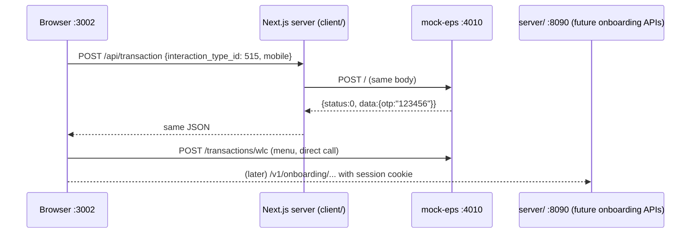

 # ELOKA: architecture overview (rough)

> Status: **rough, for discussion** · 15 October 2026
> The detailed design of the first backend feature (Local Admin onboarding) is in [`onboarding/ARCHITECTURE.md`](./onboarding/ARCHITECTURE.md). This page is the one-screen picture of the whole project.

## 1. What we are building

ELOKA is Eko's white-label fintech platform. A business (a **tenant**) gets its own branded portal, run by a **Local Admin**. Inside it, distributors and retailers (**agents**) do money transfer, AePS, bill payment and other services, and new agents onboard themselves through KYC steps.

| Persona | Uses | Today served by |
|---|---|---|
| Applicant (wants to become a tenant) | Local Admin onboarding journey | **new** `server/` + onboarding UI in `client/` |
| Eko staff | Review, approve, provision tenants | **new** `server/` + staff screens |
| Local Admin | Configure network, pricing, branding | `client/` → EPS |
| Agent (retailer / distributor) | Transactions, wallet, own onboarding | `client/` → EPS |

## 2. System context



Key point (ADR-0004, 15 Oct 2026): **`server/` is the system of record and answers the same requests EPS did**, so the client works unchanged. The EkoConnect widget (money transactions) still talks to EPS and is switched off in production until a token exchange with EPS exists. Release 2 adds Local Admin onboarding (application state, staff review, provisioning into our own database).

## 3. Repository layout

```
eloka/
├── CLAUDE.md                 # rules for everyone (people and AI agents)
├── README.md                 # quick start
├── Makefile                  # one entry point for common commands
├── docs/
│   ├── ARCHITECTURE_OVERVIEW.md   # this file
│   ├── LOCAL_DEVELOPMENT.md       # how to run locally + dummy logins
│   ├── DEVELOPMENT_WORKFLOW.md    # SDLC: branches, reviews, releases
│   ├── adr/                       # architecture decision records
│   └── onboarding/                # Local Admin onboarding blueprint (Phase 0)
├── client/                   # frontend (Next.js). Has its own CLAUDE.md
│   └── mock-eps/             # dummy EPS backend for local login/testing
└── server/                   # backend (Spring Boot). Has its own CLAUDE.md
```

## 4. Client (frontend) in one paragraph

Next.js 14 (pages router), React 18, Chakra UI, TypeScript where new. Component-based: `components/` (reusable UI), `page-components/` (one per route), `features/` (self-contained modules such as onboarding, KYC, DigiKhata), `contexts/` (global state), `hooks/`, `tf-components/` (config-driven forms). Every backend call goes through `pages/api/transaction.js`, a server-side proxy to EPS. The tenant (branding, features) is resolved from the sub-domain. Details: [`client/CLAUDE.md`](../client/CLAUDE.md).

## 5. Server (backend) in one paragraph

Spring Boot 4 **modular monolith** (Spring Modulith). One deployable, split into modules that own their data and talk through public interfaces or events: `identity`, `lead`, `onboarding`, `verification`, `documents`, `agreement`, `whitelabel`, `review`, `provisioning`, `tenant`, `audit`, `notification`, `integration`, plus `shared` and `system`. MySQL 8.4 with Flyway migrations. Layering inside a module: controller → service → domain → repository/adapter. External systems sit behind port interfaces with fake adapters for local runs and tests. Details: [`server/CLAUDE.md`](../server/CLAUDE.md).



## 6. Environments

| | local | staging | production |
|---|---|---|---|
| Client | `npm run dev:server` (real backend) or `npm run dev:mock` (mock only) | `dev` branch build | `main` branch build |
| Server | `./gradlew bootRun`, profile `local`, MySQL in Docker | profile `prod`, staging DB | profile `prod`, production DB |
| Backend for the client | `server/` (or `client/mock-eps`) | `server/` | `server/` |
| Data | dummy users only | test data | real data |
| Secrets | none needed / `client/.env.local` | secrets manager | secrets manager |

Rule: **the same build runs everywhere; only configuration changes.** Configuration comes from env files (client) and Spring profiles + environment variables (server). Secrets are never committed.

## 7. How a request flows locally



## 8. Next steps (rough order)

1. Review this layout and the onboarding blueprint; answer the blocking open questions ([`onboarding/OPEN_QUESTIONS.md`](./onboarding/OPEN_QUESTIONS.md)).
2. Server Phase 1 foundation: audit, outbox, idempotency, encryption, observability ([`onboarding/IMPLEMENTATION_PLAN.md`](./onboarding/IMPLEMENTATION_PLAN.md)).
3. Server Phase 2–3: applicant OTP login + onboarding application with its state machine, with a local seed (fixed OTP) like the client mock.
4. Client: onboarding UI that calls `server/` for the Local Admin journey (decision ADR-011 in the blueprint is still open).
