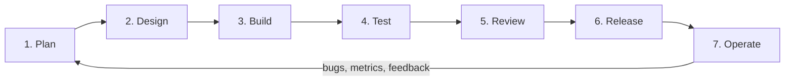

# Development workflow (SDLC)

How a change goes from idea to production in ELOKA. It applies to both `client/` and `server/`.

## 1. Plan

- Every piece of work starts as an issue (feature, bug or chore) with a clear goal and **acceptance criteria**.
- Large work is split into slices that can ship on their own. Each slice should be demo-able.
- Open questions go into [`onboarding/OPEN_QUESTIONS.md`](./onboarding/OPEN_QUESTIONS.md) (or the issue), never into assumptions in code.

## 2. Design

- Anything that changes the shape of the system (a new module, a new table, a new external integration, a new API) gets a short design note first.
- Decisions that are hard to reverse are recorded as an **ADR** in [`adr/`](./adr/): context → decision → consequences. Copy [`adr/0000-template.md`](./adr/0000-template.md).
- New APIs are written down (request, response, errors) before they are built. The client and server agree on the contract first.

## 3. Build

**Branches** (trunk = `dev`):

| Branch | Purpose |
|---|---|
| `main` | What runs in production. Only release merges. Version must be bumped. |
| `dev` | Integration branch. Always deployable to staging. |
| `feat/<short-name>` | New feature, branched from `dev` |
| `fix/<short-name>` | Bug fix, branched from `dev` |
| `chore/…`, `docs/…`, `refactor/…`, `test/…` | Other work, branched from `dev` |
| `hotfix/<short-name>` | Urgent production fix, branched from `main`, merged back to `main` **and** `dev` |

**Commits** follow [Conventional Commits](https://www.conventionalcommits.org/) (enforced by commitlint in `client/`): `feat(onboarding): add PAN step`, `fix(server): reject expired OTP`. Use the folder as the scope when it helps: `client`, `server`, `docs`.

**Code rules:**
- Server: object-oriented, layered, module boundaries enforced by tests. See [`server/CLAUDE.md`](../server/CLAUDE.md).
- Client: component-based, feature folders, config over conditionals. See [`client/CLAUDE.md`](../client/CLAUDE.md).
- No secrets in git. Ever. Local secrets go in `client/.env.local` or shell environment variables.

## 4. Test

| Level | Client | Server |
|---|---|---|
| Unit | Jest + Testing Library (`npm test`) | JUnit 5 + AssertJ |
| Slice / integration | Context-wrapped renders (`pageRender`, `adminRender`) | `@WebMvcTest`, `@DataJpaTest`, Testcontainers MySQL |
| Architecture | ESLint rules | Spring Modulith `verify()` (module boundaries) |
| Manual / E2E | Click-through with the **dummy logins** on the local mock backend ([`LOCAL_DEVELOPMENT.md`](./LOCAL_DEVELOPMENT.md)) | `GET /v1/system/info`, Actuator health |

Minimum for every change: tests for the logic you touched, plus lint and the full test suite green locally.

## 5. Review

- Open a pull request into `dev` using the PR template. Keep PRs small (aim for under ~400 changed lines).
- At least **one approving review**. Changes to auth, money movement, KYC data or database migrations need a second reviewer.
- CI must be green: lint, tests, build, CodeQL, secret scan.
- The author merges after approval (squash merge, Conventional Commit title).

**Definition of Done:**
- [ ] Acceptance criteria met and demoed locally
- [ ] Tests added or updated; all suites green
- [ ] Docs updated (README / CLAUDE.md / ADR / API notes) when behaviour or structure changed
- [ ] No new lint warnings, no secrets, no stray `console.log` / debug code
- [ ] Reviewed and approved

## 6. Release

| Environment | Branch | Who deploys | Data |
|---|---|---|---|
| **local** | any | the developer | dummy data only (mock EPS for the client, local MySQL in Docker for the server) |
| **staging** | `dev` | CI on merge | test data; EPS UAT |
| **production** | `main` | release manager, after staging sign-off | real data |

- Releases are tagged `vX.Y.Z` (Semantic Versioning). The client version lives in `client/package.json`, the server version in `server/build.gradle.kts`.
- Database changes ship only as new Flyway migration files (`server/src/main/resources/db/migration/V<n>__<what>.sql`). Never edit a migration that has already run anywhere.
- Every release must be reversible: a rollback plan is written in the release PR.

## 7. Operate

- Health: server `GET /actuator/health/liveness` and `/readiness`.
- Logs are structured and never contain secrets, OTPs, full PAN / Aadhaar / bank numbers.
- Incidents get a short post-mortem; the fix comes back in at step 1 as an issue.
