# ELOKA Local Admin Onboarding — Architecture

> Status: **DRAFT for architecture review** · **Revised 14 October 2026:** Java 25 + Spring Boot 4, MySQL 8.4 · Phase 0 (design only. No code, dependencies, migrations or integrations were created.)
> Companion documents: [ELOKA_ONBOARDING_JOURNEY.md](./ELOKA_ONBOARDING_JOURNEY.md) · [ONBOARDING_STATE_MACHINE.md](./ONBOARDING_STATE_MACHINE.md) · [FRONTEND_BACKEND_MAPPING.md](./FRONTEND_BACKEND_MAPPING.md) · [DATABASE_DESIGN.md](./DATABASE_DESIGN.md) · [API_SPECIFICATION.md](./API_SPECIFICATION.md) · [INTEGRATIONS.md](./INTEGRATIONS.md) · [SECURITY.md](./SECURITY.md) · [IMPLEMENTATION_PLAN.md](./IMPLEMENTATION_PLAN.md) · [OPEN_QUESTIONS.md](./OPEN_QUESTIONS.md)

Labels: **CONFIRMED** · **EXISTING FRONTEND BEHAVIOUR** · **PROPOSED / RECOMMENDED** · **ASSUMPTION** · **OPEN QUESTION**

---

## 1. Context in one page

**What ELOKA Local Admin onboarding is.** A qualified business customer of Eko (a "Lead" that agreed, on a sales call, to take the Eloka **White Label** solution) completes identity, business, KYC and agreement steps. Eko staff then review and approve it. The system creates the customer's **tenant** (organisation, sub-domain, branding, configuration) and its first administrator, the **Local Admin**, and makes them live. The Local Admin then runs their own network (distributors, retailers / I-merchants) on the existing Eloka web app with Eko products (DMT, AePS, BBPS, QR, PG, Travel, Insurance; whiteboard).

**What exists today** (details in FRONTEND_BACKEND_MAPPING.md):

| Piece | Exists? | Notes |
|---|---|---|
| Eloka tenant web app (`wlc-webapp`, Next.js) | ✅ | Serves every tenant by sub-domain or custom domain; resolves the org via the org-metadata service (interaction `677`) |
| EPS backend ("Eko Platform Services") behind `NEXT_PUBLIC_API_BASE_URL` | ✅ (not in this repo) | Interaction-ID envelope (`/transactions/do`, `/dojson`, `/upload`, `/customupload`) + "tf-req" REST tunnel (`/ekoicici/v1/v2/v3/...`); auth at `/authentication/*` |
| Agent onboarding (self + assisted) | ✅ | `src/features/onboarding`; uses EPS interactions 521/522/523/205/550-552/287/293/454/5 |
| **Local Admin onboarding** | ❌ in this repo | Spread over **Eko Connect** (sign-up), the **Go-Live Admin tool** (staff), email, the admin's own domain (Agreement Signing) and **manual** CRM / DLT / logo / Play Store / domain tickets |
| Onboarding state, review queue, audit, provisioning automation | ❌ | — |

**What this architecture adds:** an **ELOKA Onboarding Service**. It owns the pre-tenant application lifecycle, staff review and automated provisioning. It integrates with EPS and providers through adapters, and EPS stays the system of record for live tenants and users.

---

## 2. Required diagrams

### 2.1 High-level system architecture

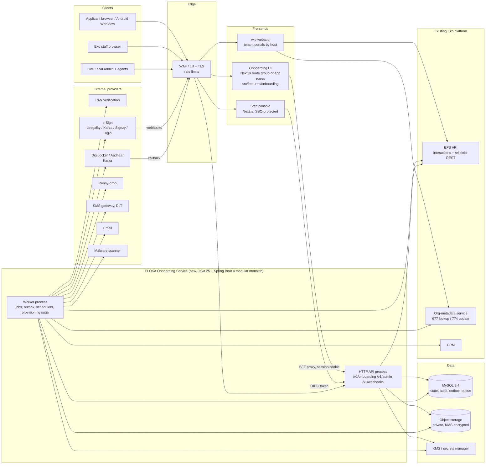

### 2.2 Current onboarding flow (today)

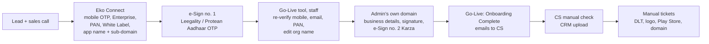

### 2.3 Recommended onboarding flow

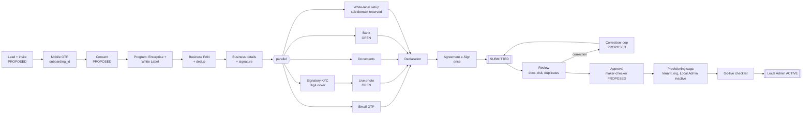

### 2.4 Onboarding state machine (application level)

The full catalogue with guards is in ONBOARDING_STATE_MACHINE.md.

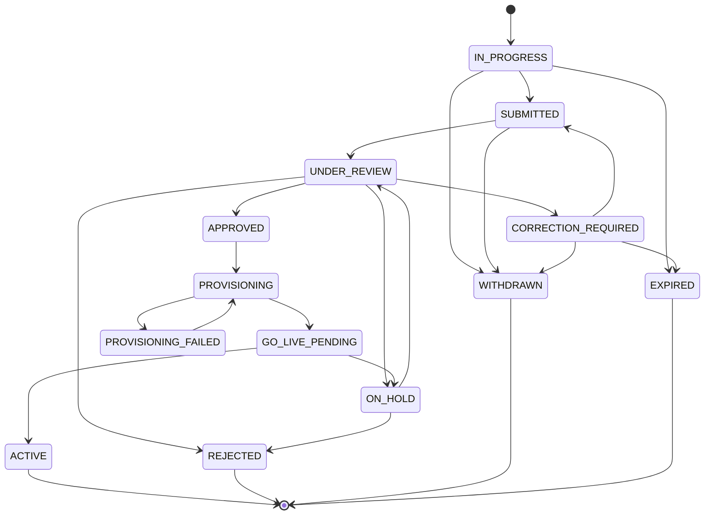

### 2.5 Backend module architecture

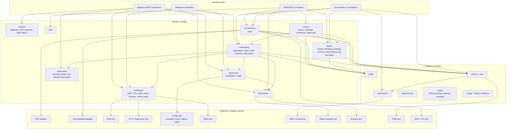

### 2.6 Main onboarding sequence

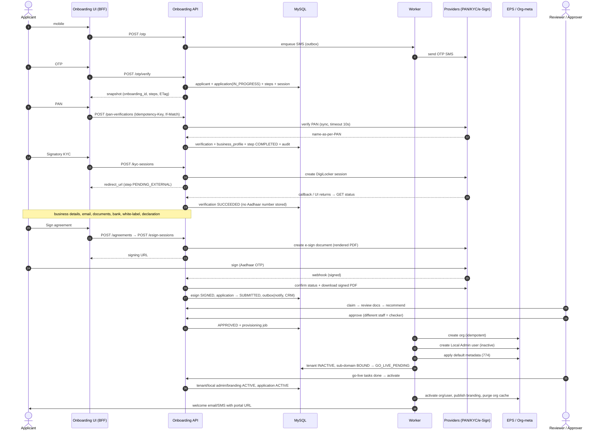

### 2.7 Data flow diagram

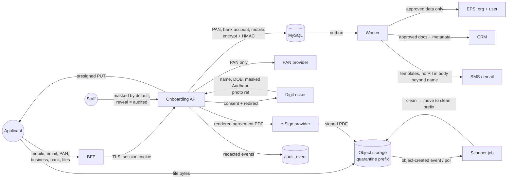

### 2.8 Database ER diagram (summary)

Full ER with columns in DATABASE_DESIGN.md §3.1.

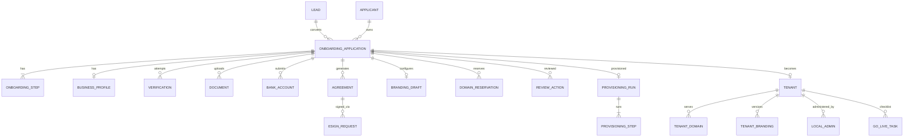

### 2.9 Deployment architecture

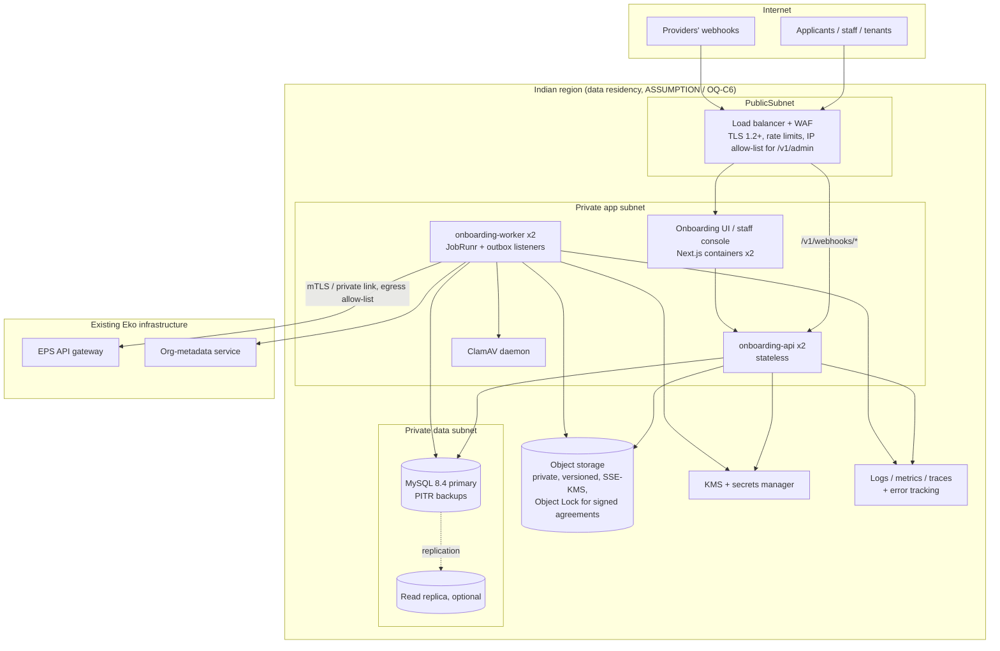

Environments: `local` (docker-compose: MySQL, MinIO, ClamAV, WireMock provider mocks) → `dev` → `staging` (provider **sandboxes**, real EPS UAT) → `production`. Each environment has separate KMS keys, buckets and provider credentials. No production PII is ever copied to lower environments.

### 2.10 Multi-tenant isolation architecture

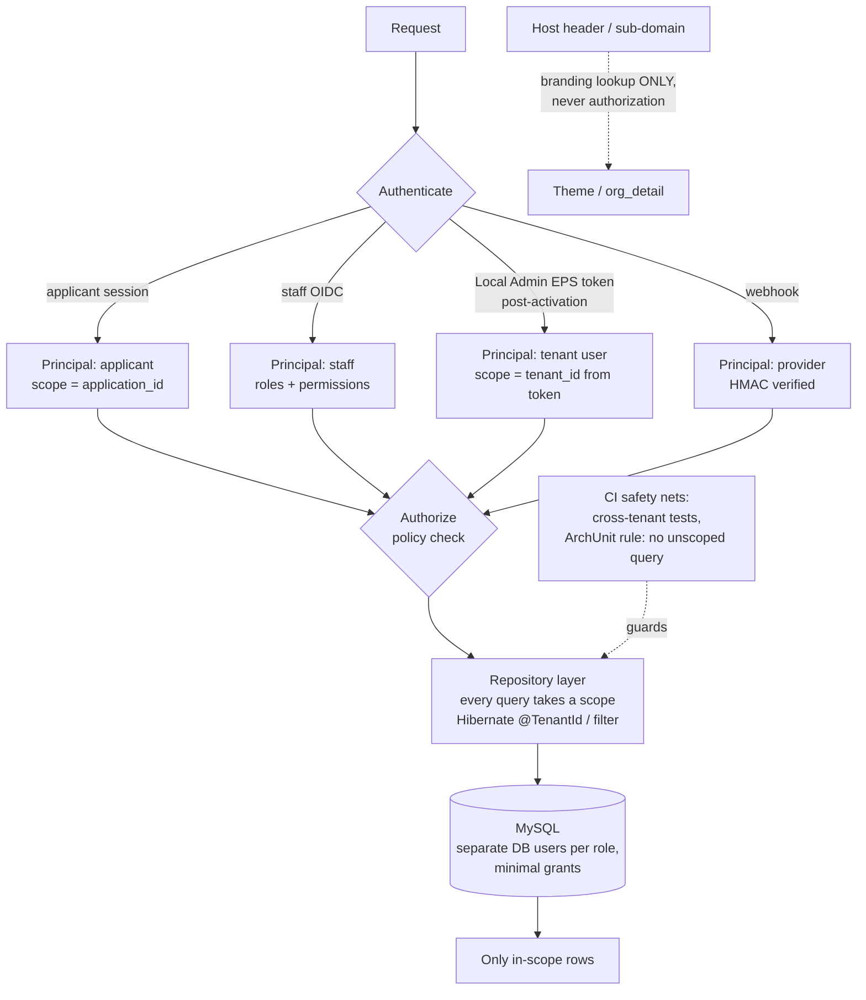

Two walls, plus safety nets (MySQL has no Row-Level Security):

1. **Authorization policy** (route + permission + ownership), in Spring Security.
2. **Repository scoping**: no query without a scope argument. Tenant tables use Hibernate's `@TenantId` (or an always-on filter) fed from the authenticated principal, never from the host.

Safety nets that stand in for the missing database wall:

- **Automated cross-tenant tests** in CI: for every endpoint, a principal from tenant A asks for tenant B's data and must get `404`.
- **ArchUnit / Spring Modulith rules**: native queries and repository methods without a scope parameter fail the build.
- **Separate MySQL users**: the API user, the worker user, the migration user and the read-only reporting user each have only the grants they need (the audit table is insert-only for everyone).

The host name never grants access. ADR-003 has the rationale.

### 2.11 External integration architecture

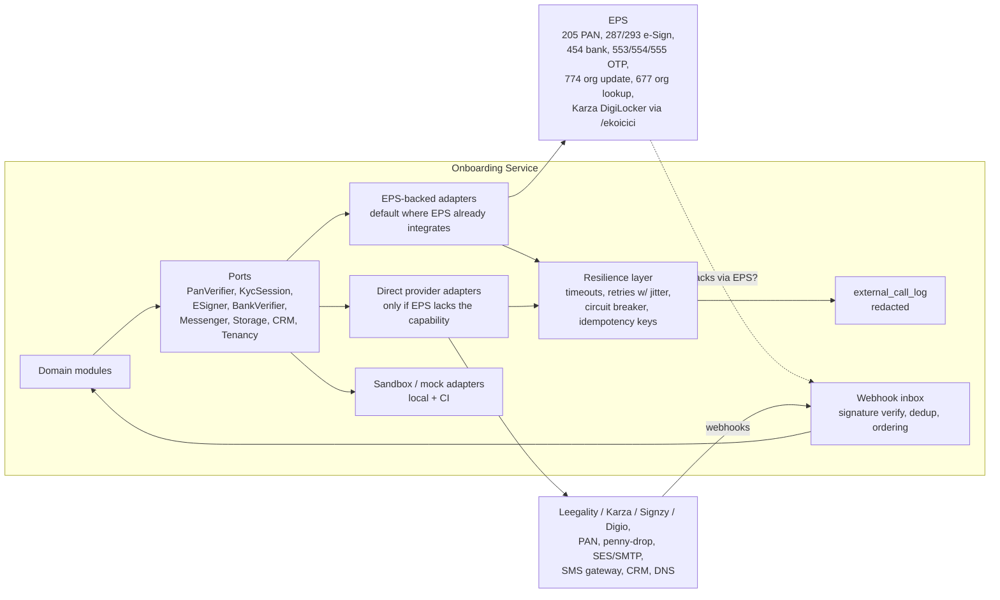

---

## 3. Architecture style evaluation

| Option | Advantages | Disadvantages | Fit for ELOKA onboarding |
|---|---|---|---|
| **Extend EPS** (add onboarding to the existing Eko backend) | Reuses its auth, provider integrations and deploy pipeline. No new service to run. | EPS source and conventions are not available to this analysis. Its interaction-ID envelope is a poor fit for a resumable state machine with HTTP semantics. Ties onboarding releases to the core transaction platform. Larger blast radius. | Viable **only if** the EPS team owns this work (**OPEN**, OQ-T5) |
| Traditional monolith (new, layered) | Simple | Layers without module boundaries erode as features grow | Not preferred |
| **Modular monolith** (new service, strict modules, one deployable with two process roles: api + worker) | One transaction boundary for state + audit + outbox. Fastest to build and test. Low ops cost. Clear module seams for later extraction. | Needs discipline (module boundaries enforced by Spring Modulith verification tests and ArchUnit). One deploy unit. | ✅ **Recommended** |
| Microservices (KYC, documents, agreement, tenant, …) | Independent scaling and deploys | Distributed transactions across onboarding state. Many deployables for a low-volume workflow (hundreds of tenants, ASSUMPTION). High ops burden. Needs a mature platform team. | Over-engineered now |
| Serverless (functions + managed queues) | Pay-per-use, scales to zero | Long-running sagas and webhooks need an orchestrator. Harder local testing. Cold starts on OTP paths. Vendor lock-in. Infra preferences unknown. | Not preferred |
| Hybrid (modular monolith + workflow engine like Temporal) | Durable sagas with built-in retries and visibility | Adds a cluster to operate. Overkill for one saga of 7 steps. | Revisit if workflows multiply (future) |

**Recommendation:** a **new ELOKA Onboarding Service built as a modular monolith** in **Java 25 + Spring Boot 4 with Spring Modulith**. It sits beside EPS and integrates through adapters. Provisioning is the only place it writes to EPS. Future migration path: modules with independent scaling needs (documents / scanning, notifications) can be extracted behind their existing ports without changing callers.

---

## 4. Backend modules

| Module | Responsibility | Main APIs | Entities | Depends on | Emits events | External | Security boundary |
|---|---|---|---|---|---|---|---|
| `identity` | Applicant OTP + sessions; staff identities from SSO; roles / permissions | `/otp`, `/otp/verify`, `/session`, staff `/me` | `applicant`, `otp_challenge`, `applicant_session`, `staff_user`, `role`, `permission` | crypto, audit | `MOBILE_VERIFIED`, `SESSION_*` | SMS, IdP | Only issuer of principals |
| `lead` | Leads, qualification, invites | `/admin/leads*` | `lead` | identity, notifications | `LEAD_*` | CRM | Staff only |
| `onboarding` | Application aggregate, step policy, state machine, resume, expiry | `/applications/current`, `/steps/*`, `/submit`, `/withdraw` | `onboarding_application`, `onboarding_step`, `step_policy` | verification, documents, agreement, white-label | `ONBOARDING_*`, `STEP_*`, `APPLICATION_SUBMITTED` | — | Applicant scope = own application |
| `verification` | PAN, KYC/DigiLocker, bank, email, liveness, name match, risk; reconciliation | `/pan-verifications`, `/kyc-sessions`, `/bank-accounts`, `/email-verifications` | `verification`, `business_profile` (PAN), `bank_account` | ports, crypto | `PAN_*`, `KYC_*`, `BANK_*` | PAN, Karza, penny-drop | Raw provider data never leaves this module unredacted |
| `documents` | Upload URLs, scanning, versions, review status, retention | `/documents*`, staff verify / reject | `document` | storage port, scanner | `DOCUMENT_*` | Object storage, AV | Presigned, short-lived, scope-checked |
| `agreement` | Templates, rendering, e-sign sessions, webhook verification, signed PDF archive | `/agreements*`, `/webhooks/{esign}` | `agreement`, `esign_request` | documents, e-sign port | `AGREEMENT_*`, `ESIGN_*` | e-sign providers | Signed status set only from provider evidence |
| `white-label` | Branding drafts, sub-domain availability and reservation | `/subdomains/availability`, `/steps/WHITE_LABEL_SETUP` | `branding_draft`, `domain_reservation` | documents | `SUBDOMAIN_*`, `BRANDING_*` | — | — |
| `review` | Queue, claim, checklist, document decisions, corrections, holds, maker-checker | `/admin/applications*` | `review_action`, `correction_request` | onboarding, documents | `APPLICATION_*`, `CORRECTION_*` | — | Permission-gated; reveal of PII audited |
| `provisioning` | Saga after approval; retries; ops resume | `/admin/applications/{id}/provisioning*` | `provisioning_run`, `provisioning_step` | tenant, EPS / org-meta adapters | `TENANT_CREATED`, `LOCAL_ADMIN_CREATED`, `PROVISIONING_*` | EPS, org-meta, DNS | Worker-only writes to EPS |
| `tenant` | Tenant, domains (custom-domain verification), branding versions, Local Admins, go-live tasks, activation | `/admin/tenants*`, `/tenants/{id}/domains*` | `tenant`, `tenant_domain`, `tenant_branding`, `local_admin`, `go_live_task` | provisioning, notifications | `TENANT_*`, `DOMAIN_*`, `LOCAL_ADMIN_ACTIVATED` | DNS, TLS, org-meta | tenant_id scope (Hibernate tenant filter) |
| `audit` | Append-only audit with hash chain | `/admin/audit?entity=` | `audit_event` | — | — | WORM export | Insert-only DB grants |
| `notifications` | Templates, channel routing, dedup, delivery status | internal | `notification` | outbox | — | SMS, email | No PII beyond what the template needs |
| `outbox/jobs` | Transactional outbox, job queue, schedulers | internal | `outbox_event`, `event_publication`, JobRunr tables | — | — | — | — |
| `idempotency` | `Idempotency-Key` store + replay | middleware | `idempotency_key` | — | — | — | Keys scoped per principal |
| `crypto` | Envelope encryption, HMAC blind indexes, masking, crypto-shredding | internal | `data_key` | KMS | — | KMS | Only module with KMS access |
| `integrations` | Ports + adapters + resilience + call log + webhook inbox | `/webhooks/*` | `external_call_log`, `webhook_event` | — | — | all providers | Signature verification at the edge of the module |

---

## 5. Technology evaluation and recommendation

> **Updated 14 October 2026.** The first draft recommended TypeScript + NestJS + PostgreSQL. After review, the team chose **MySQL**, and the backend language moved to **Java 25 + Spring Boot 4**. The architecture (modules, state machines, APIs, security rules) is unchanged; only the tools below changed.

Inputs that drove these choices:

- the workload is a **bank-grade, compliance-heavy, long-running workflow** (KYC, e-sign, maker-checker approval, provisioning saga), where correctness, auditability and long-term maintenance matter more than speed of the first release,
- the team chose **MySQL**, which Eko already operates,
- Java + Spring is the most common backend stack in Indian banking and fintech, which helps with audits, bank-partner reviews and hiring,
- the frontend stays **TypeScript / Next.js 14 on Node 20** (`wlc-webapp`); it talks to the backend through a generated, typed client,
- CI is **GitHub Actions** with **CodeQL** and **Sonar** (`.github/workflows`), and the repo uses **gitleaks** (`.gitleaksignore`),
- files are served from `files.eko.co.in` and the CSP allows `*.digitaloceanspaces.com`,
- volume is low (onboardings per month in the tens to hundreds; ASSUMPTION), but workflows are long-running,
- compliance bar: "RBI guidelines", "DP Act", "Build Bank Grade" (whiteboard).

| Decision | Recommended | Alternatives | Advantages | Disadvantages | Why recommended |
|---|---|---|---|---|---|
| Language | **Java 25 (LTS)** | TypeScript / Node 20, Kotlin, Go | Strong, enforced types at runtime; mature libraries for security, transactions and crypto; virtual threads make simple blocking code fast for provider calls; long LTS support | More code than TypeScript; frontend developers cannot easily contribute | Best fit for a bank-grade, long-lived workflow service; standard in Indian banking |
| Backend framework | **Spring Boot 4** + **Spring Modulith** | NestJS, Quarkus, Micronaut | Spring Modulith gives enforced module boundaries, module tests and a built-in transactional outbox; Spring Security, Spring Data, Spring Session all fit the design | Framework weight; slower start-up (irrelevant for this service) | The modular-monolith design maps 1:1 to Spring Modulith modules |
| Build | **Gradle** (Kotlin DSL), one multi-module build | Maven | Fast incremental builds, version catalogs | — | — |
| Database | **MySQL 8.4 LTS** (InnoDB, utf8mb4, `READ COMMITTED`), its own database | PostgreSQL 16 (first draft) | Already operated by Eko; mature replication and backups | No RLS, no partial indexes, no transactional DDL (workarounds in DATABASE_DESIGN.md §2) | **Team decision** (OQ-T1 closed) |
| DB access | **Spring Data JPA (Hibernate)**; plain SQL (`JdbcClient`) for reports and queue reads | jOOQ, MyBatis | Standard; `@Version` optimistic locking; `@TenantId` for tenant scoping | Must watch N+1 queries | — |
| Migrations | **Flyway**, one DDL change per file | Liquibase | Plain SQL files, reviewed in PRs | MySQL DDL is not transactional, so a failed file needs a manual fix | — |
| Validation | **Jakarta Bean Validation** (Hibernate Validator) on every request DTO | Hand-written checks | Declarative, shows in OpenAPI | Rules are not shared with the UI automatically | The frontend gets matching Zod rules generated from OpenAPI (next row) |
| API style | **REST + OpenAPI 3.1** | GraphQL; EPS interaction envelope | HTTP status codes, ETags, `If-Match`, idempotency semantics, easy webhook handling, simple to secure per route | Needs a frontend adapter (the existing UI expects the EPS envelope) | ADR-009 |
| API docs and typed client | **springdoc-openapi** generates the spec from code; **Orval** generates the frontend's TypeScript types, fetch client and **Zod** schemas | Hand-written spec | Spec cannot drift from code; the frontend keeps one source of truth for PAN / IFSC / pincode / mobile rules | Generation step in CI | Removes today's duplicated regexes in the frontend |
| Background jobs | **JobRunr** (MySQL storage): retries, delays, cron schedules, dashboard | db-scheduler, Quartz, RabbitMQ, Kafka, AWS SQS, Temporal | No new infrastructure; jobs survive restarts | MySQL load at high volume (not expected) | ADR-006 |
| Outbox | **Spring Modulith event publication registry** (JDBC on MySQL): events are saved in the same transaction as the state change and delivered after commit | Hand-written outbox, Debezium | Built in; incomplete events are retried | Listeners must be idempotent (dedup by event id) | Fixes the "7 duplicate emails" class of bug |
| Application state machine | **Plain Java enums + one transition table** inside `transition()` | Spring Statemachine | Easy to read, test (table-driven) and audit | — | Spring Statemachine adds complexity without benefit here |
| Cache | **None initially**; Caffeine in-process cache for config / step policy | Redis | Less infra | — | Add Redis only if measurements demand it |
| Rate limiting | Edge (WAF / gateway) + **Bucket4j** with MySQL (JDBC) backend | Redis token bucket | No new infra; durable counters | Coarser | OTP and verification limits are business rules, so they must be durable |
| Applicant auth | **OTP → server-side opaque session** with **Spring Session JDBC** (httpOnly, Secure, SameSite=Strict cookie via the BFF) | JWT access + refresh | Instantly revocable; no token in JS-readable storage (today tokens sit in `sessionStorage`) | Session lookup per request (cheap) | ADR-005 |
| Staff auth | **Spring Security OIDC** with Eko's identity provider (**Google Workspace or Keycloak: OPEN**, OQ-T8), **MFA enforced at the IdP** + app RBAC | Local passwords (today's Go-Live tool uses email + password and "Request New ID") | No password store; joiner/leaver handled centrally | IdP dependency | Bank-grade staff access |
| Service-to-service | mTLS or OAuth2 client-credentials to EPS; HMAC for webhooks | Static API keys | Rotation, identity | Setup effort | — |
| Outbound HTTP | **Spring `RestClient`** + **Resilience4j** (timeouts, retries with jitter, circuit breakers, bulkheads) | WebClient, OpenFeign | Simple blocking code on virtual threads; one resilience library | — | — |
| Field encryption | **Google Tink** (AES-256-GCM envelope encryption) with keys wrapped by **AWS KMS**; HMAC-SHA256 blind indexes | JCE by hand, Vault Transit | Safe-by-default crypto API; key rotation | — | SECURITY.md §6 |
| File storage | **S3-compatible object storage in an Indian region** with SSE-KMS, versioning, Object Lock for signed agreements (AWS S3 `ap-south-1` meets all; DigitalOcean Spaces is already in the CSP but **its KMS / Object Lock capabilities must be verified**, OQ-T7); AWS SDK for Java v2 | DB BLOBs, NFS, `files.eko.co.in` | Presigned URLs, lifecycle rules, legal hold | Cloud choice is **OPEN** | ADR-007 |
| Malware scanning | **ClamAV** daemon in the worker network (clamd over TCP) | Cloud AV services | Free, offline, no data leaves | Signature freshness to maintain | — |
| PDF rendering (agreement) | HTML template (**Thymeleaf**) → PDF with **OpenHTMLtoPDF** in the worker | Headless Chromium, provider-hosted templates | Pure Java, no browser in the image; versioned templates in git; hash of the exact content | Limited CSS support (enough for an agreement) | If the e-sign provider renders templates itself, use that instead (OQ-B10) |
| Email | Transactional provider (Amazon SES or existing Eko SMTP) via Spring Mail / SES SDK | Gmail API (today's Go-Live tool sends via Gmail) | Deliverability, bounces, DKIM | — | Gmail is not a system-to-system channel (OQ-I1) |
| SMS / OTP | **Reuse EPS OTP (553/554/555)** or Eko's DLT-registered SMS gateway | New SMS vendor | DLT templates and sender IDs already approved | Coupling to EPS availability | Indian DLT rules make a new sender costly (OQ-I1) |
| Logging | **Logback** JSON (logstash-logback-encoder) with a masking / allow-list layout; correlation id in MDC on every line | Log4j2 | Spring default; structured | — | — |
| Tracing / metrics | **Micrometer + OpenTelemetry** → existing stack (Grafana / Prometheus / Tempo or vendor, OQ-T6); **Sentry** for errors (PII scrubbing on) | Vendor APM only | Vendor-neutral; Spring Boot Actuator health and metrics | — | — |
| Deployment | **Docker images** (Eclipse Temurin 25 JRE base, non-root); 2× api + 2× worker behind a load balancer; managed MySQL; infra as code (Terraform) | Kubernetes, VMs, serverless | Matches the existing Dockerfile and docker-compose practice | K8s only if Eko already runs it (OQ-T6) | — |
| CI/CD | **GitHub Actions**: Gradle build, unit + integration tests (Testcontainers MySQL), Flyway migration dry-run, OpenAPI diff, Spring Modulith verification, CodeQL, SonarQube, gitleaks, **OWASP Dependency-Check**, container scan (Trivy), deploy with manual approval to prod | Jenkins, GitLab CI | Already used by `wlc-webapp` | — | — |
| Secrets | Cloud **secrets manager** + **KMS** (envelope encryption), loaded with Spring Cloud AWS | Vault, `.env` files | Rotation, audit | — | `.env` secrets are not acceptable for provider keys |
| Testing | **JUnit 5** + **AssertJ** (unit), **Spring Boot Test** + **REST Assured** (API), **Testcontainers** (MySQL, MinIO), **WireMock** provider mocks, **Pact JVM** (EPS contract), **ArchUnit** + Spring Modulith tests (boundaries), **Playwright** (E2E, frontend) | — | Real MySQL in tests catches constraint, generated-column and scoping bugs | — | See IMPLEMENTATION_PLAN.md §Testing |

**Deliberately not used:** microservices, Kubernetes (unless Eko already runs it), Kafka / RabbitMQ, Redis, MongoDB. The workload does not need them.

---

## 6. Synchronous vs asynchronous

| Operation | Mode | Why |
|---|---|---|
| Start / resume, OTP verify, get snapshot, save draft, field validation | **Sync** | User is waiting; local only |
| PAN verification | **Sync with timeout** (10 s) → falls back to async reconciliation | Most providers answer in 1–3 s; the user expects an inline result |
| DigiLocker / e-sign | **Redirect + async callback**, plus a status-poll endpoint | Provider-driven |
| Bank penny-drop | **Async** (job), UI polls | Can take seconds to minutes |
| OTP / email sending | **Async** (outbox) but enqueued in the same transaction | Never double-send on retry |
| Document scanning | **Async** | CPU / time |
| Notifications, CRM sync | **Async** | Must not block or fail the user flow |
| Provisioning | **Async saga** | Multiple external calls; retries |
| Custom-domain verification, TLS issuance | **Async scheduled re-checks** | DNS propagation |
| Expiry, reminders, reconciliation | **Scheduled jobs** | — |

Background-processing options compared:

| Option | Complexity | Scalability | Ops | Verdict |
|---|---|---|---|---|
| **JobRunr + Spring Modulith outbox (MySQL)** | Low | Thousands of jobs/min (far above need) | None extra | ✅ Phase 1 |
| BullMQ + Redis | Low–medium | High | Redis HA + persistence; the outbox is still needed for atomicity | Only if Redis already exists for other reasons |
| RabbitMQ | Medium | High | Broker cluster | Not needed |
| Kafka | High | Very high | Heavy | Not justified |
| AWS SQS / EventBridge | Low | High | Managed, cloud lock-in | Good if the deploy target is AWS (OQ-T6) |
| Temporal | Medium–high | High | Cluster or cloud subscription | Future, if sagas multiply |

---

## 7. Architecture Decision Records

### ADR-001 — Overall architecture: new modular-monolith onboarding service

- **Context:** Local Admin onboarding is spread across Eko Connect, the Go-Live tool, email and tickets. `wlc-webapp` is frontend-only. The EPS code is unavailable. The workflow is long-running and correctness-critical, and its volume is low.
- **Options:** extend EPS; new layered monolith; new modular monolith; microservices; serverless.
- **Decision:** a new **modular monolith** ("ELOKA Onboarding Service") in **Java 25 + Spring Boot 4 + Spring Modulith**, with `api` and `worker` process roles (the same Gradle build, started with different Spring profiles), integrating with EPS through adapters.
- **Advantages:** one ACID boundary; fast delivery; low ops cost; clean seams.
- **Disadvantages:** another service to run; it must coordinate with EPS for provisioning.
- **Trade-offs:** some duplication of provider plumbing that EPS already has. This is mitigated by **calling EPS** where it already integrates (ADR-010).
- **Future implications:** documents or notifications can be extracted later. If the EPS team takes ownership, the same module design can live inside EPS.
- **Language (updated 14 October 2026):** the first draft chose TypeScript + NestJS so the frontend team could own it. Java + Spring Boot was chosen instead because the service is security- and compliance-heavy and long-lived, and Spring Modulith supplies the module boundaries and outbox this design needs. The cost: more code, and the frontend team cannot easily contribute. The frontend keeps type safety through an OpenAPI-generated client (Orval).

### ADR-002 — Database: MySQL 8.4 LTS (team decision)

- **Context:** invariants need "unique only while active" rules; isolation needs defence in depth; the outbox and queue want the same datastore. Eko already operates MySQL.
- **Options:** PostgreSQL 16 (the first draft's choice), MySQL 8.4, MongoDB.
- **Decision:** **MySQL 8.4 LTS**, InnoDB, managed, with point-in-time recovery, in its **own database** (not inside `ekodb`). Decided by the team on 14 October 2026.
- **Advantages:** no new database engine for Eko's DBAs and ops; existing backup, monitoring and on-call practice; good Spring support.
- **Disadvantages:** no Row-Level Security (one fewer isolation wall); no partial unique indexes; DDL is not transactional.
- **Mitigations:** stored generated columns + unique indexes for "active-only" uniqueness; Hibernate tenant scoping + cross-tenant tests + per-role DB users instead of RLS; one-change-per-file Flyway migrations (DATABASE_DESIGN.md §2).
- **Future implications:** read replicas for reporting; partition `audit_event` by month (`PARTITION BY RANGE`) when it grows.

### ADR-003 — Multi-tenancy: shared database, scope columns + repository scoping

- **Context:** pre-tenant data (applications) and post-tenant data (tenant, branding, domains, Local Admins) must be isolated. Hundreds of tenants (CLAUDE.md: "hundreds of organizations"). The live tenant data (users, transactions) stays in EPS.

| Option | Security | Ops | Scale | Cost |
|---|---|---|---|---|
| **Shared DB + `tenant_id` / `application_id` + repository scoping** | Good (2 walls + CI safety nets) | One schema, one migration | Thousands of tenants | Lowest |
| Schema per tenant | Better blast-radius control | Migrations × N; connection-pool churn | Hundreds | Medium |
| Database per tenant | Strongest | Heavy (N backups, N migrations) | Tens–hundreds | Highest |

- **Decision:** **shared database** with scope columns and **repository-enforced scoping**: Hibernate `@TenantId` / an always-on filter fed from the authenticated principal; native queries must take a scope parameter (ArchUnit rule). MySQL has no RLS, so the database wall is replaced by **automated cross-tenant tests** and **separate MySQL users with minimal grants**. Staff and cross-tenant jobs use a separate DB user and audited code paths.
- **Advantages:** simple operations; one migration path; cheap.
- **Disadvantages:** a bug in the scoping code could expose data, and there is no database-level backstop. Mitigated by default-deny scoping (no principal → no rows), automated cross-tenant tests on every endpoint, and code review rules for native SQL.
- **Security note:** the **domain / host is never an authorization input**. The tenant comes from the authenticated principal (session or EPS token). The host only selects branding.
- **Future implications:** a regulated "premium" tenant could move to its own database later without a model change (`tenant_id` stays).

### ADR-004 — Onboarding state management: explicit state machines owned by the backend

- **Context:** today's frontend infers progress from `onboarding_steps` / `role_list` positions and keeps skips and retries in memory.
- **Options:** positional steps; one giant status enum; application status + step statuses + per-entity machines; workflow engine.
- **Decision:** **application status + step status rows + separate machines** (lead, verification, e-sign, document, provisioning, domain, tenant, Local Admin). All transitions go through one `transition()` function with an allow-list, guards, optimistic locking (`version` / `If-Match`) and audit + outbox in the same transaction.
- **Advantages:** resumable, explainable, testable (table-driven transition tests), correct under concurrency.
- **Disadvantages:** more tables than a single enum.
- **Future implications:** new steps are added through `step_policy` configuration plus a handler, without changing the application machine.

### ADR-005 — Authentication and authorization

- **Context:** three populations (applicants, Eko staff, post-activation tenant users). The current frontend keeps bearer tokens in `sessionStorage`. The Go-Live tool uses local email + password.
- **Options:** JWT access + refresh for everyone; server sessions; OIDC for staff; reuse EPS auth.
- **Decision:**
  - **Applicants:** mobile OTP → **opaque server-side session** (Spring Session JDBC on MySQL), 30 min idle / 12 h absolute (ASSUMPTION), cookie set by the BFF, CSRF protected. Re-authentication with OTP for sensitive actions (bank change, e-sign start, withdraw).
  - **Staff:** **OIDC SSO + IdP-enforced MFA**; RBAC roles `CS_REVIEWER`, `OPS`, `APPROVER`, `COMPLIANCE`, `SUPER_ADMIN`, `READ_ONLY_AUDITOR`; permissions such as `onboarding.review`, `onboarding.approve`, `pii.reveal`, `onboarding.provision`, `tenant.activate`; maker-checker for approval and activation.
  - **Local Admin and their users after activation:** the **existing EPS authentication** used by `wlc-webapp` (OTP / Google login). The onboarding service accepts EPS-issued tokens only for the few tenant-side endpoints (e.g. custom domain) and maps them to `tenant_id` (OQ-T9).
- **Advantages:** revocable sessions; no long-lived bearer tokens in the browser for the onboarding flow; centralised staff lifecycle.
- **Disadvantages:** needs a BFF route (Next.js API route) to hold the cookie; IdP integration work.
- **Future implications:** if EPS adopts OIDC, tenant users can move to the same IdP pattern.

### ADR-006 — Asynchronous processing: JobRunr + transactional outbox on MySQL

- **Decision:** **JobRunr** (MySQL storage) for jobs, retries and schedules; the **Spring Modulith event publication registry** as the outbox: domain events are written in the same transaction as each state change and delivered to `@ApplicationModuleListener`s after commit; incomplete publications are re-run on restart / by a sweep; each consumer is idempotent (dedup key = event id).
- **Advantages:** no lost or phantom side effects (fixes the "7 duplicate emails" class of bug); no new infrastructure.
- **Disadvantages:** MySQL is the single dependency; monitor queue depth and incomplete publications.
- **Future implications:** Spring Modulith event externalization can forward the same events to SQS / Kafka later without touching domain code.

### ADR-007 — Document storage: private object storage + presigned URLs

- **Decision:** a private, versioned bucket per environment in an Indian region; SSE-KMS; uploads via **presigned PUT** (5 min, exact `Content-Type` and `Content-Length`, key chosen by the server) into a `quarantine/` prefix; scanner moves clean files to `clean/`; downloads via presigned GET (60 s) after an authorization check; signed agreements copied to a retention bucket with **Object Lock (compliance mode)**; DB stores metadata + SHA-256 only.
- **Rejected:** DB BLOBs (backup bloat, no lifecycle rules); `files.eko.co.in` public-style URLs (the current pattern in the frontend serves files by URL, which is not acceptable for KYC documents).
- **Future implications:** lifecycle rules implement retention; crypto-shredding via per-application keys for client-side-encrypted objects if required (OQ-C2).

### ADR-008 — Tenant provisioning: post-approval saga with idempotent steps

- **Context:** today the org and sub-domain exist **before** approval (doc step 4 / step 11).
- **Decision:** nothing is created in EPS until `APPROVED`. Then the saga runs (create org → tenant row → Local Admin user inactive → default config → bind sub-domain → stage branding → archive documents + CRM). Each step:
  - has a deterministic idempotency key `prov:{application_id}:{step}`,
  - records its output (EPS ids),
  - retries with exponential backoff and jitter (max 5),
  - is never "rolled back" by deletion. The saga uses **forward recovery** (resume) or **compensation**: compensations deactivate (org → disabled, user → disabled), never delete.
- **Advantages:** no orphan tenants for rejected applications; safe re-runs.
- **Disadvantages:** depends on EPS exposing idempotent create APIs or a lookup-before-create (OQ-T2).
- **Future implications:** the saga can move to a workflow engine (Temporal) unchanged in shape.

### ADR-009 — API style: REST + OpenAPI with idempotency and ETags

- **Decision:** resource-oriented REST under `/v1`, RFC 9457 problem+json errors with stable `code`s, `Idempotency-Key` on every POST with side effects, `ETag` / `If-Match` on application writes, cursor pagination for staff lists.
- **Rejected:** GraphQL (authorization per field is harder; no benefit for a step workflow); reusing the EPS envelope (HTTP 200 for errors; no concurrency semantics).
- **Compatibility:** a thin frontend adapter maps responses into the existing `PipelineResult` shape so `src/features/onboarding` step components can be reused.

### ADR-010 — Integrations: ports and adapters, EPS-first where EPS already integrates

- **Context:** EPS already talks to Karza (DigiLocker), PAN providers, e-sign providers (`pipe` 0–3) and bank verification, and owns DLT-approved SMS.
- **Decision:** define ports; implement **EPS-backed adapters first** (lower legal and commercial friction, existing contracts); allow direct adapters per capability if EPS cannot provide webhooks, idempotency or status APIs (each needs a provider contract review). Mocks for local and CI.
- **Trade-off:** EPS-backed adapters may not support webhooks, so they may need polling reconciliation.
- **Open:** OQ-I2, OQ-I3, OQ-I4, OQ-I6.

### ADR-011 — Where the onboarding UI lives

- **Options:** (a) new route group in `wlc-webapp` on a platform host (e.g. `onboard.{zone}`); (b) Eko Connect; (c) a new small Next.js app sharing `src/features/onboarding` as a package.
- **Recommendation:** **(c) or (a)**. Both reuse `src/features/onboarding`. (a) needs `_app.tsx` to support a host without an org (today `1829` → 404).
- **Decision owner:** product + frontend leads (**OPEN**, OQ-P2).

---

## 8. Branding and white-label design

| Question | Answer | Classification |
|---|---|---|
| When is branding collected? | `WHITE_LABEL_SETUP` during onboarding (app name + sub-domain mandatory; logo / colours optional) | CONFIRMED (name + sub-domain) / **OPEN** (logo/colours mandatory?) |
| When does it become active? | Published at activation (`tenant_branding` v1 → `PUBLISHED`, pushed to org-meta via `774`, org cache purged) | PROPOSED |
| Who can modify it? | Before submit: applicant. During review: reviewer can request changes (not edit). After activation: Local Admin edits colours (existing ThemeConfig); logo and app name changes create a **new version needing staff approval**. | PROPOSED (OQ-P9) |
| Approval needed? | Yes for app name and logo (impersonation risk: bank / regulator names); colours no | PROPOSED |
| Can it change after activation? | Yes, versioned, with rollback to a previous version | PROPOSED |
| Hard-coding | None. The frontend already themes from `org_detail.metadata.theme` and `logo`. The onboarding service only feeds those fields. | EXISTING FRONTEND BEHAVIOUR |

---

## 9. Domain architecture

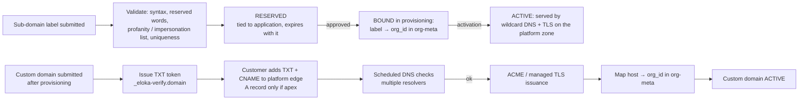

| Topic | Design |
|---|---|
| Ownership | Proven by a TXT record containing a random token (hash stored), re-checked periodically. Losing the record → `FAILED`, then grace, then detach. |
| Verification mechanism | DNS TXT (preferred) + CNAME to the platform edge. Today's process uses an A record to the server IP. Recommend CNAME to a stable edge hostname, so infrastructure IP changes do not break tenants. |
| Tenant mapping | Org-metadata service already resolves `domain` / `sub_domain` → `org_id` (`fetchOrgDetailsHelper.js`). Provisioning writes the mapping there (EPS API **EXTERNAL API DETAILS REQUIRED**). |
| Duplicate prevention | Unique `lower(hostname)` on non-released rows; reserved labels table; check against existing org-meta mappings before reserving. |
| Failure handling | `PENDING_DNS` re-checks with backoff for 72 h (ASSUMPTION), then `FAILED` with guidance. TLS failures surface CAA / rate-limit errors to staff. |
| Mandatory? | Default sub-domain: **yes** (CONFIRMED doc step 4). Custom domain: **no**, post-activation ("you can set up your own domain later", doc). Play Store app: **OPEN**. |
| Authorization | **Never.** The host selects branding only. All API authorization uses the principal's scope. A request on `tenantA.zone` with tenant B's token is rejected by scope checks, not by host. |
| Zone | Production zone(s) **OPEN**: doc shows `finstore.app`, frontend uses `elokademo.in` (OQ-T4). |

---

## 10. Internal review and approval

| Question | Design | Classification |
|---|---|---|
| Who reviews | Customer Service reviewers (today: CS verifies documents) | CONFIRMED (team) / OPEN (exact roles, OQ-O1) |
| What is reviewed | Verification results (PAN, KYC, bank, email), name matches, documents, agreement signed copy, duplicates / risk flags, brand name, sub-domain | PROPOSED checklist |
| Approval permission | `onboarding.approve`, held by a different person than the recommending reviewer (maker-checker) | PROPOSED (OQ-O3) |
| Rejection | Reason code (catalogue) + free text (internal) + applicant-facing message | PROPOSED |
| Correction | Reopen specific steps with reason codes; applicant edits only those; re-sign if agreement content changed | PROPOSED |
| Resubmission | `CORRECTION_REQUIRED → SUBMITTED`; the review history is kept | PROPOSED |
| Audit trail | Every review action is an `audit_event` + `review_action` row | PROPOSED |
| SLA | Timers on `SUBMITTED` and `UNDER_REVIEW` with alerts (values OQ-O5) | PROPOSED |

---

## 11. Provisioning and activation sequence

See ONBOARDING_STATE_MACHINE.md §5.5 and §7. Key properties:

| Property | Mechanism |
|---|---|
| Transactions | Each saga step = one external call + one local transaction recording the result. No distributed transaction. |
| Idempotency | Deterministic keys per step; lookup-before-create against EPS (by PAN / mobile / `client_ref_id`) if EPS lacks idempotent creates |
| Rollback | Forward recovery by default. Compensation = deactivate, never delete. |
| Partial failure | `PROVISIONING_FAILED` with the failed step + error; ops retry resumes there |
| Duplicate prevention | `UNIQUE(application_id)` on run and tenant; `UNIQUE(eps_org_id)` |
| Retries | 5 attempts, exponential backoff 30 s → 15 min, jitter; then human |
| Activation | One local transaction + idempotent outbox calls; reversible by suspension |

---

## 12. Final architecture review

Scored honestly against the review questions. A first pass was scored, the gaps were fixed in the docs, and the residual score is shown.

| Question | Finding | Status |
|---|---|---|
| **Completeness**: is every requirement represented? | All S1–S4 topics mapped (journey §1.1). DLT, Play Store and CRM are tracked as go-live tasks / async sync rather than automated, because their APIs are unknown. | ✅ with open items |
| **Consistency**: do frontend, DB, API and state machine agree? | Step keys, statuses, entities and endpoints use the same names across all docs. Frontend reuse is mapped per component. The frontend needs an adapter (different envelope). | ✅ |
| **Security**: can one tenant read another's data? | Two walls (policy, repository scope) plus CI safety nets (cross-tenant tests, ArchUnit, per-role DB users); MySQL has no RLS. Host never authorizes. Residual risks: a scoping bug has no database backstop; staff over-access, mitigated by masking + reveal audit + maker-checker. | ✅ with accepted risk |
| **Reliability**: what if providers fail? | Timeouts, retries with jitter, circuit breakers, reconciliation jobs, `PENDING_EXTERNAL` state, webhook inbox with dedup | ✅ |
| **Recovery**: can users resume? | Server-side state, resume on OTP, ETag for multiple tabs, reconciliation for closed browsers | ✅ |
| **Idempotency**: can duplicates create duplicate entities? | Idempotency keys + unique constraints + state guards + outbox dedup | ✅ |
| **Operations**: can staff review and correct? | Staff console, queue, corrections, holds, provisioning retry, go-live checklist | ✅ |
| **Scalability**: many Local Admins? | Stateless API, MySQL comfortably handles this volume, horizontal workers | ✅ |
| **Extensibility**: future products / programs? | `step_policy` per program and entity; ports for new providers; "Partner APIs" program can reuse the engine | ✅ |
| **Maintainability**: can a new engineer follow it? | 10 docs, 11+ diagrams, ADRs, consistent naming | ✅ |
| **Complexity**: unnecessary infrastructure? | No Redis, Kafka, K8s or workflow engine in phase 1; one database | ✅ |
| **Biggest risks** | (1) EPS provisioning APIs unknown (OQ-T2) block automation; (2) KYC / Aadhaar compliance choices (OQ-C1); (3) ownership (OQ-T5): the language is now Java + Spring Boot, so the owning team needs Java skills; (4) live photo, bank and documents lists undecided (OQ-P4/5/6) | ⚠️ open |

**Self-score: 8 / 10** for an architecture that can start Phase 1. Points lost: real EPS contracts are missing (2 points), so provisioning and several adapters are still interface-level designs. They become concrete once the EPS team answers OQ-T2 / I2–I4.
