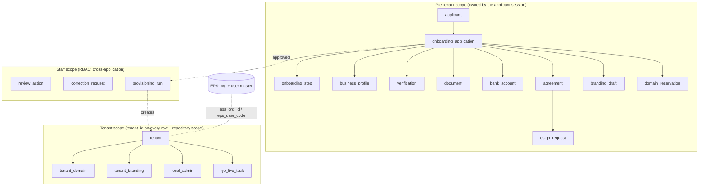

# ELOKA Local Admin Onboarding — Database Design

> Status: **DRAFT for architecture review** · **Revised 14 October 2026:** Java 25 + Spring Boot 4, MySQL 8.4 · Phase 0 (design only. No migrations are created by this document.)
> Related: [ONBOARDING_STATE_MACHINE.md](./ONBOARDING_STATE_MACHINE.md) · [SECURITY.md](./SECURITY.md) · [API_SPECIFICATION.md](./API_SPECIFICATION.md)

Labels: **CONFIRMED** · **EXISTING FRONTEND BEHAVIOUR** · **PROPOSED / RECOMMENDED** · **ASSUMPTION** · **OPEN QUESTION**

---

## 1. What already exists (and what we must not duplicate)

`wlc-webapp` has **no database of its own**. It is a Next.js frontend. All data lives behind the EPS (Eko Platform Services) backend that the app reaches through `src/pages/api/transaction.js` → `NEXT_PUBLIC_API_BASE_URL`, and behind the org-metadata service used by `src/lib/fetchOrgDetailsHelper.js`. That backend's source and schema are **not available** to this analysis.

What the frontend tells us about the existing data model (EXISTING FRONTEND BEHAVIOUR):

| Existing concept | Evidence in the frontend | Owner | Reuse decision |
|---|---|---|---|
| Organisation / tenant: `org_id`, `app_name`, `logo`, colours, `metadata.onboarding`, `metadata.disable_self_onboarding`, `bc` | `OrgDetailContext`, `fetchOrgDetailsHelper.js`, `src/features/onboarding/context/OnboardingContext.tsx` | EPS / org-metadata service | **Reuse.** The onboarding service stores only `org_id` as a foreign reference and never copies the org master. |
| User: `user_code` / `code`, `mobile`, `signup_mobile`, `user_type`, `name`, `agreement_id`, `onboarding` flag, `onboarding_steps[]`, `role_list` | `UserContext`, `src/features/onboarding/utils/dataExtractors.ts`, `SelfOnboarding/Onboarding.tsx` | EPS | **Reuse.** The Local Admin user is created **in EPS** during provisioning. This service keeps `eps_user_code` only. |
| User types: `ENTERPRISE_PARTNER_ADMIN = 23`, `ORG_ADMIN = 24`, `ORG_EMPLOYEE = 25`, `DISTRIBUTOR = 1`, `MERCHANT = 2`, `I_MERCHANT = 3`, … | `src/constants/UserTypes.js` | EPS | **Reuse.** Which value a Local Admin gets is **OPEN** (OQ-B2). |
| Documents: `doc_type` 1 Aadhaar, 2 PAN, 3 selfie, 7 bank passbook; `UPLOAD_DOCUMENT = 523` | `src/features/onboarding/constants.ts` | EPS | Keep the codes as `eps_doc_type` for sync. This service owns the document **metadata and review**. |
| Agreement: `agreement_id`, e-sign `document_id`, `pipe` (provider 0 Digio, 1 Karza, 2 Signzy, 3 Leegality) | `services/esign/*`, `useSignAgreement.ts` | EPS | Reuse the provider integrations through EPS (or directly, per INTEGRATIONS.md). Store our own `esign_request` with the provider reference. |
| Bank: `bank_code`, `bank_id`, `account`, `ifsc`; bank list API `155`; add account `454` | `AddBankAccountStep.tsx` | EPS | Reuse the bank master list. Store the verification result. |
| Company types: Private Ltd (1), LLP (2), Partnership (3), Sole Proprietorship (4) | `BusinessDetailsStep.tsx` `COMPANY_TYPE_OPTIONS` | Frontend constant | Reuse the same codes for `business_profile.company_type` (the list itself is **OPEN**, OQ-B4). |

**Principle (PROPOSED):** the onboarding service owns the **application** (the pre-tenant world: applicant, steps, verifications, documents, review, provisioning). EPS stays the system of record for **live** tenants and users. Data is pushed to EPS once, at provisioning, idempotently. Nothing is written to EPS for applications that are not approved. (Today's flow does write early: Eko Connect creates a partial account at role selection, interaction `CREATE_PARTIAL_ACCOUNT`.)

---

## 2. Database engine

### Decision (CONFIRMED by the team, 14 October 2026): **MySQL 8.4 LTS**

The blueprint first recommended PostgreSQL 16. The team chose **MySQL**, and the design below is written for it. The main reason is operational: Eko's core systems already run on MySQL, so the DBAs, backups, monitoring and on-call practice already exist.

| Setting | Value | Why |
|---|---|---|
| Version | **MySQL 8.4 LTS** (managed, e.g. Amazon RDS for MySQL in `ap-south-1`, or Eko's existing MySQL estate) | Long-term support line; `SKIP LOCKED`, `CHECK`, functional indexes, `REGEXP_LIKE`, instant DDL |
| Engine | **InnoDB** only | Transactions, row locks, foreign keys |
| Character set | `utf8mb4` / `utf8mb4_0900_ai_ci` (hostnames use `utf8mb4_bin` after lower-casing) | Full Unicode for names; exact match where needed |
| SQL mode | `STRICT_ALL_TABLES`, `NO_ZERO_DATE`, `ERROR_FOR_DIVISION_BY_ZERO`, `ONLY_FULL_GROUP_BY` | No silent truncation or bad dates |
| Isolation level | **`READ COMMITTED`** for the service's connections | Fewer gap locks on the job, outbox and idempotency tables |
| Time zone | Server and connections in **UTC** | One clock for audit, expiry and SLAs |
| Placement | **A separate database (schema) and separate DB users**, not inside `ekodb` | The live partner data in EPS must never share a blast radius with onboarding data |
| Backups | Point-in-time recovery (binlog retention ≥ 7 days) + daily snapshots | Recover from operator error |

### What changes compared with the PostgreSQL design

| PostgreSQL feature the first draft used | MySQL 8.4 replacement in this design | Effect |
|---|---|---|
| **Partial unique indexes** (`… WHERE status NOT IN (…)`) | A **stored generated column** that holds the key only while the row is "active" (otherwise `NULL`), plus a `UNIQUE` index on it. MySQL allows many `NULL`s in a unique index. | Same guarantee, slightly more verbose (§5.1) |
| **Row-Level Security** (third isolation wall) | **No database-level row filter exists in MySQL.** Isolation is enforced by (1) the authorization policy and (2) mandatory repository scoping (Hibernate `@TenantId` / filters), backed by **separate DB users with minimal grants** and **automated cross-tenant tests** in CI. | Two walls instead of three. Accepted risk, compensated by tests and code rules (SECURITY.md §4) |
| `JSONB` | `JSON` columns; any field that must be searched gets a generated column + index | Works; fewer index options |
| `datetime` | `DATETIME(6)` stored in UTC | Same precision; the UTC rule is enforced by the service |
| Native `uuid` type | **UUIDv7 stored as `BINARY(16)`** (converted in the ORM) | Compact and index-friendly |
| `text[]` arrays | `JSON` array | — |
| `citext` / `lower()` unique | Store hostnames already lower-cased in a `utf8mb4_bin` column, or a functional unique index on `(lower(hostname))` | Same behaviour |
| Transactional DDL (a failed migration rolls back) | **Not available.** Flyway migrations hold **one DDL change per file**; large-table changes use `ALGORITHM=INSTANT/INPLACE` or online schema-change tools | Migrations need more care (IMPLEMENTATION_PLAN.md) |
| Deferred constraint triggers | Checks inside the activation transaction + a `BEFORE UPDATE` trigger | Same rule, enforced at write time |
| pg-boss queue | **JobRunr** (MySQL storage) + **Spring Modulith event publication registry** (transactional outbox, JDBC). Both keep their state in MySQL tables; MySQL 8 also supports `SELECT … FOR UPDATE SKIP LOCKED` for any custom queue read | No extra infrastructure (ARCHITECTURE ADR-006) |

Document databases (MongoDB) were rejected: the data is relational, and approvals, agreements and audit need strict multi-row transactions.

## 3. Schema overview (logical)

Conventions (PROPOSED):

- Primary keys: `UUIDv7` stored as `BINARY(16)` (time-ordered, index-friendly, not guessable). Public IDs carry a prefix for readability: `onb_…`, `lead_…`, `doc_…`, `ten_…`.
- Every table has `created_at`, `updated_at` (`DATETIME(6)`, UTC). Mutable aggregates have a `version INT` for optimistic locking (JPA `@Version`).
- Enums are `VARCHAR` + `CHECK` constraints, never MySQL `ENUM` (changing an `ENUM` list rewrites the table). Java code maps them to Java enums.
- Short text is `VARCHAR(n)`, long free text is `TEXT`; the ER diagram below shows logical types (`uuid`, `text`, `json`, `datetime`).
- **Sensitive values** are never stored in plain text: `*_enc` (AES-256-GCM envelope-encrypted with a KMS data key), `*_hash` (HMAC-SHA256 with a separate key, used for equality lookups and dedup), `*_masked` (for display, e.g. `XXXXXX1234`).
- No physical deletes of business records. Personal data is erased by **crypto-shredding** (destroy the per-application data key) or field nulling when retention ends.

### 3.1 ER diagram

```mermaid
erDiagram
    LEAD ||--o{ ONBOARDING_APPLICATION : "converts to (0..n attempts)"
    APPLICANT ||--o{ ONBOARDING_APPLICATION : "owns"
    ONBOARDING_APPLICATION ||--|{ ONBOARDING_STEP : "has"
    ONBOARDING_APPLICATION ||--o| BUSINESS_PROFILE : "has"
    ONBOARDING_APPLICATION ||--o{ VERIFICATION : "attempts"
    ONBOARDING_APPLICATION ||--o{ DOCUMENT : "uploads"
    ONBOARDING_APPLICATION ||--o{ BANK_ACCOUNT : "submits"
    ONBOARDING_APPLICATION ||--o{ AGREEMENT : "generates"
    AGREEMENT ||--o{ ESIGN_REQUEST : "signed via"
    ONBOARDING_APPLICATION ||--o| BRANDING_DRAFT : "configures"
    ONBOARDING_APPLICATION ||--o{ DOMAIN_RESERVATION : "reserves"
    ONBOARDING_APPLICATION ||--o{ REVIEW_ACTION : "reviewed by"
    ONBOARDING_APPLICATION ||--o{ CORRECTION_REQUEST : "reopened by"
    ONBOARDING_APPLICATION ||--o| PROVISIONING_RUN : "provisioned by"
    PROVISIONING_RUN ||--|{ PROVISIONING_STEP : "executes"
    ONBOARDING_APPLICATION ||--o| TENANT : "becomes"
    TENANT ||--o{ TENANT_DOMAIN : "serves"
    TENANT ||--o{ TENANT_BRANDING : "versions"
    TENANT ||--o{ LOCAL_ADMIN : "administered by"
    TENANT ||--o{ GO_LIVE_TASK : "checklist"
    BUSINESS_PROFILE ||--o| VERIFICATION : "PAN verified by"
    BANK_ACCOUNT ||--o| VERIFICATION : "verified by"
    DOCUMENT }o--o| VERIFICATION : "evidence for"
    STAFF_USER ||--o{ REVIEW_ACTION : "performs"
    STAFF_USER }o--o{ ROLE : "has"
    ROLE }o--o{ PERMISSION : "grants"

    LEAD {
        uuid id PK
        text public_id UK
        text status
        text company_name
        text contact_mobile_hash
        text contact_mobile_enc
        text source
        uuid owner_staff_id FK
        text crm_ref
        text invite_token_hash
        datetime invite_expires_at
    }
    APPLICANT {
        uuid id PK
        text mobile_hash UK
        text mobile_enc
        text mobile_masked
        text email_hash
        text email_enc
        datetime mobile_verified_at
        datetime email_verified_at
    }
    ONBOARDING_APPLICATION {
        uuid id PK
        text public_id UK "onb_..."
        uuid lead_id FK
        uuid applicant_id FK
        text status
        int version
        text entity_type
        text product_type
        text pan_hash "dedup key"
        text step_policy_version
        datetime submitted_at
        datetime last_applicant_activity_at
        datetime expires_at
        uuid data_key_id "per-application DEK"
        uuid tenant_id FK
    }
    ONBOARDING_STEP {
        uuid id PK
        uuid application_id FK
        text step_key
        text status
        bool required
        int attempt_count
        int max_attempts
        json draft_data "non-sensitive only"
        uuid current_verification_id FK
        text last_error_code
        text reopen_reason_code
        text reviewer_message
        int data_version
    }
    BUSINESS_PROFILE {
        uuid id PK
        uuid application_id FK
        text legal_name
        text name_as_per_pan
        smallint company_type
        text pan_enc
        text pan_hash
        text pan_masked
        char pan_holder_type "4th PAN char"
        text authorised_signatory_name
        text contact_mobile_enc
        text alternate_mobile_enc
        json registered_address
        uuid signature_document_id FK
        text gstin "OPEN"
    }
    VERIFICATION {
        uuid id PK
        uuid application_id FK
        text type "PAN|AADHAAR|BANK|EMAIL|MOBILE|LIVENESS|GST|NAME_MATCH"
        text status
        text provider
        text provider_ref
        text request_idempotency_key UK
        numeric match_score
        json result_summary "redacted"
        datetime valid_until
        int attempt_no
    }
    DOCUMENT {
        uuid id PK
        uuid application_id FK
        text doc_type
        smallint eps_doc_type
        text status
        text storage_bucket
        text storage_key
        text sha256
        text mime_type
        bigint size_bytes
        int version
        uuid supersedes_id FK
        text scan_status
        text reject_reason_code
        uuid reviewed_by FK
    }
    BANK_ACCOUNT {
        uuid id PK
        uuid application_id FK
        text bank_code
        text ifsc
        text account_enc
        text account_hash
        text account_masked
        text beneficiary_name_returned
        uuid verification_id FK
        uuid proof_document_id FK
        bool is_primary
    }
    AGREEMENT {
        uuid id PK
        uuid application_id FK
        text template_code
        text template_version
        text status
        uuid unsigned_document_id FK
        uuid signed_document_id FK
        text content_sha256
        int version
    }
    ESIGN_REQUEST {
        uuid id PK
        uuid agreement_id FK
        smallint provider_pipe "0 Digio 1 Karza 2 Signzy 3 Leegality"
        text provider_document_id UK
        text status
        text signer_name_returned
        datetime signed_at
        datetime url_expires_at
    }
    BRANDING_DRAFT {
        uuid id PK
        uuid application_id FK
        text app_name
        uuid logo_document_id FK
        uuid favicon_document_id FK
        json colors
        text status
    }
    DOMAIN_RESERVATION {
        uuid id PK
        uuid application_id FK
        text label "sub-domain label"
        text platform_zone "e.g. finstore.app"
        text status
        datetime expires_at
    }
    TENANT {
        uuid id PK
        text public_id UK
        text eps_org_id UK
        uuid application_id FK
        text status
        text slug UK
    }
    TENANT_DOMAIN {
        uuid id PK
        uuid tenant_id FK
        text hostname UK
        text kind "SUBDOMAIN|CUSTOM"
        text status
        text verification_token_hash
        datetime verified_at
        text cert_ref
    }
    TENANT_BRANDING {
        uuid id PK
        uuid tenant_id FK
        int version
        text status "DRAFT|APPROVED|PUBLISHED|ARCHIVED"
        json config
        uuid approved_by FK
    }
    LOCAL_ADMIN {
        uuid id PK
        uuid tenant_id FK
        uuid applicant_id FK
        text eps_user_code UK
        smallint eps_user_type
        text status
        datetime activated_at
    }
    PROVISIONING_RUN {
        uuid id PK
        uuid application_id FK "unique"
        text status
        int attempt
    }
    PROVISIONING_STEP {
        uuid id PK
        uuid run_id FK
        text step_key
        text status
        text idempotency_key UK
        json output "ids returned by EPS"
        text last_error
        int attempts
    }
    REVIEW_ACTION {
        uuid id PK
        uuid application_id FK
        uuid staff_id FK
        text action "CLAIM|RECOMMEND_APPROVE|APPROVE|REJECT|REQUEST_CORRECTION|HOLD|RELEASE|VERIFY_DOC|REJECT_DOC"
        text reason_code
        text comment
    }
    CORRECTION_REQUEST {
        uuid id PK
        uuid application_id FK
        json step_keys
        text reason_code
        text message
        text status
        datetime due_at
    }
    GO_LIVE_TASK {
        uuid id PK
        uuid tenant_id FK
        text task_key "DLT|LOGO|PLAY_STORE|CUSTOM_DOMAIN|SMS_TEMPLATE"
        text status
        bool blocking
        text external_ref
    }
    STAFF_USER {
        uuid id PK
        text idp_subject UK
        text email
        text status
    }
    ROLE {
        uuid id PK
        text code UK
    }
    PERMISSION {
        uuid id PK
        text code UK
    }
```

Infrastructure tables (not drawn above, to keep the diagram readable):

| Table | Purpose | Key constraints |
|---|---|---|
| `otp_challenge` | OTP issuance/verification (if the OTP is generated by this service; if EPS `SEND_OTP 553` is used, it only stores `provider_ref` + attempt counters) | `otp_hash`, `expires_at`, `attempts`, `consumed_at`; index `(mobile_hash, created_at)` for rate limits |
| `applicant_session` | Server-side applicant sessions | `token_hash` unique, `applicant_id`, `application_id`, `expires_at`, `revoked_at`, `ip_hash`, `user_agent_hash` |
| `idempotency_key` | Replays the stored response for a repeated `Idempotency-Key` | unique `(scope, key)`; `request_hash`, `response_status`, `response_body`, `expires_at` (24 h) |
| `webhook_event` | Inbox for provider callbacks | unique `(provider, provider_event_id)`; `signature_valid`, `payload_hash`, `received_at`, `processed_at`, `status` |
| `outbox_event` | Business view of side effects (what was promised, for ops screens and replays); delivery itself rides on `event_publication` | `aggregate_type`, `aggregate_id`, `event_type`, `payload`, `available_at`, `attempts`, `published_at` |
| `jobrunr_*` | Job queue and schedules (JobRunr's own MySQL tables) | managed by the library |
| `event_publication` | Transactional outbox (Spring Modulith event publication registry) | managed by the library; one row per event × listener, completed when handled |
| `audit_event` | Append-only audit trail (see §6) | no UPDATE/DELETE grants; `prev_hash` chain |
| `external_call_log` | Redacted provider request/response metadata | `provider`, `operation`, `correlation_id`, `latency_ms`, `http_status`, `outcome`, `error_code`; **no bodies with PII** |
| `notification` | One row per notification intent + delivery status | unique `(template_code, aggregate_id, dedup_key)` stops duplicate sends |
| `step_policy` | Configuration: which steps are required / optional / N/A per `(entity_type, product_type)`, prerequisites, max attempts, invalidation rules | versioned, `step_policy_version` copied onto each application at creation |
| `data_key` | Per-application wrapped DEKs (for crypto-shredding) | `wrapped_key`, `kms_key_id`, `destroyed_at` |

---

## 4. Ownership and relationships

- **Before approval**, data is scoped by `application_id`. An applicant session can only read and write rows whose `application_id` matches the session's application.
- **After provisioning**, tenant-scoped tables carry `tenant_id`. Access is restricted by `tenant_id` from the authenticated principal, never from the hostname. See SECURITY.md §4.
- `onboarding_application.tenant_id` is set once at provisioning and never changes.

---

## 5. Constraints and indexes (PROPOSED)

### 5.1 Duplicate prevention

MySQL has no partial indexes. Each "unique only while active" rule uses a **stored generated column** that is `NULL` when the row is no longer active, plus a `UNIQUE` index on it (MySQL allows any number of `NULL`s in a unique index).

| Rule | Constraint (MySQL 8.4) |
|---|---|
| One **non-terminal** application per verified mobile | `active_applicant_key BINARY(16) AS (IF(status IN ('REJECTED','WITHDRAWN','EXPIRED','ACTIVE'), NULL, applicant_id)) STORED` + `UNIQUE KEY ux_app_active_applicant (active_applicant_key)` |
| One **non-terminal** application per business PAN | `active_pan_key VARBINARY(32) AS (IF(status IN ('REJECTED','WITHDRAWN','EXPIRED'), NULL, pan_hash)) STORED` + `UNIQUE KEY ux_app_active_pan (active_pan_key)`. `ACTIVE` keeps its key, so an already-active Local Admin PAN cannot open a second application. Multi-tenant-per-PAN is **OPEN** (OQ-B6). |
| One applicant per mobile | `UNIQUE (mobile_hash)` on `applicant` |
| Sub-domain unique while reserved / bound / active | `active_label_key VARCHAR(255) AS (IF(status IN ('RESERVED','BOUND'), CONCAT(LOWER(label), '.', platform_zone), NULL)) STORED` + `UNIQUE` on it; on `tenant_domain`, `hostname` is stored lower-cased (`utf8mb4_bin`) with `active_hostname_key VARCHAR(253) AS (IF(status <> 'RELEASED', hostname, NULL)) STORED` + `UNIQUE` |
| Reserved words not allowed as sub-domains (`www`, `api`, `admin`, `mail`, `connect`, `eloka`, `eko`, …) | validation table `reserved_label` + check in the service |
| One tenant per application, one provisioning run per application | `UNIQUE (application_id)` on `tenant` and on `provisioning_run` |
| One EPS org per tenant | `UNIQUE (eps_org_id)` |
| Webhooks processed once | `UNIQUE (provider, provider_event_id)` on `webhook_event` |
| Provider calls not repeated | `UNIQUE (request_idempotency_key)` on `verification`; `UNIQUE (provider_document_id)` on `esign_request` |
| One step row per key per application | `UNIQUE (application_id, step_key)` on `onboarding_step` |
| Same bank account not reused across active tenants | `INDEX (account_hash, ifsc)`. Reuse is flagged for review, not hard-blocked (**OPEN**, OQ-B6). |

A duplicate-key error (`ER_DUP_ENTRY`, 1062) on any of these is translated by the service into a clear problem+json error (for example `PAN_ALREADY_IN_USE`), never a 500.

### 5.2 Query indexes

| Query | Index |
|---|---|
| Ops queue: "submitted, oldest first" | `(status, submitted_at)` |
| Scheduler: expiry sweep | `(status, last_applicant_activity_at)` (MySQL has no partial indexes; the leading `status` column keeps the scan narrow) |
| Applicant resume | `ux_app_active_applicant` (above) |
| Lead lookup by mobile / CRM | `(contact_mobile_hash)`, `(crm_ref)` |
| Reconciliation: pending provider calls | `(status, updated_at)` |
| Outbox publisher | `(published_at, available_at)`; add an index on `event_publication(completion_date)` for the "incomplete events" sweep |
| Audit by entity | `(entity_type, entity_id, occurred_at)` |
| Tenant-scoped tables | leading `tenant_id` in every composite index |
| Searching inside `JSON` columns | generated column on the JSON path + normal index (only where a screen needs it) |

### 5.3 Check constraints (examples)

- `onboarding_application.status IN (…13 states…)`
- `business_profile.pan_holder_type IN ('C','F','P','H','A','T','B','L','J','G')` (4th PAN character). Which types are accepted is **OPEN** (OQ-B5).
- `document.size_bytes BETWEEN 1 AND 10485760` (10 MB, ASSUMPTION)
- `CHECK (REGEXP_LIKE(tenant_domain.hostname, '^[a-z0-9]([a-z0-9-]{0,61}[a-z0-9])?(\\.[a-z0-9]([a-z0-9-]{0,61}[a-z0-9])?)+$', 'c'))`
- `local_admin.status = 'ACTIVE'` is allowed only when the tenant is `ACTIVE`. Enforced in the activation transaction (tenant row locked with `SELECT … FOR UPDATE`) plus a `BEFORE UPDATE` trigger on `local_admin` that rejects the change otherwise. MySQL has no deferred constraints, so the activation code updates the tenant first, then the Local Admin.
- `CHECK` constraints are enforced by MySQL 8.0.16 and later. Each one is also mirrored in Jakarta Bean Validation, so users get a friendly message before the database refuses the row.

---

## 6. Audit storage

`audit_event` (append-only):

| Column | Notes |
|---|---|
| `id` | UUIDv7 |
| `occurred_at` | server time |
| `actor_type` | `APPLICANT` · `STAFF` · `SYSTEM` · `PROVIDER` |
| `actor_id` | applicant id / staff id / job name / provider name |
| `action` | e.g. `PAN_VERIFIED` (full catalogue in SECURITY.md §9) |
| `entity_type`, `entity_id` | e.g. `onboarding_application`, `onb_…` |
| `application_id`, `tenant_id` | for scoping |
| `from_state`, `to_state` | nullable |
| `reference_id` | provider ref / document id / review action id |
| `correlation_id` | request id propagated from the edge (`X-Request-Id`) |
| `source` | `WEB` · `ANDROID` · `STAFF_CONSOLE` · `WEBHOOK` · `JOB` |
| `ip_hash`, `user_agent_hash` | hashed, not raw |
| `metadata` | `JSON`, **allow-listed keys only**, never PAN/Aadhaar/account numbers |
| `prev_hash`, `hash` | SHA-256 chain per application for tamper evidence (PROPOSED) |

The service's MySQL user gets `INSERT, SELECT` only on `audit_event` (no `UPDATE`, `DELETE`, `DROP`, `ALTER`). Schema migrations run under a separate migration user. A nightly job exports to WORM object storage (S3 Object Lock or equivalent) for long-term retention (PROPOSED).

---

## 7. Sensitive data handling

| Field | Stored as | Reason |
|---|---|---|
| Mobile | `mobile_enc` + `mobile_hash` + `mobile_masked` | Needed for login/resume and contact |
| Email | `email_enc` + `email_hash` | Same |
| Business PAN | `pan_enc` + `pan_hash` + `pan_masked` + `pan_holder_type` | Needed for the agreement, CRM and EPS provisioning; hash for dedup |
| **Aadhaar number** | **Not stored.** Keep only the provider reference (DigiLocker request id / e-KYC ref), name, DOB year (if required), last 4 digits masked, and the verification outcome. | Aadhaar Act / UIDAI rules restrict storage of Aadhaar numbers. If storage were ever required, it would need an Aadhaar Data Vault (**OPEN**, compliance, OQ-C1). |
| Aadhaar XML / e-KYC photo | Not stored by default. If needed for face match, store as a document with the shortest retention. | Data minimisation (DPDP Act 2023) |
| Bank account number | `account_enc` + `account_hash` + `account_masked` | Needed for settlements once live |
| Live photo / documents | Object storage, SSE-KMS, private bucket. The DB holds metadata only. | See SECURITY.md §7 |
| OTP | `otp_hash` (HMAC) only, single use, short TTL | — |
| e-sign signed PDF | Object storage, retention bucket, legal hold capable | Legal evidence |
| Provider raw responses | **Not persisted.** Redacted `result_summary` only. | Logs and DB must not become a PII lake |

Envelope encryption: one data key (DEK) per application, wrapped by a KMS master key. Rejected or expired applications are crypto-shredded after their retention period by destroying the DEK (retention periods are **OPEN**, OQ-C2).

---

## 8. Migration and data-sync notes

- Applications started in today's flow (Eko Connect + Go-Live tool) are **not migrated** automatically. Whether in-flight applications should be imported is **OPEN** (OQ-O4).
- Provisioning writes to EPS through idempotent calls. The EPS-returned ids (`org_id`, `user_code`) are stored in `provisioning_step.output` and copied to `tenant.eps_org_id` and `local_admin.eps_user_code`.
- After activation, the org master in EPS is authoritative for org name, logo and colours used by the running app (`org_detail`). `tenant_branding` holds the onboarding-approved versions and pushes **published** versions to the org-metadata service.
