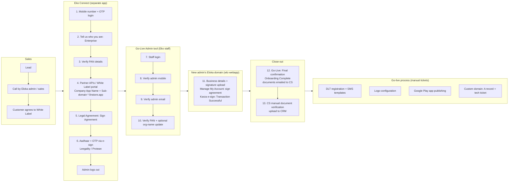
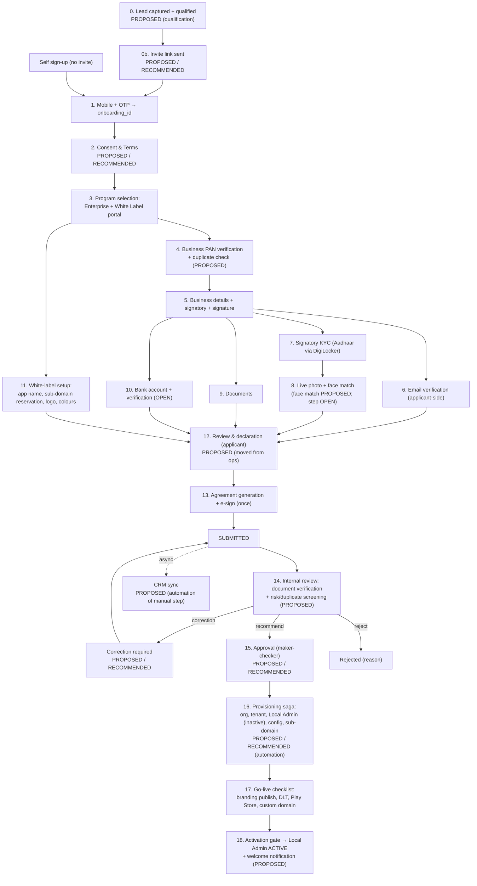

# ELOKA Local Admin Onboarding — Journey

> Status: **DRAFT for architecture review** · **Revised 14 October 2026:** Java 25 + Spring Boot 4, MySQL 8.4 · Phase 0 (design only)
> Related: [ONBOARDING_STATE_MACHINE.md](./ONBOARDING_STATE_MACHINE.md) · [FRONTEND_BACKEND_MAPPING.md](./FRONTEND_BACKEND_MAPPING.md) · [API_SPECIFICATION.md](./API_SPECIFICATION.md) · [OPEN_QUESTIONS.md](./OPEN_QUESTIONS.md)

Labels: **CONFIRMED** · **EXISTING FRONTEND BEHAVIOUR** · **PROPOSED / RECOMMENDED** · **ASSUMPTION** · **OPEN QUESTION**

---

## 0. Sources compared

| # | Source | What it is | How it was read |
|---|---|---|---|
| S1 | `wlc-webapp` frontend (`/Users/souryagupta/Eko/wlc-webapp`) | The tenant-facing Eloka web app (Next.js 14). Contains **agent** self/assisted onboarding (`features/onboarding`), admin Business Settings incl. **Agreement Signing** (`page-components/Admin/PricingCommission/AgreementSigning.jsx`), theme configuration, org resolution by sub-domain. | Code read directly + two repo-wide sweeps |
| S2 | `Eloka Onbaording Process.docx` | Step-by-step of today's process across **Eko Connect** (sign-up), the internal **Go-Live Admin "Eloka Assistance Tool"**, the new admin's own Eloka domain, CS + CRM, then the go-live process (DLT, logo, Play Store, domain). 18 screenshots. | Text + every screenshot |
| S3 | Whiteboard photo + two handwritten note pages | Business context: SBI → Eloka → products, white label, Lead → Eloka admin → call → onboarding, the 6 "pages", RBI/DP Act, "Build Bank Grade", Task 1 = onboarding journey, Task 2 = products (DMT) | Images |
| S4 | Task specification (the request for this blueprint) | Lead → … → Local Admin Activated, plus concepts (onboarding_id, resume, bank, documents, review, tenant, audit, idempotency, isolation) | Text |

### Headline finding

**The existing frontend (S1) has no Local Admin / tenant onboarding screens at all.** The repo-wide search found zero hits for `finstore`, `go-live`, `onboarding_id`, `DLT`, `white label portal`, `Partner APIs`, `custom_domain`, or a lead concept. `/signup` is **agent** onboarding into an **already existing** tenant (resolved from the sub-domain by `fetchOrgDetailsHelper.js`). An "I'm an Enterprise Partner" role card exists (`applicant_type 3` → `user_type 23`) but is **hidden** in both self and assisted onboarding (`visibleAgentTypes` = Retailer, Distributor only).

The Local Admin journey happens today in two **other** applications that are not in this repo:

- **Eko Connect** sign-up (doc steps 1–6, `eko connect` branding in the screenshots),
- the **Go-Live Admin "Eloka Assistance Tool"** used by Eko staff (doc steps 7–10, 12).

It then comes back into `wlc-webapp` for one stage: the new admin logs into **their own domain** and uses **Business Settings → Agreement Signing** to verify email, add the business address, upload a signature and sign (doc step 11). That screen is EXISTING FRONTEND BEHAVIOUR.

Consequences:

1. The frontend can be **reused** as a component library and pattern source (`OnboardingWidget`, step pipeline, `BusinessDetailsStep`, `AddBankAccountStep`, `DigilockerRedirectionStep`, `SignAgreementStep`, e-sign providers, `tf-components` Form). There is **no existing Local Admin UI contract** to stay compatible with.
2. The backend contract in this blueprint is **new**. Where an existing EPS interaction already does the job (PAN 205, DigiLocker via `/karza/digilocker-redirection-url`, e-sign 287/293, bank 454, OTP 553/554/555, org update 774, org lookup 677), the new service **calls it** rather than reimplementing it (see INTEGRATIONS.md).

---

## 1. Source comparison

### 1.1 Step-by-step matrix

| Topic | S1 Frontend | S2 Doc (today's process) | S3 Whiteboard / notes | S4 Task spec | Verdict |
|---|---|---|---|---|---|
| Lead | — | — (process starts at sign-up) | "we got Lead → Eloka admin → call → onboarding → Eloka admin" | Lead → Business/Sales discussion → agrees | **CONFIRMED** concept. Data model **PROPOSED**. |
| Mobile + OTP | Agent login OTP (LoginPanel); 553/554 | Step 1 (Connect) **and** step 8 (Go-Live "Verify Mobile") | Page 1 mobile | Mobile verification | **CONFIRMED**. Duplicate verification today. |
| Choose option / entity | Role cards; Enterprise hidden | Step 2 "I'm a Enterprise" | Page 2 "choose option" | Business/entity selection | **CONFIRMED** |
| White Label vs Partner APIs | — | Step 4 "What are you looking for? Partner APIs / White Label portal" | "White label solution", "EPS → API" | White-label solution | **CONFIRMED** |
| PAN | Agent: PAN number + image upload (`doc_type 2`) | Step 3 (Connect, "PAN details of the company") **and** step 10 (Go-Live "Pan Verify") | Page 3 "PAN verify" | PAN | **CONFIRMED**. Verified twice today. **Conflict:** company vs admin PAN (§1.2 C3). |
| Company name / sub-domain | — (org resolved from host) | Step 4 Company App Name + Company Sub Domain → `https://<x>.finstore.app`, "you can set up your own domain later" | "Eloka → Logo, Domain" | Branding, custom domain | **CONFIRMED** |
| Org name change | Admin: support ticket only ("Update Organisation Name") | Step 10 Go-Live "Update Name" | — | — | **CONFIRMED**. Three different mechanisms. |
| Business details | Agent `BusinessDetailsStep`: name, company_type, signatory, contact, address. Admin Agreement Signing: business address. | Step 11 "Fill the business details" | — | Business information | **CONFIRMED** |
| Signature upload | Admin Agreement Signing: upload signature (`doc_type 19`, `intent_id 4`) + signatory name | Step 11 "upload the signature" | — | — | **CONFIRMED** |
| Email verification | Admin Agreement Signing: email OTP (553 / 555, `intent_id 16`) | Step 9 Go-Live "Verify Email" (done by ops) | — | — | **CONFIRMED**. Done twice. |
| Aadhaar | Agent: DigiLocker (Karza) or upload; 550/551/552 consent/number/OTP | Step 6: Aadhaar + OTP **inside the e-sign** (Protean / NSDL) | Page 4 "Aadhaar verify"; notes "Agreements: KYC, Aadhaar" | KYC | **CONFIRMED**. Mechanism differs: see C4. |
| Live photo | Agent `VideoKycStep` (selfie + location) | — | Page 5 "Live Photo" | "business/shop/live photo" | **CONFIRMED** (S3, S4). Missing in S2. Mandatory? **OPEN**. |
| Documents | Agent uploads (Aadhaar, PAN, selfie, passbook) | Step 13: CS receives "all the agreements and documents" by email | — | Documents | **CONFIRMED** concept. List **OPEN**. |
| Bank details | Agent `AddBankAccountStep` (bank list, account, IFSC, passbook) | — | — | Bank details + verification | **CONFIRMED** in S4 only. **OPEN** for Local Admin. |
| Agreement / e-sign | Agent `SignAgreementStep` (Leegality / Karza / Signzy); admin Agreement Signing | Steps 5–6 (Leegality + Protean Aadhaar e-sign) **and** step 11 ("Karza Esign Document Signed") | Page 6 "Agreement"; "Agreement sign → APIs of agreement sign" | Agreement, e-sign | **CONFIRMED**. Signed twice today. See C2. |
| Final confirmation | — | Step 12 Go-Live: ops ticks declaration → documents emailed to a **named** CS representative | — | — | **CONFIRMED** |
| Internal review | — | Step 13: CS manual verification | — | Internal verification / approval | **CONFIRMED** |
| CRM | `access_token_crm`, `crm_meta` in transaction data (unrelated to onboarding) | Step 13: upload documents to CRM manually | — | CRM document handling | **CONFIRMED**. Manual today. |
| DLT / SMS templates | — | Go-live §1 (Vodafone/Jio/Airtel DLT, Text Nation gateway, tech ticket) | — | — | **CONFIRMED**. External, manual. |
| Logo | Read-only `orgDetail.logo` | Go-live §2 (partner shares logo or designer ticket → tech ticket) | "Eloka → Logo" | Branding | **CONFIRMED** |
| Colours / theme | Admin ThemeConfig → 774 `UPDATE_ORG_DETAILS` metadata `theme` | — | — | Branding | **EXISTING FRONTEND BEHAVIOUR** |
| Play Store app | — | Go-live §3 (Play Console, $25, .aab, review) | — | — | **CONFIRMED**. Manual. Scope **OPEN**. |
| Custom domain | Host resolution supports custom domains (org-meta lookup by `domain`) | Go-live §4 (buy domain, A record → server IP, tech ticket) | "Domain" | Custom domain | **CONFIRMED** |
| Tenant / Local Admin activation | Org must already exist | Tenant + sub-domain exist **before** Go-Live completes (admin logs into own domain at step 11, then step 12) | "onboarded → Eloka Admin" | Tenant provisioning, Local Admin activated | **CONFIRMED** goal. Timing **conflicts** (C1). |
| Compliance posture | — | — | "RBI guidelines follow", "follow all test cases of RBI", "DP Act (read)", "Build Bank Grade", "Security purpose" | Security, audit, isolation | **CONFIRMED** as requirements. Specific controls **OPEN**. |
| Audit, idempotency, notifications | Not present (client `client_ref_id = Date.now()`) | Duplicate emails observed (7 identical "New Admin onboarding details and Agreement code : 38023001" mails) | — | Required | **CONFIRMED** need. Today's defect is evidence. |

### 1.2 Conflicts

| ID | Conflict | Evidence | Recommendation | Needs business? |
|---|---|---|---|---|
| **C1** | Tenant/sub-domain created **before** approval | Doc step 4 picks the sub-domain at sign-up. Step 11 has the admin log into their own domain **before** step 12 "Onboarding Complete" and step 13 CS verification. | Reserve at sign-up, provision only after approval (state machine §2). | Yes (OQ-B8) |
| **C2** | Agreement is signed **twice** with two providers | Steps 5–6: Leegality (Protean Aadhaar e-sign, "Grey Swift Private Limited has requested…"). Step 11: "Karza Esign Document Signed". | One agreement signed once. If two legal documents really exist (e.g. platform agreement + agent-agreement signing config), name and model them separately. | Yes (OQ-B10) |
| **C3** | Whose PAN | Connect UI: "Enter PAN details of the **company**". Doc text: "Enter the **admin's** PAN". Sample PAN `DIVPG7816Q` has 4th char `P`, an **individual**. | `BUSINESS_PAN` = PAN of the contracting entity, with the allowed holder types decided per entity type. Proprietorship → individual PAN of the proprietor. | Yes (OQ-B5) |
| **C4** | How Aadhaar is verified | Doc: only as part of the e-sign OTP. Whiteboard: separate "Aadhaar verify" page. Frontend agents: DigiLocker or card upload. | Separate `SIGNATORY_KYC` (DigiLocker preferred, no Aadhaar number stored), then e-sign. The e-sign Aadhaar OTP authenticates the signature. It is not KYC evidence for the business. | Yes (OQ-C1) |
| **C5** | Verification done by **ops** on the applicant's behalf | Go-Live steps 8–10 re-enter mobile/email/PAN; ops ticks the declaration "on behalf of" the admin | Applicant does it; ops **reviews**. A declaration ticked by staff is not the customer's consent. | Yes (OQ-O1) |
| **C6** | Platform sub-domain zone | Doc: `*.finstore.app`. Frontend env: `WLC_SUBDOMAIN_ROOT=elokademo.in` (`.env.example`). CLAUDE.md: `ekoshield.elokademo.in`. | Make the zone configuration (`platform_zone`). Production zone(s) to be confirmed. | Yes (OQ-T4) |
| **C7** | Org-name change mechanism | Go-Live "Update Name". Admin UI raises a support ticket. EPS has 774 `UPDATE_ORG_DETAILS`. | The name is set from PAN-verified legal name + an editable display/brand name. Changes after activation go through an approval workflow. | Yes (OQ-P9) |
| **C8** | Order of steps | Doc: PAN → company/sub-domain → agreement (with Aadhaar). Whiteboard: PAN → Aadhaar → live photo → agreement. | Data and verification first, agreement last (so the agreement contains verified data). | Light (OQ-P1) |
| **C9** | Final confirmation names a person | "…forwarded to **Reena Yadav**, Customer Service Representative" | Route to a review **queue/role**, never a named person in product copy. | No |

### 1.3 Gaps (missing in every source)

| Gap | Why it matters | Where handled |
|---|---|---|
| Consent capture (DPDP Act 2023, Aadhaar consent text, T&C acceptance) | Lawful processing; whiteboard explicitly says "DP Act (read)" | `CONSENT` step (**PROPOSED**) |
| Duplicate detection (same PAN / mobile / bank / sub-domain) | Prevents multiple tenants for one entity, fraud | DB constraints + review flags |
| Correction / rework loop | Today the only path is out-of-band emails | `CORRECTION_REQUIRED` |
| Rejection reasons + re-application policy | — | `REJECTED` + OQ-B7 |
| Expiry of abandoned applications | Data retention, sub-domain squatting | `EXPIRED` + OQ-B9 |
| Maker-checker approval | Bank-grade control; one person should not both review and approve | Review workflow (**PROPOSED**) |
| Risk / sanctions / negative-list screening | RBI-regulated partner ecosystem | `ON_HOLD` + OQ-C4 |
| Provisioning failure handling | Today it is a tech ticket | Provisioning saga |
| Activation criteria | Nothing defines "live" | Activation gate |
| Notifications (correction, approval, activation) | Applicant visibility | Notification module |
| Who can change branding / domain after activation | — | OQ-P8, OQ-P9 |

### 1.4 Duplicate steps to remove

| Duplicate today | Keep | Remove |
|---|---|---|
| Mobile verified in Connect (step 1) and in Go-Live (step 8) | Applicant OTP at start | Ops re-verification |
| PAN verified in Connect (step 3) and in Go-Live (step 10) | `BUSINESS_PAN` | Ops re-verification (reviewer sees the result) |
| Email verified in Go-Live (step 9) and in Agreement Signing | `EMAIL_VERIFICATION` once | The other |
| Agreement e-signed in Connect (steps 5–6) and on the admin domain (step 11) | `AGREEMENT_ESIGN` once (**OPEN** C2) | The second signing, unless legally separate |
| Org name edited in Go-Live and via support ticket | Name derived from PAN + brand name in `WHITE_LABEL_SETUP` | Go-Live free-text edit |

---

## 2. A. Current / Confirmed Journey

Only what S1–S4 support. No new steps. This is a **description of today**, used as the baseline. It is not the target design.

Notes on the current journey:

- The whiteboard's simplified "6 pages" (mobile → choose option → PAN → Aadhaar → live photo → agreement) is the **target** the team sketched ("Onboarding journey similar to SBI"). It is not what the doc shows today. Live photo appears only in S3/S4.
- Bank details appear only in S4 (and in the agent widget, S1).
- Every step after step 6 depends on Eko staff and email.

---

## 3. B. Recommended Journey

Every new step is marked **PROPOSED / RECOMMENDED**. Everything else traces to S1–S4.

### 3.1 Proposed additions: why, where, how mandatory

| Proposed step | Why / problem solved | Where | Mandatory? | Dependencies | Frontend change | Backend change | Business confirmation |
|---|---|---|---|---|---|---|---|
| **Lead qualification + invite link** | Links sales context to the application; stops random self-sign-ups from reaching review | Before step 1 | Optional (self sign-up still allowed?) | CRM / lead source | New staff "Leads" screen; public invite landing page | `lead` module, signed invite tokens | **Yes** (OQ-B1, OQ-B3) |
| **Consent & Terms** | DPDP Act 2023 notice + consent; Aadhaar-specific consent; T&C acceptance with version | Step 2 | Mandatory | Legal-approved text + version | New screen (checkboxes + links) | `consent_record` (in `onboarding_step` data, versioned) | **Yes**, legal (OQ-C5) |
| **Duplicate detection** (PAN, mobile, bank, sub-domain, existing Local Admin) | Stops multiple tenants per entity and account takeover by re-registration | Inside steps 1, 4, 10, 11 | Mandatory | — | Error states | Partial unique indexes + review flags | Partly (OQ-B6) |
| **Applicant-side email verification** | Today ops verify email for the customer | Step 6 | Mandatory | Email provider | Re-use the Agreement Signing email OTP UI pattern | OTP / link verification | Light (OQ-O1) |
| **Face match** on the live photo vs Aadhaar photo | A live photo without comparison proves little | Step 8 | Optional / config | KYC provider capability | Re-use `VideoKycStep` | Verification type `LIVENESS` | **Yes** (OQ-P4) |
| **Applicant declaration** (moved from Go-Live) | The declaration must come from the customer, not staff | Step 12 | Mandatory | — | Summary + declaration screen | Store declaration text version + timestamp | Light |
| **Single agreement signing** | Removes the double signing (C2) | Step 13 | Mandatory | e-sign provider decision | Re-use `SignAgreementStep` | Agreement template versioning | **Yes** (OQ-B10) |
| **Risk / sanctions screening** | RBI-regulated ecosystem; bank-grade | Review | Config | Provider TBD | Staff console only | `verification` type `RISK` | **Yes** (OQ-C4) |
| **Correction / additional-info loop** | Replaces email back-and-forth | Review ↔ applicant | Mandatory capability | — | Show reopened steps + reviewer messages | `correction_request`, step `REOPENED` | Light |
| **Maker-checker approval** | No single person can approve a tenant | Review | Recommended mandatory | Staff RBAC | Staff console | Approval rules | **Yes** (OQ-O3) |
| **Automated provisioning** | Replaces tech tickets for org/sub-domain creation | After approval | Mandatory | EPS org/user APIs | Status page only | Provisioning saga | **Yes**, EPS team (OQ-T2) |
| **Go-live checklist tracking** | DLT, logo, Play Store, domain are currently untracked tickets | After provisioning | Mandatory tracking; blocking-ness configurable | — | Staff console + applicant status | `go_live_task` | **Yes** (OQ-O2) |
| **Welcome / activation notification** | Clear handover moment | Activation | Mandatory | Email/SMS | — | Notification templates | No |
| **Expiry + reminders** | Abandoned applications, sub-domain squatting | Background | Mandatory | — | Expiry banner | Scheduler | **Yes** values (OQ-B9) |

---

## 4. Step-by-step specification (recommended journey)

Each step uses the same template. APIs are defined in [API_SPECIFICATION.md](./API_SPECIFICATION.md). Audit event names are defined in [SECURITY.md §9](./SECURITY.md).

---

### Step 0 — Lead capture and invite

| Field | Detail |
|---|---|
| **Classification** | Lead = CONFIRMED (S3, S4). Qualification + invite = **PROPOSED / RECOMMENDED** |
| **Business purpose** | Track the prospect from the sales call to the application. Pre-fill the company name and contact. |
| **User action** | Sales/ops creates a lead and sends an invite (SMS/email link) |
| **Frontend screen** | None today. New staff console "Leads" list + form; public landing `/{zone}/onboarding/start?invite=…` (PROPOSED) |
| **Backend responsibility** | Create/update lead. Generate a single-use, expiring invite token (store only its hash). Optional CRM pull. |
| **API** | `POST /v1/admin/leads`, `POST /v1/admin/leads/{leadId}/invites` |
| **Request data** | company_name, contact_name, contact_mobile, contact_email, source, notes, owner |
| **Validation** | Mobile `^[6-9]\d{9}$` (same as `OnboardViaForm` agent validation), email format, no open lead with the same mobile (warn) |
| **Database changes** | `lead` insert. `invite_token_hash`, `invite_expires_at`. |
| **State transition** | Lead `NEW → QUALIFIED → INVITED` |
| **External dependency** | CRM (**EXTERNAL API DETAILS REQUIRED**); SMS/email |
| **Success behaviour** | Invite sent; lead shows "Invited" |
| **Failure behaviour** | Notification failure → lead stays `QUALIFIED`, retry from the outbox |
| **Retry behaviour** | Re-send rotates the token (old token invalid) |
| **Audit event** | `LEAD_CREATED`, `LEAD_QUALIFIED`, `LEAD_INVITED` |
| **Security considerations** | Invite token ≥128-bit random, single use, expiry (ASSUMPTION 7 days). It only pre-links; it never authenticates. OTP is still required. |
| **Open questions** | OQ-B1 (can anyone self-sign-up without a lead?), OQ-B3 (lead system of record) |

---

### Step 1 — Mobile verification (creates `onboarding_id`)

| Field | Detail |
|---|---|
| **Classification** | CONFIRMED (S2 step 1, S3 page 1, S4) |
| **Business purpose** | Identify the applicant. Anchor resume and contact. |
| **User action** | Enter a 10-digit mobile, receive an OTP, enter the OTP |
| **Frontend screen** | New. Pattern to reuse: `page-components/LoginPanel` (`Login` → `VerifyOtp`) |
| **Backend responsibility** | Rate-limited OTP issue. Verify OTP. Create or find `applicant`. Find an existing non-terminal application (resume) or create a new one with `onboarding_id`. Create the step rows from `step_policy`. Issue the applicant session. |
| **API** | `POST /v1/onboarding/otp`, `POST /v1/onboarding/otp/verify` |
| **Request data** | `mobile`, optional `invite_token`; then `otp_ref`, `otp` |
| **Validation** | Mobile `^[6-9]\d{9}$`; OTP 6 digits (ASSUMPTION: EPS OTP length to be confirmed); max 5 verify attempts per OTP; resend cool-down 30 s; max 5 sends per mobile per hour and 10 per IP per hour (ASSUMPTION) |
| **Database changes** | `otp_challenge`; `applicant` upsert; `onboarding_application` insert (status `IN_PROGRESS`); `onboarding_step` rows; `applicant_session` |
| **State transition** | — → `IN_PROGRESS` (T1); step `MOBILE_VERIFICATION → COMPLETED` |
| **External dependency** | OTP/SMS: EPS `SEND_OTP 553` / `RESEND_OTP 554` or a direct SMS gateway (**OPEN**, OQ-I1) |
| **Success behaviour** | Returns the application snapshot. The frontend routes to the next recommended step. |
| **Failure behaviour** | Wrong OTP → `401 OTP_INVALID` with remaining attempts. Expired → `410 OTP_EXPIRED`. Locked → `429 OTP_LOCKED` with `retry_after`. |
| **Retry behaviour** | Resend creates a new challenge; the old one is invalidated |
| **Audit event** | `OTP_SENT`, `OTP_VERIFY_FAILED`, `MOBILE_VERIFIED`, `ONBOARDING_STARTED` or `ONBOARDING_RESUMED` |
| **Security considerations** | OTP stored hashed; uniform responses (no "number exists" oracle); lockout; bind the session to the applicant; log only masked mobile |
| **Open questions** | OQ-I1 (OTP provider), OQ-B6 (mobile already belongs to an existing Eloka user / agent: allowed?) |

**Edge:** the mobile already belongs to an **active Local Admin** → do not create an application. Show "already registered, log in to your portal" (generic wording) and log `DUPLICATE_LOCAL_ADMIN_ATTEMPT`.

---

### Step 2 — Consent and terms (PROPOSED / RECOMMENDED)

| Field | Detail |
|---|---|
| **Classification** | **PROPOSED / RECOMMENDED** (justified by S3 "DP Act (read)", "RBI guidelines follow") |
| **Business purpose** | Lawful basis for processing personal data and Aadhaar; T&C acceptance |
| **User action** | Read the notice, tick consents (processing, Aadhaar e-KYC, communications), accept T&C |
| **Frontend screen** | New |
| **Backend responsibility** | Record consent text **version**, timestamp, purpose list, IP hash |
| **API** | `POST /v1/onboarding/applications/{id}/steps/CONSENT/submit` |
| **Request data** | `consent_version`, `purposes[]`, `terms_version`, `accepted: true` |
| **Validation** | Versions must equal the currently published versions |
| **Database changes** | Step data + audit |
| **State transition** | Step `CONSENT → COMPLETED` |
| **External dependency** | None |
| **Success / failure** | — / `422 CONSENT_VERSION_STALE` (re-fetch text) |
| **Retry behaviour** | Re-submit allowed |
| **Audit event** | `CONSENT_GIVEN`, later `CONSENT_WITHDRAWN` |
| **Security considerations** | Consent withdrawal must stop processing → application `WITHDRAWN` |
| **Open questions** | OQ-C5 (consent text owner, languages) |

---

### Step 3 — Program selection (entity + product)

| Field | Detail |
|---|---|
| **Classification** | CONFIRMED (S2 steps 2 and 4; S3 page 2) |
| **Business purpose** | Decide the program (White Label portal vs Partner APIs) and entity type. This selects the `step_policy`. |
| **User action** | Choose "Enterprise" and "White Label portal". Choose the legal entity type. |
| **Frontend screen** | Reuse the visual pattern of `features/onboarding/components/RoleSelection.tsx` (role cards). The Enterprise card already exists but is hidden. |
| **Backend responsibility** | Persist the choice. Apply the step policy (required / optional / N/A steps). If "Partner APIs" is selected → **out of scope**: hand off to the existing API-partner flow (**OPEN**, OQ-B11). |
| **API** | `PUT /v1/onboarding/applications/{id}/steps/PROGRAM_SELECTION` + `/submit` |
| **Request data** | `applicant_category: "ENTERPRISE"`, `product_type: "WHITE_LABEL"`, `entity_type: 1..4` (Pvt Ltd, LLP, Partnership, Sole Proprietorship, mirroring `COMPANY_TYPE_OPTIONS`) |
| **Validation** | Allowed combinations per `step_policy` |
| **Database changes** | `onboarding_application.entity_type/product_type/step_policy_version`; step rows set to `NOT_APPLICABLE` as the policy says |
| **State transition** | Step `PROGRAM_SELECTION → COMPLETED`; downstream steps re-evaluated |
| **External dependency** | None (**unlike** today's `CREATE_PARTIAL_ACCOUNT 521`, which creates an EPS account immediately) |
| **Failure behaviour** | `422 UNSUPPORTED_PROGRAM` |
| **Audit event** | `PROGRAM_SELECTED` |
| **Security considerations** | Changing the entity type after PAN verification invalidates PAN/business steps |
| **Open questions** | OQ-B4 (supported entity types), OQ-B11 (Partner APIs path), OQ-B2 (EPS user type for Local Admin: 23 or 24?) |

---

### Step 4 — Business PAN verification

| Field | Detail |
|---|---|
| **Classification** | CONFIRMED (S2 step 3/10, S3 page 3, S4) |
| **Business purpose** | Establish the legal identity of the contracting entity |
| **User action** | Enter the PAN (and optionally upload the PAN card image, which the agent flow requires today) |
| **Frontend screen** | New for admin. Reuse the field definition from `masterOnboardingSteps` `PAN_VERIFICATION` (regex `^[A-Z]{5}[0-9]{4}[A-Z]$`, length 10). |
| **Backend responsibility** | Normalise to upper case. Validate format + holder type (4th character) against the entity type. **Duplicate check** (`pan_hash`). Call the PAN provider idempotently. Store the name-as-per-PAN, masked PAN, encrypted PAN. Compute the name match vs the entered legal name (step 5). |
| **API** | `POST /v1/onboarding/applications/{id}/pan-verifications` |
| **Request data** | `pan`, optional `document_id` (PAN image), `Idempotency-Key` |
| **Validation** | Regex; holder type: Company `C`, LLP/Firm `F`, Proprietor `P` (**OPEN** mapping, OQ-B5); not already used by a non-terminal application or an active tenant |
| **Database changes** | `verification` (type PAN), `business_profile.pan_*`, `onboarding_application.pan_hash` (unique "active-only" key via a generated column) |
| **State transition** | Step `BUSINESS_PAN: IN_PROGRESS → COMPLETED / FAILED` |
| **External dependency** | PAN provider via EPS (`USER_ONBOARDING_PAN_VERIFICATION 205`, or EPS v3 `/tools/kyc/pan-lite` / `pan-advanced` as used by the KYC product). **EXTERNAL API DETAILS REQUIRED** for which endpoint is approved for onboarding. |
| **Success behaviour** | Returns masked PAN, name-as-per-PAN, holder type |
| **Failure behaviour** | Invalid PAN → `FAILED` with `PAN_NOT_FOUND`. Provider timeout → `PENDING_EXTERNAL` + reconciliation job. Duplicate → `409 PAN_ALREADY_REGISTERED` (generic text to the user; detail for staff). |
| **Retry behaviour** | Max 5 attempts (ASSUMPTION), then `BLOCKED`. The same `Idempotency-Key` returns the stored result without re-charging the provider. |
| **Audit event** | `PAN_SUBMITTED`, `PAN_VERIFIED`, `PAN_VERIFICATION_FAILED`, `DUPLICATE_PAN_DETECTED` |
| **Security considerations** | PAN encrypted + HMAC hash; never logged; masked in responses (`XXXXX1234X` style) |
| **Open questions** | OQ-B5, OQ-I2 (PAN provider and cost per call), OQ-C3 (name-match threshold) |

---

### Step 5 — Business details, signatory and signature

| Field | Detail |
|---|---|
| **Classification** | CONFIRMED (S2 step 11; S1 `BusinessDetailsStep` + admin `AgreementSigning`) |
| **Business purpose** | Legal and contact details for the agreement, CRM and tenant |
| **User action** | Fill company/firm name, company type, authorised signatory full name, contact mobile, alternate mobile, registered address (line 1, line 2, city, state, pincode); upload the signatory's specimen signature |
| **Frontend screen** | Reuse `features/onboarding/components/custom/BusinessDetailsStep.tsx` (fields and validations already exist) + the signature dropzone pattern from `AgreementSigning.jsx` (jpeg/png, aspect 1.5) |
| **Backend responsibility** | Validate. Name match against name-as-per-PAN. Store. Signature stored as a document (`doc_type SIGNATURE`, EPS `doc_type 19`). |
| **API** | `PUT …/steps/BUSINESS_DETAILS` (draft), `POST …/steps/BUSINESS_DETAILS/submit`; signature via the document upload flow |
| **Request data** | Exactly the `BusinessDetailsStep` payload: `name`, `company_type`, `authorized_signatory_name`, `contact_person_cell`, `alternate_mobile`, `current_address_line1`, `current_address_line2`, `current_address_district`, `current_address_state`, `current_address_pincode` + `signature_document_id`. GSTIN / CIN / LLPIN are **OPEN** (OQ-P5). |
| **Validation** | Reuse `constants/validation.ts` rules (shop name, name, phone, address, pincode); city `^[a-zA-Z ]+$` 2–50; state from the state list (`useCountryStates`, EPS 387); signatory `^[A-Za-z\s]+$` |
| **Database changes** | `business_profile` upsert; `document` (signature) |
| **State transition** | Step `BUSINESS_DETAILS → COMPLETED`, or `MANUAL_REVIEW` flag if the name match is low |
| **External dependency** | Optional name-match service (KYC product has "Name Match 80557"; **EXTERNAL API DETAILS REQUIRED**) |
| **Failure behaviour** | `422` with `invalid_params` per field (keeps compatibility with the frontend's existing `invalid_params` handling in `executePipeline.isApiSuccess`) |
| **Retry behaviour** | Free edits until submit |
| **Audit event** | `BUSINESS_DETAILS_SAVED`, `BUSINESS_DETAILS_SUBMITTED`, `SIGNATURE_UPLOADED` |
| **Security considerations** | Phone numbers encrypted; address is PII (masked in staff list views) |
| **Open questions** | OQ-P5 (GST/CIN/LLPIN required?), OQ-C3 |

---

### Step 6 — Email verification

| Field | Detail |
|---|---|
| **Classification** | CONFIRMED (S2 step 9; S1 Agreement Signing email OTP 553/555 `intent_id 16`). Applicant-side = **PROPOSED / RECOMMENDED** |
| **Business purpose** | Verified channel for agreements, notices and credentials |
| **User action** | Enter the email, receive an OTP (or magic link), confirm |
| **Frontend screen** | Reuse the email OTP UI pattern in `AgreementSigning.jsx` |
| **Backend responsibility** | Issue and verify the OTP. Mark `applicant.email_verified_at`. Block disposable domains (config). |
| **API** | `POST …/email-verifications`, `POST …/email-verifications/{id}/confirm` |
| **Validation** | RFC-5322-lite regex; max 5 sends/hour |
| **Database changes** | `otp_challenge` (channel EMAIL), `applicant.email_*` |
| **State transition** | Step `EMAIL_VERIFICATION → COMPLETED` |
| **External dependency** | EPS 553/555 or an email provider (**OPEN**, OQ-I1) |
| **Audit event** | `EMAIL_VERIFICATION_SENT`, `EMAIL_VERIFIED` |
| **Security considerations** | Same OTP rules as mobile |
| **Open questions** | OQ-I1 |

---

### Step 7 — Signatory KYC (Aadhaar)

| Field | Detail |
|---|---|
| **Classification** | CONFIRMED (S3 page 4; S2 step 6 Aadhaar; S1 DigiLocker step for agents) |
| **Business purpose** | Verify the identity of the person signing for the business |
| **User action** | Consent → redirected to DigiLocker → returns → "Proceed" |
| **Frontend screen** | Reuse `components/custom/DigilockerRedirectionStep.tsx` (gets the link, opens a new tab, submits `token_id`, handles `2443` number mismatch and `1709` incomplete) |
| **Backend responsibility** | Create a DigiLocker session (server-side, **not** via the browser calling `/karza/digilocker-redirection-url` with a hard-coded UAT root path). Receive the callback / poll. Extract name, DOB, gender, masked Aadhaar and photo reference. **Do not store the Aadhaar number.** Match the name with the signatory name and check the mobile linkage rule. |
| **API** | `POST …/kyc-sessions` (returns `redirect_url`, `session_id`), `GET …/kyc-sessions/{id}`, webhook `POST /v1/webhooks/karza` (if supported) |
| **Request data** | `consent: true`, `consent_version` |
| **Validation** | Consent present; session belongs to the application |
| **Database changes** | `verification` (type AADHAAR, provider ref, masked last 4, name, match score, `valid_until`) |
| **State transition** | Step `SIGNATORY_KYC: IN_PROGRESS → PENDING_EXTERNAL → COMPLETED / FAILED` |
| **External dependency** | Karza DigiLocker (today via the EPS gateway). **EXTERNAL API DETAILS REQUIRED** (callback support, data fields returned, retention terms). |
| **Success behaviour** | Shows the verified name + masked Aadhaar |
| **Failure behaviour** | Number mismatch (today `2443`) → `FAILED` with `AADHAAR_MOBILE_MISMATCH`; incomplete (`1709`) → new session; timeout → reconciliation |
| **Retry behaviour** | New session per attempt; max attempts configurable |
| **Audit event** | `KYC_STARTED`, `KYC_COMPLETED`, `KYC_FAILED` |
| **Security considerations** | Aadhaar data minimisation; consent text; Aadhaar photo only kept if face match is required, and only for the shortest time |
| **Open questions** | OQ-C1 (offline XML vs DigiLocker vs OTP e-KYC; storage limits), OQ-B12 (mobile mismatch acceptable for a signatory?) |

---

### Step 8 — Live photo

| Field | Detail |
|---|---|
| **Classification** | CONFIRMED (S3 page 5, S4). Face match = **PROPOSED / RECOMMENDED**. Mandatory = **OPEN** |
| **Business purpose** | Presence check of the signatory |
| **User action** | Capture a selfie in good light (camera, not file upload) |
| **Frontend screen** | Reuse `components/custom/VideoKycStep.tsx` (selfie + `captured_latlong`) |
| **Backend responsibility** | Accept the upload (document flow), optional liveness + face match vs the Aadhaar photo, store the location |
| **API** | Document upload (`doc_type LIVE_PHOTO`) + `POST …/steps/LIVE_PHOTO/submit` |
| **Validation** | JPEG/PNG; ≤ 5 MB (ASSUMPTION); face detected (the frontend has MediaPipe `libs/faceDetector.js`, but the server must re-check) |
| **Database changes** | `document`, `verification` (LIVENESS) |
| **State transition** | `LIVE_PHOTO → COMPLETED / FAILED / MANUAL_REVIEW` |
| **External dependency** | Liveness/face-match provider (**EXTERNAL API DETAILS REQUIRED**) |
| **Audit event** | `LIVE_PHOTO_UPLOADED`, `FACE_MATCH_PASSED/FAILED` |
| **Security considerations** | **Location note:** the agent widget falls back to a hard-coded `27.176670,78.008075` when geolocation is denied (`OnboardingWidget.tsx` `DEFAULT_LATLONG`). The backend must store `location_source = DEVICE | FALLBACK | NONE` and never treat the fallback as evidence. |
| **Open questions** | OQ-P4 |

---

### Step 9 — Documents

| Field | Detail |
|---|---|
| **Classification** | CONFIRMED (S2 step 13, S4). Exact list **OPEN** |
| **Business purpose** | Evidence for the review and the CRM record |
| **User action** | Upload the required documents for the entity type |
| **Frontend screen** | New list screen; reuse the `tf-components` FILE field + `LocalStepForm` |
| **Backend responsibility** | Presigned upload, server-side validation (magic bytes, size, page count), malware scan, version, review status |
| **API** | `POST …/documents` (create + upload URL), `POST …/documents/{docId}/complete`, `GET …/documents`, `DELETE …/documents/{docId}` (only before submit) |
| **Request data** | `doc_type`, `file_name`, `mime_type`, `size_bytes`, `sha256` |
| **Validation** | Allowed types per `doc_type` (PDF/JPEG/PNG); ≤ 10 MB (ASSUMPTION) |
| **Database changes** | `document` rows (versioned) |
| **State transition** | Document `UPLOAD_PENDING → SCANNING → PENDING_REVIEW`; step `DOCUMENTS → COMPLETED` when all required types are clean |
| **External dependency** | Object storage; malware scanner |
| **Failure behaviour** | Quarantined → user asked to re-upload; upload URL expired → new URL |
| **Audit event** | `DOCUMENT_UPLOADED`, `DOCUMENT_QUARANTINED`, `DOCUMENT_VERIFIED`, `DOCUMENT_REJECTED` |
| **Security considerations** | See SECURITY.md §7 |
| **Open questions** | OQ-P5 (list per entity type: COI, MOA/AOA, partnership deed, board resolution / authorisation letter, GST certificate, address proof, cancelled cheque) |

---

### Step 10 — Bank account and verification

| Field | Detail |
|---|---|
| **Classification** | CONFIRMED in S4 only; EXISTING FRONTEND BEHAVIOUR for agents. Mandatory for Local Admin = **OPEN** |
| **Business purpose** | Settlement / commission account of the tenant (ASSUMPTION about purpose) |
| **User action** | Choose the bank, enter the account number + IFSC, upload a passbook / cancelled cheque |
| **Frontend screen** | Reuse `components/custom/AddBankAccountStep.tsx` (bank list with `dependent_params` length rules, IFSC `^[A-Z]{4}0[A-Z0-9]{6}$`, passbook upload) |
| **Backend responsibility** | Penny-drop / name lookup; name match vs legal name; store encrypted; dedup flag |
| **API** | `POST …/bank-accounts` (+ `Idempotency-Key`), `GET …/bank-accounts/{id}` |
| **Request data** | `bank_code`, `bank_id`, `account`, `ifsc`, `proof_document_id` |
| **Validation** | Per-bank account length from the bank master (EPS `BANK_LIST 155`); IFSC regex |
| **Database changes** | `bank_account`, `verification` (BANK) |
| **State transition** | `BANK_ACCOUNT: IN_PROGRESS → PENDING_EXTERNAL → COMPLETED / FAILED / MANUAL_REVIEW` |
| **External dependency** | EPS `ADD_BANK_ACCOUNT 454` (today success `response_type_id 1445`) or a direct penny-drop provider. **EXTERNAL API DETAILS REQUIRED**. |
| **Failure behaviour** | Invalid account → `FAILED`; name mismatch → `MANUAL_REVIEW`; provider timeout → reconciliation |
| **Retry behaviour** | Max 3 penny-drops per application (ASSUMPTION, cost control) |
| **Audit event** | `BANK_SUBMITTED`, `BANK_VERIFIED`, `BANK_VERIFICATION_FAILED` |
| **Security considerations** | Account number never logged; masked |
| **Open questions** | OQ-P6 |

---

### Step 11 — White-label setup (app name, sub-domain, logo, colours)

| Field | Detail |
|---|---|
| **Classification** | CONFIRMED (S2 step 4 app name + sub-domain; go-live logo; S1 theme config) |
| **Business purpose** | Brand identity and default URL of the tenant portal |
| **User action** | Enter the app/brand name, choose a sub-domain label (live availability check), upload the logo (optional), pick colours from the predefined themes |
| **Frontend screen** | New. Reuse the `constants/colorThemes.js` palette + `ThemeConfig` preview. Show "Your default URL is https://{label}.{zone}" exactly like the Connect screen. |
| **Backend responsibility** | Availability check (reserved words, profanity list, uniqueness). **Reserve** the label with an expiry tied to the application. Store the branding **draft**. Validate the logo (PNG/SVG sanitised, dimensions). |
| **API** | `GET /v1/onboarding/subdomains/availability?label=`, `PUT …/steps/WHITE_LABEL_SETUP`, `POST …/steps/WHITE_LABEL_SETUP/submit` |
| **Request data** | `app_name`, `subdomain_label`, `logo_document_id?`, `theme { primary, accent, navstyle }` |
| **Validation** | Label `^[a-z0-9](?:[a-z0-9-]{1,61}[a-z0-9])$` (stricter than the frontend resolver's `^[-a-z0-9\._]+$`); app name 3–40 chars (ASSUMPTION) |
| **Database changes** | `domain_reservation`, `branding_draft` |
| **State transition** | `WHITE_LABEL_SETUP → COMPLETED`; reservation `RESERVED` |
| **External dependency** | None at this point (no DNS change before approval) |
| **Failure behaviour** | `409 SUBDOMAIN_TAKEN` + suggestions |
| **Audit event** | `SUBDOMAIN_RESERVED`, `BRANDING_DRAFT_SAVED` |
| **Security considerations** | SVG logos sanitised or rasterised; brand names screened for impersonation of banks/regulators (review checklist) |
| **Open questions** | OQ-P8 (logo/colours mandatory before activation?), OQ-T4 (zone), OQ-P10 (does the agreement print the brand?) |

---

### Step 12 — Review and declaration (applicant)

| Field | Detail |
|---|---|
| **Classification** | CONFIRMED (S2 step 12 text). Moved to the applicant = **PROPOSED / RECOMMENDED** |
| **Business purpose** | The applicant confirms everything is complete and accurate |
| **User action** | Review the read-only summary, tick the declaration |
| **Frontend screen** | New summary screen |
| **Backend responsibility** | Check every required step is `COMPLETED` and every verification is within `valid_until`. Store the declaration version. |
| **API** | `POST …/steps/DECLARATION/submit` |
| **Audit event** | `DECLARATION_ACCEPTED` |
| **Open questions** | Declaration wording (legal) |

---

### Step 13 — Agreement generation and e-sign

| Field | Detail |
|---|---|
| **Classification** | CONFIRMED (S2 steps 5–6/11; S3 page 6; S4) |
| **Business purpose** | Legally binding contract between Eko/Eloka and the Local Admin's entity |
| **User action** | Click "Sign Agreement" → provider window (Aadhaar OTP e-sign) → return |
| **Frontend screen** | Reuse `components/custom/SignAgreementStep.tsx` + `hooks/useSignAgreement.ts` + `services/esign/*` (provider `pipe` routing, Android bridge `LEEGALITY_ESIGN_OPEN`) |
| **Backend responsibility** | Render the agreement PDF from template version + verified data; hash it; create the provider document; return the signing URL; on webhook or status poll, verify the signature status **with the provider**; download and store the signed PDF; verify signer name ≈ signatory name |
| **API** | `POST …/agreements` (generate), `POST …/agreements/{id}/esign-sessions`, `GET …/agreements/{id}`, webhook `POST /v1/webhooks/{provider}` |
| **Request data** | none (server builds the content) |
| **Validation** | Prerequisites complete; no stale data since generation (`content_sha256`) |
| **Database changes** | `agreement`, `esign_request`, `document` (unsigned + signed) |
| **State transition** | e-sign `READY → SIGNING → SIGNED`; step `AGREEMENT_ESIGN → COMPLETED`; then the application auto-moves `IN_PROGRESS → SUBMITTED` (T3) |
| **External dependency** | Leegality / Karza / Signzy / Digio (EPS `287` get URL, `293` submit; `pipe` selects provider). **EXTERNAL API DETAILS REQUIRED**: webhook signature scheme, status API. |
| **Success behaviour** | "Agreement signed" + submitted acknowledgement |
| **Failure behaviour** | Closed without signing → back to `READY`; provider error → `FAILED`, retry generates a new provider document; URL expired → regenerate |
| **Retry behaviour** | Idempotent session creation: an existing unexpired session is returned |
| **Audit event** | `AGREEMENT_GENERATED`, `ESIGN_STARTED`, `AGREEMENT_SIGNED`, `ESIGN_FAILED` |
| **Security considerations** | Never trust a client "signed" flag (today the frontend sends `esign_completed: true` and accepts any `postMessage` `STATUS_UPDATE` without checking origin) |
| **Open questions** | OQ-B10 (single agreement? template owner?), OQ-I3 (provider choice) |

---

### Step 14 — Internal review

| Field | Detail |
|---|---|
| **Classification** | CONFIRMED (S2 step 13; S4). Checklist + risk screening = **PROPOSED / RECOMMENDED** |
| **Business purpose** | Human verification before a tenant is created |
| **User action (staff)** | Claim the case; check every verification result, document, name matches, duplicates; verify/reject documents; request a correction or recommend approval |
| **Frontend screen** | New **staff console** (separate app or protected area, not inside a tenant portal) |
| **Backend responsibility** | Queue, assignment, checklists, document review, correction requests, SLA timers |
| **API** | `GET /v1/admin/applications`, `POST …/claim`, `POST …/documents/{id}/verify|reject`, `POST …/corrections`, `POST …/recommendations`, `POST …/holds` |
| **State transition** | `SUBMITTED → UNDER_REVIEW → CORRECTION_REQUIRED / ON_HOLD / (recommendation)` |
| **Audit event** | `APPLICATION_CLAIMED`, `DOCUMENT_VERIFIED`, `DOCUMENT_REJECTED`, `CORRECTION_REQUESTED`, `APPROVAL_RECOMMENDED`, `APPLICATION_HELD` |
| **Security considerations** | Staff see masked PAN/account by default; "reveal" is a separate audited permission |
| **Open questions** | OQ-O1 (which team reviews), OQ-O5 (review SLA) |

### Step 15 — Approval / rejection

| Field | Detail |
|---|---|
| **Classification** | Approval CONFIRMED (S4). Maker-checker **PROPOSED / RECOMMENDED** |
| **Backend responsibility** | Enforce approver ≠ recommender; reason codes for rejection; trigger provisioning |
| **API** | `POST /v1/admin/applications/{id}/approve`, `POST …/reject` |
| **State transition** | `UNDER_REVIEW → APPROVED → PROVISIONING` or `→ REJECTED` |
| **Audit event** | `APPLICATION_APPROVED`, `APPLICATION_REJECTED` |
| **Open questions** | OQ-O3 (who can approve; one or two levels), OQ-B7 (reapply policy) |

### Step 16 — Provisioning (tenant, org, Local Admin)

| Field | Detail |
|---|---|
| **Classification** | Outcome CONFIRMED (S4). Automated saga **PROPOSED / RECOMMENDED** |
| **Backend responsibility** | Saga of idempotent steps (state machine §5.5): EPS org create → tenant row → EPS admin user (inactive) → default config/metadata (774) → bind sub-domain → stage branding → archive documents + CRM sync |
| **API** | Internal job; `GET /v1/admin/applications/{id}/provisioning`, `POST …/provisioning/retry` |
| **External dependency** | EPS org/user creation, org-metadata service (677 lookup / 774 update), DNS for the zone (wildcard, ASSUMPTION). **EXTERNAL API DETAILS REQUIRED** |
| **Audit event** | `PROVISIONING_STARTED`, `TENANT_CREATED`, `LOCAL_ADMIN_CREATED`, `PROVISIONING_FAILED`, `PROVISIONING_SUCCEEDED` |
| **Open questions** | OQ-T2 (EPS create-org/create-admin APIs), OQ-T3 (wildcard DNS + TLS on the zone) |

### Step 17 — Go-live checklist

| Field | Detail |
|---|---|
| **Classification** | CONFIRMED (S2 go-live process). Tracking **PROPOSED / RECOMMENDED** |
| **Tasks** | `BRANDING_PUBLISH` (platform), `DLT_REGISTRATION` (partner + telecom DLT + Text Nation; external), `SMS_TEMPLATE_CONFIG` (tech), `LOGO_DESIGN` (if the partner has none), `PLAY_STORE_APP` (manual), `CUSTOM_DOMAIN` (DNS verification flow) |
| **API** | `GET/PATCH /v1/admin/tenants/{id}/go-live-tasks/{taskKey}`; custom domain: `POST /v1/tenants/{id}/domains`, `POST …/domains/{domainId}/verify` |
| **Audit event** | `GO_LIVE_TASK_UPDATED`, `DOMAIN_VERIFIED`, `BRANDING_PUBLISHED` |
| **Open questions** | OQ-O2 (which tasks block activation), OQ-P7 (Play Store app in scope; who owns the developer account) |

### Step 18 — Activation

| Field | Detail |
|---|---|
| **Classification** | CONFIRMED goal (S4). Gate + notification **PROPOSED / RECOMMENDED** |
| **Backend responsibility** | Evaluate the activation gate; one transaction flips tenant / Local Admin / branding / application; outbox → EPS status + org cache purge + welcome notification |
| **API** | `POST /v1/admin/applications/{id}/activate` (or automatic when the gate passes, **OPEN**, OQ-O2) |
| **Audit event** | `LOCAL_ADMIN_ACTIVATED`, `TENANT_ACTIVATED` |
| **Post-activation** | The Local Admin logs in through the **existing** `wlc-webapp` login on `https://{label}.{zone}` (OTP via EPS); the existing admin features (Business Settings, Onboard Agents, Configurations) take over |

---

## 5. What the backend owns vs what the frontend owns

| Concern | Backend (onboarding service) | Frontend (`wlc-webapp` or a dedicated onboarding app) |
|---|---|---|
| Current step / progress | **Owns** (`GET /applications/current`) | Renders it; never derives it from positions |
| Validation | **Authoritative** | Mirrors it for UX (same regexes) |
| Verification results | **Owns**; only the backend talks to providers server-to-server | Starts redirects (DigiLocker / e-sign) with URLs from the backend |
| Signed status of the agreement | **Owns**; webhook + provider status | Shows it |
| Skips | **Persists** | Requests them |
| Retry state | **Owns** attempts / limits | Shows remaining attempts |
| Branding preview | Stores drafts | Live preview |
| Tenant resolution by host | Org-metadata service (existing) | Existing `fetchOrgDetailsHelper` |
| Auth tokens | Issues / validates sessions | Holds the session cookie via the BFF (PROPOSED) |

Where the onboarding UI lives (**OPEN**, OQ-P2): either (a) a new route group in `wlc-webapp` served on a platform host (e.g. `onboard.{zone}`) that has no tenant `org_detail`, or (b) the existing Eko Connect app. Option (a) reuses the existing onboarding components most directly. Note that `wlc-webapp` currently **requires** an org for every host (unknown hosts return `1829` and are cached as invalid), so (a) needs a platform-org concept.
