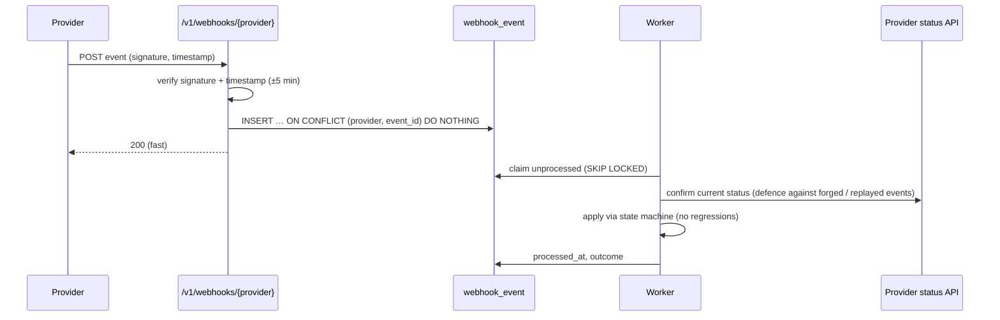

# ELOKA Local Admin Onboarding — Integrations

> Status: **DRAFT for architecture review** · **Revised 14 October 2026:** Java 25 + Spring Boot 4, MySQL 8.4 · Phase 0 (no integration was created or called)
> Rule applied: where provider or EPS API details are not visible in the code or documents, the entry says **EXTERNAL API DETAILS REQUIRED**. No provider API is invented.

Labels: **CONFIRMED** · **EXISTING FRONTEND BEHAVIOUR** · **PROPOSED / RECOMMENDED** · **ASSUMPTION** · **OPEN QUESTION**

---

## 1. Inventory

| # | Integration | Purpose | Provider (known) | Evidence | Path (PROPOSED) |
|---|---|---|---|---|---|
| I-1 | **EPS core API** | Org + user creation, OTP, PAN, bank, e-sign plumbing, DigiLocker, metadata | Eko (internal) | Whole frontend; `src/constants/EpsTransactions.js`, `src/constants/EndPoints.js` | EPS adapter (worker + API) |
| I-2 | **Org-metadata service** | Host → org resolution; org metadata (theme, logo, onboarding config) | Eko (internal) | `src/lib/fetchOrgDetailsHelper.js` (interaction `677`, env `ORG_META_SERVICE`, `ORG_META_SERVICE_SECRET`); writes via `774 UPDATE_ORG_DETAILS` | Org-meta adapter |
| I-3 | **OTP / SMS** | Mobile OTP; notifications | Via EPS `SEND_OTP 553` / `RESEND_OTP 554`; DLT-registered sender. Text Nation is named in the doc as the SMS gateway for **tenants'** DLT templates. | `TransactionIds`, doc go-live §1 | Messenger port → EPS adapter (default) |
| I-4 | **Email** | Email OTP, notifications, agreement copies | Email OTP via EPS `553` / `555` (`intent_id 16`); Go-Live tool currently sends via **Gmail** (message ids shown in screenshots) | `AgreementSigning.jsx`; doc screenshots | Messenger port → transactional provider (OQ-I1) |
| I-5 | **PAN verification** | Business PAN validity + name | Via EPS: `USER_ONBOARDING_PAN_VERIFICATION 205`; EPS v3 `/tools/kyc/pan-lite`, `/tools/kyc/pan-advanced` (KYC product labels show "Cashfree - Pan Lite" in mocks) | `src/constants/EpsTransactions.js`, `src/features/kyc-verification/mocks/mockServices.ts`, `src/screens/products/kyc/*` | PanVerifier port → EPS adapter |
| I-6 | **Aadhaar / DigiLocker** | Signatory KYC | **Karza** DigiLocker via EPS tunnel `/karza/digilocker-redirection-url`; confirm via `USER_AADHAR_OTP_CONFIRM 552` (`token_id`); Aadhaar consent / number / OTP `550` / `551` / `552` | `DigilockerRedirectionStep.tsx`, `constants.ts` | KycSession port → EPS adapter or direct Karza |
| I-7 | **e-Sign** | Agreement signing | **Leegality** (SDK `public/scripts/leegalityv5.min.js`; Protean / NSDL Aadhaar e-sign page in the doc), **Karza** (doc step 11 "Karza Esign Document Signed"), **Signzy** (window), **Digio** (enum only). Via EPS `287` (get URL → `short_url`, `document_id`, `pipe`) and `293` (submit); "already signed" `1615` / `1069` | `services/esign/*`, `src/constants/ProductDetails.js:527-532`, `src/utils/AndroidUtils.ts` | ESigner port → EPS adapter (default) or direct |
| I-8 | **Bank verification** | Penny-drop / name check | Via EPS `ADD_BANK_ACCOUNT 454` (success `1445`); bank master `BANK_LIST 155`; KYC product has a "Bank Account" service (`/tools/kyc/dummy-bank-account`, a mock) | `AddBankAccountStep.tsx`, `useBankList`, KYC mocks | BankVerifier port → EPS adapter |
| I-9 | **Name match** | Compare names across PAN / KYC / bank | KYC product "Name Match" (`80557`, `/tools/kyc/dummy-name-match`, a mock) | KYC mocks | NameMatcher port (optional) |
| I-10 | **Liveness / face match** | Live photo | Unknown | — | LivenessChecker port |
| I-11 | **Object storage** | Documents, signed agreements, logos | Today: `files.eko.co.in` (rewrites `/_files/*`), CSP allows `*.digitaloceanspaces.com` | `next.config.js` | Storage port (S3 API) |
| I-12 | **Malware scanning** | Uploaded files | None today | — | Scanner port → ClamAV |
| I-13 | **CRM** | Lead source; store approved documents | Unknown product; only `access_token_crm` and `crm_meta` exist in the frontend (unrelated to onboarding) | `src/lib/loginHelper.js:215`, `processTransactionData.js:112` | CRM port |
| I-14 | **DNS / TLS** | Sub-domain serving, custom-domain verification and certificates | Today: A record → server IP + tech ticket | Doc go-live §4 | DnsVerifier + CertificateIssuer ports |
| I-15 | **DLT (telecom)** | Tenant's SMS header and template approval | Vodafone / Jio / Airtel DLT portals; Text Nation gateway | Doc go-live §1 | **Manual go-live task** (no API integration proposed) |
| I-16 | **Google Play Console** | Tenant Android app publishing | Google Play | Doc go-live §3 | **Manual go-live task** |
| I-17 | **Staff IdP** | SSO + MFA for staff | Unknown (Google Workspace likely, ASSUMPTION) | — | OIDC |
| I-18 | **Support tickets** | Existing manual requests (org-name change, landing image, toggles) | EPS `RAISE_ISSUE 10000` | `createSupportTicket.ts` | Only for exceptions; not part of the core flow |

---

## 2. Integration details

Common rules (PROPOSED), applied to every outbound call unless stated:

- **Timeouts:** connect 3 s; read per integration (below). Never the frontend's 120 s default.
- **Retries:** only idempotent operations, or operations protected by an idempotency key. Exponential backoff with full jitter (base 1 s, max 60 s, 3 attempts inline, then hand off to a job).
- **Circuit breaker:** opens after 50 % failures over 20 calls / 60 s; half-open probe after 30 s. While open, steps go to `PENDING_EXTERNAL` with `PROVIDER_UNAVAILABLE`.
- **Logging:** `external_call_log` holds provider, operation, correlation id, duration, HTTP status, outcome code. **Never** request or response bodies containing PAN, Aadhaar, account numbers, OTPs, names, addresses or files.
- **Credentials:** secrets manager, per environment, rotated. Sandbox credentials in dev / staging only.
- **Egress:** allow-listed hostnames from the worker subnet.

### I-1 EPS core API

| Field | Detail |
|---|---|
| Purpose | Provisioning (org, Local Admin user, default metadata), plus the EPS-backed provider adapters below |
| Provider | Eko internal |
| Authentication | Today the frontend uses end-user bearer tokens. A **service identity** (client credentials or mTLS) is needed for server-to-server calls. **EXTERNAL API DETAILS REQUIRED** |
| Request shape (existing) | `POST {base}/transactions/do` or `/dojson` with `{ interaction_type_id, client_ref_id, source, … }`; or the tf tunnel with headers `tf-req-uri-root-path`, `tf-req-uri`, `tf-req-method` |
| Response shape (existing) | HTTP 200 with `{ status \| response_status_id, response_type_id, message, data, invalid_params }` |
| Needed but unknown | **Create organisation** (what `org_id`, `bc`, `org_token`, `org_name`, `app_name`, `metadata`?); **create admin user** for an org (user type 23 vs 24, `is_org_admin`); **activate / deactivate** org and user; **bind sub-domain / domain** in org-meta; **lookup by PAN / mobile** for idempotent creates. **EXTERNAL API DETAILS REQUIRED** (OQ-T2) |
| Timeout | 15 s per call |
| Retry | Provisioning steps: 5 attempts with backoff, then `PROVISIONING_FAILED` |
| Idempotency | Send a deterministic `client_ref_id` = `prov:{application_id}:{step}`. Whether EPS de-duplicates on `client_ref_id` is unknown, so lookup-before-create is the fallback. **EXTERNAL API DETAILS REQUIRED** |
| Webhook | n/a |
| Failure handling | Map `response_type_id` codes to typed errors in the adapter; unknown codes → `PROVIDER_ERROR` + alert |
| Security | Service identity with least privilege (only org / user provisioning interactions); no end-user tokens reused server-side; hard-coded test identities (`99029899` / `1234567891`) must never be used |

### I-2 Org-metadata service

| Field | Detail |
|---|---|
| Purpose | Make the new tenant resolvable by host and themed |
| Existing contract (read) | `POST ORG_META_SERVICE { sub_domain \| domain, secret, interaction_type_id: "677", … }` → `data.data.org_id …`, not found `response_type_id 1829` (EXISTING FRONTEND BEHAVIOUR) |
| Existing contract (write) | `774 UPDATE_ORG_DETAILS { orgDetails: { metadata: [{ name, type, value }] } }` (theme). Writing `logo`, `app_name`, `org_name`, `sub_domain`, `domain`: **EXTERNAL API DETAILS REQUIRED** |
| Cache | The frontend caches org lookups in memory (`ORG_CACHE_EXPIRY_SEC`, 3600–28800 s) and has `/clear_org_cache`. Activation must trigger a cache purge on every frontend instance. A purge API or short TTL for new tenants: **EXTERNAL API DETAILS REQUIRED** (OQ-T10) |
| Timeout / retry | 5 s; outbox retries |
| Security | `ORG_META_SERVICE_SECRET` is currently sent **in the request body**. Prefer a header or mTLS for the new service-to-service calls. |

### I-3 OTP / SMS

| Field | Detail |
|---|---|
| Purpose | Applicant mobile OTP; status notifications |
| Provider | EPS OTP (`553` send / `554` resend; login OTP `515` / `518` in WIP code). Underlying SMS vendor not visible. |
| Authentication | EPS service identity |
| Request | `{ mobile, intent_id, … }`. Which `intent_id` applies to admin onboarding: **EXTERNAL API DETAILS REQUIRED** |
| Response | `otp_length` (WIP), `2377` limit exhausted (`data.description` = minutes) |
| Timeout | 5 s |
| Retry | No automatic resend (user-driven) |
| Idempotency | Our own 30 s window per mobile |
| Webhook | Delivery reports: **EXTERNAL API DETAILS REQUIRED** |
| Failure | Return `503` with `retry_after`; do not consume the attempt counter |
| Security | Our service generates and verifies the OTP **or** EPS does. Decide one (OQ-I1). Either way the OTP is never logged. DLT template ids are needed for any new SMS text. |

### I-4 Email

| Field | Detail |
|---|---|
| Purpose | Email OTP, application acknowledgements, correction requests, approval / rejection, activation, agreement copy |
| Provider | **OPEN** (EPS `553` / `555` for OTP; transactional provider for notifications; Gmail is not appropriate as a system channel) |
| Authentication | Provider API key or SMTP credentials in the secrets manager; SPF / DKIM / DMARC on the sending domain |
| Timeout / retry | 10 s; outbox retries ×5; bounce handling |
| Idempotency | `notification` unique `(template_code, aggregate_id, dedup_key)` |
| Webhook | Bounce / complaint events: **EXTERNAL API DETAILS REQUIRED** |
| Security | No documents attached by default. Send links to authenticated downloads instead (today CS receives agreements as attachments). |

### I-5 PAN verification

| Field | Detail |
|---|---|
| Purpose | Validate the business PAN; get name-as-per-PAN and holder type |
| Provider | Via EPS (`205`) or EPS v3 KYC tools (`/tools/kyc/pan-lite`, `/pan-advanced`). Underlying vendor appears to be Cashfree in the KYC product mocks (ASSUMPTION for production) |
| Authentication | EPS service identity |
| Request | `{ pan }` (+ name / DOB for "advanced" variants). Exact fields per endpoint: **EXTERNAL API DETAILS REQUIRED** |
| Response | Expected: validity, registered name, category / holder type, Aadhaar-seeding status (if "advanced"). **EXTERNAL API DETAILS REQUIRED** |
| Timeout | 10 s inline, then async reconciliation |
| Retry | 2 inline retries on network errors only; never retry on a definitive "invalid PAN" |
| Idempotency | `verification.request_idempotency_key`; provider charged once per key |
| Webhook | Not expected (sync) |
| Failure | `FAILED` + safe code; `PENDING_EXTERNAL` on timeout |
| Logging | Masked PAN only |
| Security | PAN encrypted at rest; HMAC for dedup |

### I-6 Aadhaar / DigiLocker (Karza)

| Field | Detail |
|---|---|
| Purpose | Verify the authorised signatory's identity without storing the Aadhaar number |
| Provider | Karza DigiLocker (today via EPS tunnel `/karza/digilocker-redirection-url`, root `/ekoicici/v1/marketuat` hard-coded in the frontend) |
| Authentication | EPS service identity (or direct Karza credentials) |
| Request | Create session → `{ link, requestId }` (EXISTING FRONTEND BEHAVIOUR: `data.data.link`, `data.data.requestId`). Confirm with `552` + `token_id`, `is_consent: "Y"` |
| Response | Known codes: `1621` success (DigiLocker redirection), `2443` Aadhaar-linked mobile ≠ onboarding mobile, `1709` incomplete. Returned data fields (name, DOB, gender, address, photo, masked Aadhaar): **EXTERNAL API DETAILS REQUIRED** |
| Timeout | 10 s for session creation; user journey up to 15 min |
| Retry | New session per retry; max attempts per step policy |
| Idempotency | One open session per application, reused |
| Webhook | Whether Karza / EPS can call back: **EXTERNAL API DETAILS REQUIRED**. Fallback: the status poll on return + reconciliation job. |
| Failure | Mapped to `AADHAAR_MOBILE_MISMATCH`, `KYC_INCOMPLETE`, `PROVIDER_ERROR` |
| Security | Consent captured with version; Aadhaar number never persisted; photo kept only if face match is required, with short retention (OQ-C1) |

### I-7 e-Sign (Leegality / Karza / Signzy / Digio)

| Field | Detail |
|---|---|
| Purpose | Sign the Local Admin agreement |
| Provider | `pipe` selects the provider: 0 Digio, 1 Karza, 2 Signzy, 3 Leegality (EXISTING FRONTEND BEHAVIOUR). The doc shows Leegality + Protean Aadhaar e-sign (requester "Grey Swift Private Limited", ASSUMPTION: an Eko group entity) and Karza. |
| Authentication | Via EPS today. Direct provider auth: **EXTERNAL API DETAILS REQUIRED** |
| Request | Today: `287 { agreement_id, document_id: "", latlong, csp_id, user_id }` → `{ short_url, document_id, pipe }`. For Local Admin: the agreement PDF / template must be **specific to the Local Admin agreement** (today `agreement_id` defaults to `5` in the frontend). Template and signer parameters: **EXTERNAL API DETAILS REQUIRED** |
| Response | Signing URL, document id; on completion the signed PDF + audit trail (certificate) |
| Timeout | 15 s for document creation |
| Retry | Regenerate on failure / expiry; old provider document marked superseded |
| Idempotency | Open session reused; `UNIQUE(provider_document_id)` |
| Webhook | Required for robust completion. Signature scheme, event ids, payload: **EXTERNAL API DETAILS REQUIRED**. Fallback: status API polling after the UI returns. |
| Failure | `FAILED` with a provider reason (e.g. Aadhaar OTP failure, signer cancelled) |
| Security | Server verifies completion with the provider (never the client); signer-name check vs signatory; signed PDF hashed and stored under Object Lock; the Leegality SDK runs in the browser only to open the signing UI |

### I-8 Bank verification

| Field | Detail |
|---|---|
| Purpose | Confirm the account exists and the beneficiary name matches the business |
| Provider | Via EPS `454` (+ bank master `155`). Underlying vendor: **EXTERNAL API DETAILS REQUIRED** |
| Request | `{ bank_code, bank_id, account, ifsc }` (EXISTING FRONTEND BEHAVIOUR) |
| Response | Success `1445`; beneficiary name field: **EXTERNAL API DETAILS REQUIRED** |
| Timeout | 20 s; async if longer |
| Retry | No automatic retry on a definitive failure (each penny-drop may cost money); network errors ×2 |
| Idempotency | Key per attempt; `(account_hash, ifsc)` cache per application |
| Webhook | If async: **EXTERNAL API DETAILS REQUIRED** |
| Security | Account number encrypted; masked everywhere |

### I-11 Object storage

| Field | Detail |
|---|---|
| Purpose | KYC documents, signatures, live photos, agreements, logos |
| Provider | **OPEN** (OQ-T7): S3-compatible in an Indian region |
| Authentication | Workload identity / scoped keys; bucket policy denies public access |
| Request | Presigned PUT (5 min, fixed content-type, length and checksum); presigned GET (60 s) |
| Retry | Client re-requests a URL; server-side copy jobs retried |
| Webhook | Object-created notifications → scan job (or poll on `complete`) |
| Security | SSE-KMS; versioning; lifecycle rules; Object Lock for signed agreements; no public URLs (unlike `files.eko.co.in` links used elsewhere in the app) |

### I-13 CRM

| Field | Detail |
|---|---|
| Purpose | (a) Leads (source of truth?) (b) record of the approved Local Admin with documents (today: manual upload by CS) |
| Provider | **EXTERNAL API DETAILS REQUIRED** (which CRM, API, auth, object model, document upload limits) |
| Timeout / retry | 15 s; outbox retries with backoff up to 24 h, then dead-letter + alert |
| Idempotency | External id = `onboarding_id` / `tenant public_id` |
| Failure | Never blocks approval / activation (E21) |
| Security | Only approved data is sent; documents sent only if the CRM meets the same storage standards (otherwise send links) |

### I-14 DNS / TLS

| Field | Detail |
|---|---|
| Purpose | Serve `{label}.{zone}`; verify and serve custom domains |
| Provider | **EXTERNAL API DETAILS REQUIRED** (DNS host for the platform zone; edge / LB that terminates TLS for tenant hosts) |
| Design | Wildcard record + wildcard certificate on the platform zone (no per-tenant DNS change; ASSUMPTION that this exists today for `*.elokademo.in` / `*.finstore.app`). Custom domains: TXT verification via public resolvers + ACME HTTP-01 / TLS-ALPN-01 at the edge, or the cloud LB's managed certificates. |
| Retry | Scheduled re-checks with backoff for 72 h |
| Security | The verification token is random, its hash stored, single-use per domain claim; periodic re-verification |

---

## 3. Webhook processing (shared design)

---

## 4. Required from other teams before build (summary)

| Item | Owner | Blocks phase |
|---|---|---|
| EPS service identity + create-org / create-user / activate / bind-domain APIs | EPS team | Phase 9 (provisioning) |
| PAN endpoint approved for onboarding + response schema | EPS / compliance | Phase 4 |
| DigiLocker session + callback contract | EPS / Karza | Phase 5 |
| e-Sign provider choice, Local Admin agreement template, webhook spec | Legal + EPS | Phase 7 |
| Bank verification contract | EPS | Phase 6 |
| CRM API | Sales ops | Phase 10 |
| DNS zone, wildcard TLS, edge for custom domains | DevOps | Phase 9–11 |
| Object storage account in an Indian region + KMS | DevOps | Phase 1 |
| Staff IdP (OIDC) client | IT | Phase 8 |
