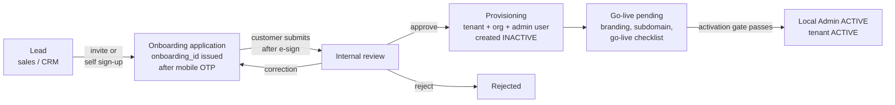
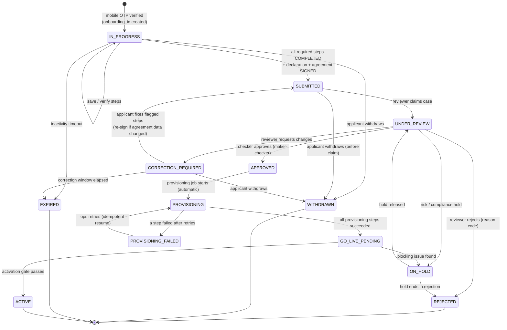
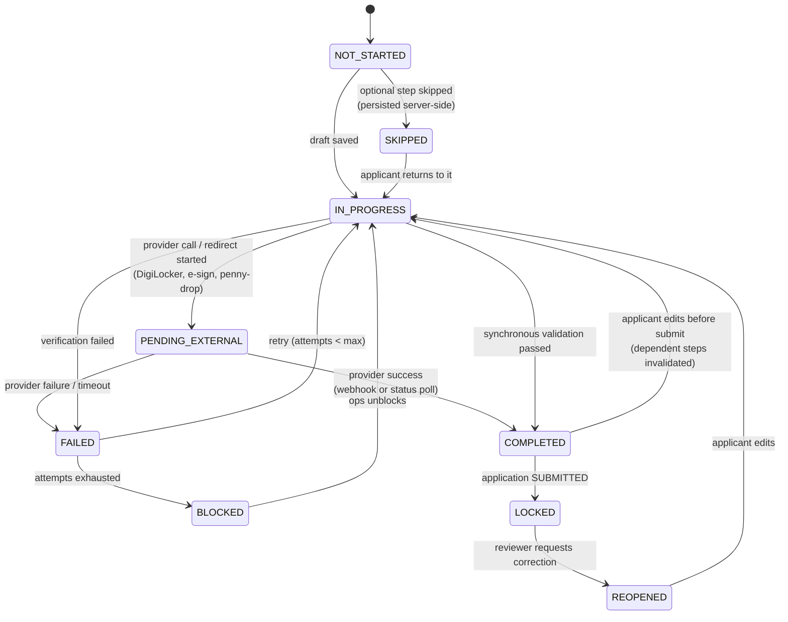
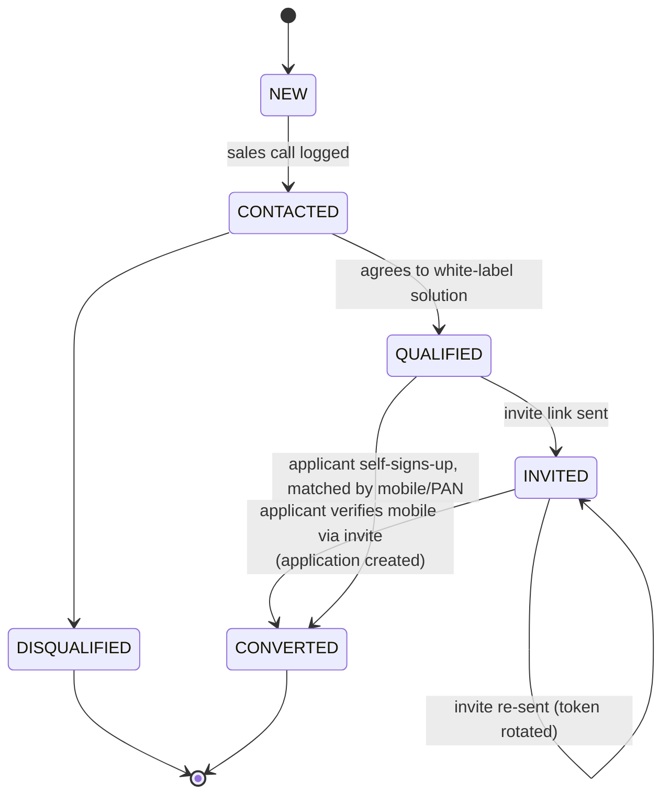
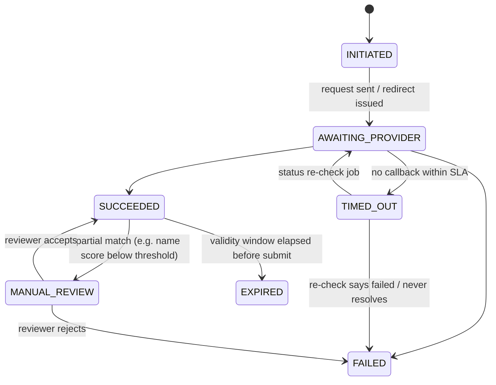
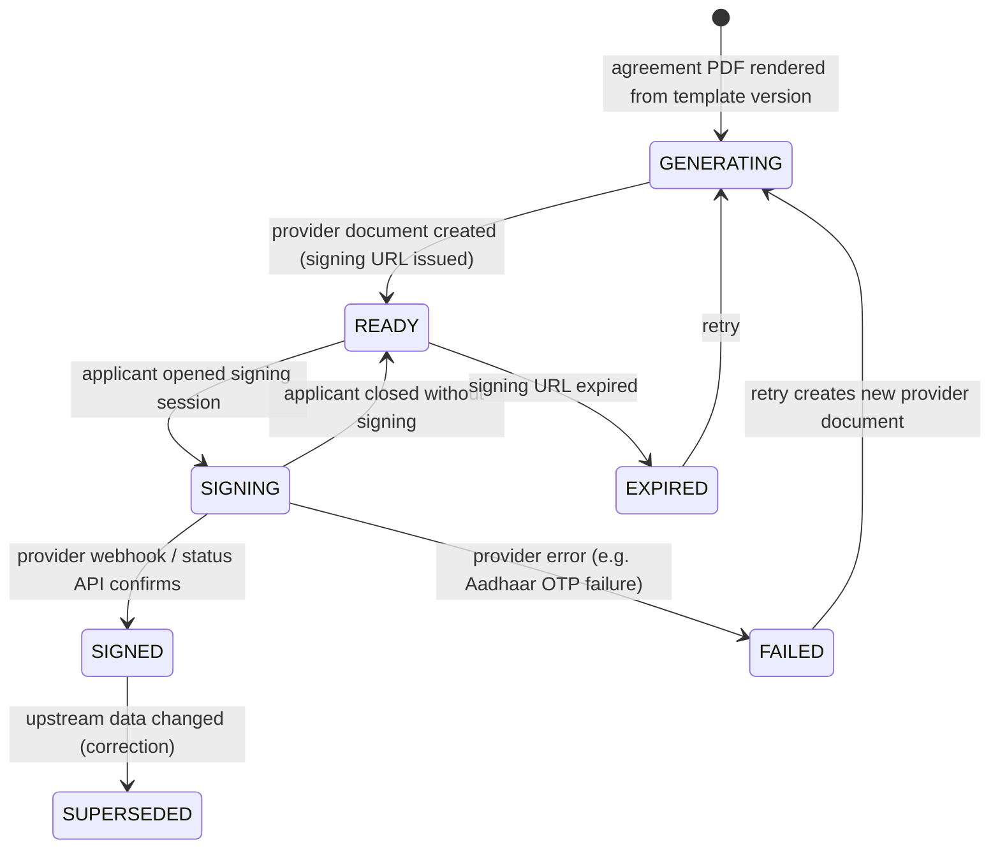
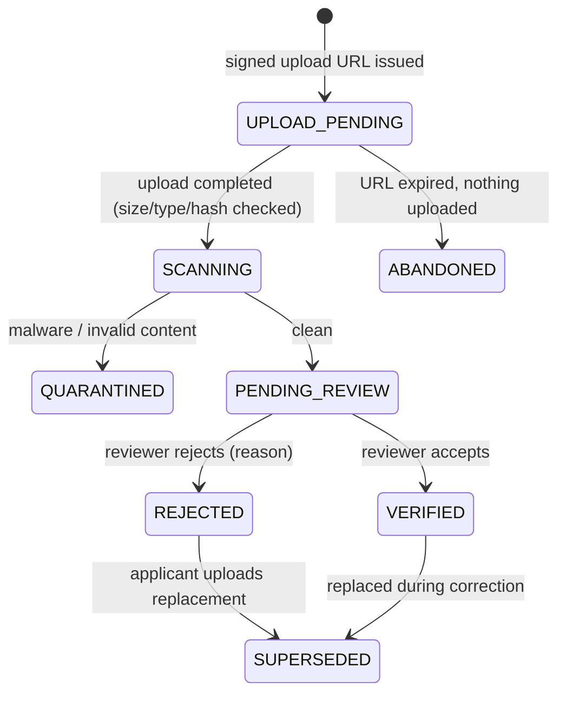
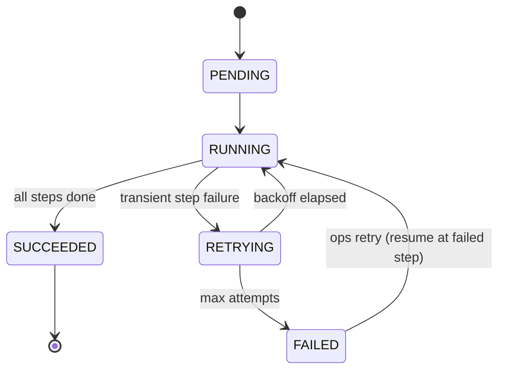
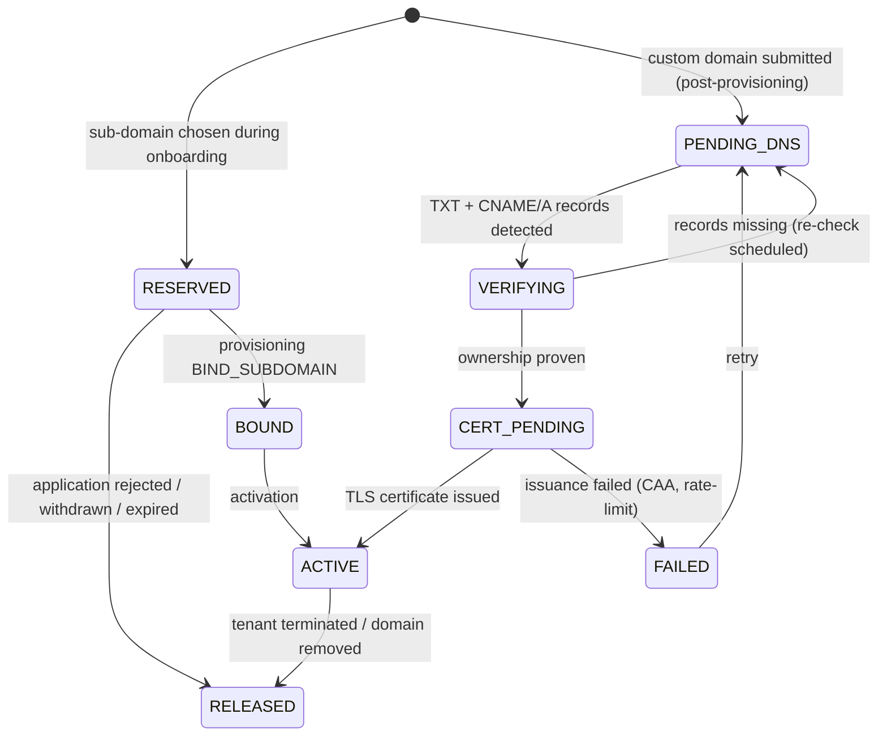
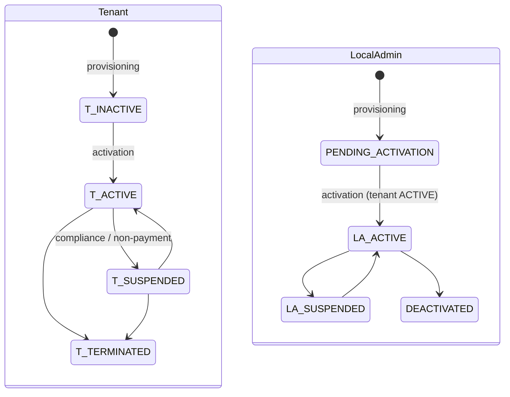

/us# ELOKA Local Admin Onboarding — State Machine

> Status: **DRAFT for architecture review** · **Revised 14 October 2026:** Java 25 + Spring Boot 4, MySQL 8.4 · Phase 0 (design only, no code)
> Related: [ELOKA_ONBOARDING_JOURNEY.md](./ELOKA_ONBOARDING_JOURNEY.md) · [DATABASE_DESIGN.md](./DATABASE_DESIGN.md) · [API_SPECIFICATION.md](./API_SPECIFICATION.md)

Labels used in this document:

| Label | Meaning |
|---|---|
| **CONFIRMED** | Backed by the onboarding document, the whiteboard/notes, or the task specification |
| **EXISTING FRONTEND BEHAVIOUR** | Something the code in `wlc-webapp` actually does today |
| **PROPOSED / RECOMMENDED** | An architectural or product recommendation from this blueprint |
| **ASSUMPTION** | Inferred, not confirmed |
| **OPEN QUESTION** | Needs a business/product decision (tracked in [OPEN_QUESTIONS.md](./OPEN_QUESTIONS.md)) |

---

## 1. Why a state machine (and not "page 1 → page 2")

**EXISTING FRONTEND BEHAVIOUR.** The agent onboarding widget in `features/onboarding` does not hold a real state. It works out "where the user is" from two fields of the user profile that EPS returns. In committed code this comes from the login / `/authentication/refresh-profile` response. In the uncommitted local work on branch `fix/auto-trigger-balance-api-post-login` it comes from interaction `151`, `response_type_id 369`, through the new `/api/transaction` proxy. The two fields are:

- `user_detail.onboarding_steps`: a list of `{ role, label }`. Each `role` is a numeric step token (for example `12400` Aadhaar, `12300` PAN, `13300` business, `51700` bank, `12800` agreement).
- `user_detail.role_list`: the roles that are still **pending**.

`calculateResumeState()` (`features/onboarding/utils/stepGenerator.ts`) marks every step before the first pending role as COMPLETED, the first pending one as IN_PROGRESS, and the rest as NOT_STARTED. Skips (`handleSkip`) and retry state (`pipelineResults`) live only in React memory. They are lost on refresh and never reach the backend.

This is a positional model. It cannot express:

- a step that **failed** and must be retried,
- a step that is **waiting for an external callback** (e-sign, DigiLocker),
- a **correction** requested by a reviewer on step 3 while steps 4–9 stay valid,
- **review, approval, rejection, provisioning, expiry and cancellation**,
- the difference between "the customer finished" and "the Local Admin is live".

**PROPOSED / RECOMMENDED.** The backend owns a two-level state model:

1. **Application status.** One coarse lifecycle value per onboarding application (`onboarding_application.status`).
2. **Step status.** One row per step per application (`onboarding_step.status`) holding the fine-grained progress, attempts and last error.

Separate state machines run for the **Lead**, **Tenant**, **Local Admin**, **Domain**, **Branding**, **Document**, **Verification**, **e-Sign request** and **Provisioning run**. They are linked by guards, not merged into one huge enum. A single enum with 35 values (as in the task brief's example list) mixes independent dimensions. For example, bank verification can be pending while the domain is already verified. A combined enum would need every combination.

---

## 2. Lifecycle overview: Lead → Onboarding → Tenant → Local Admin

| Entity | Comes into existence | Becomes active | Source |
|---|---|---|---|
| Lead | When sales or CRM records a prospect (before the call) | n/a (converted, never "active") | CONFIRMED (whiteboard: "Lead → Eloka admin → call → onboarding") |
| Onboarding application / `onboarding_id` | Right after the applicant's **mobile OTP is verified**. No application row exists before that. | n/a | PROPOSED / RECOMMENDED (stops junk rows from unverified numbers) |
| Tenant / organisation | During **provisioning**, only after `APPROVED` | On activation | PROPOSED / RECOMMENDED (**differs** from today: Eko Connect creates the org and sub-domain at sign-up, see §8) |
| Local Admin user | During provisioning, in status `PENDING_ACTIVATION` | On activation | PROPOSED / RECOMMENDED |
| Tenant configuration (defaults) | During provisioning | With the tenant | PROPOSED / RECOMMENDED |
| Branding | Captured as a **draft** during onboarding | **Published** at activation | PROPOSED / RECOMMENDED |
| Default sub-domain | **Reserved** during onboarding, **bound** to the tenant during provisioning | Serves traffic at activation | CONFIRMED (doc step 4 collects it) + PROPOSED timing |
| Custom domain | Any time after provisioning | After DNS + TLS verification (can be after activation) | CONFIRMED (go-live process §4) + PROPOSED verification |

**Invariant I-1 (PROPOSED, mandatory):** no Local Admin user may be `ACTIVE` unless the owning application is `ACTIVE`, which in turn requires `APPROVED` → provisioning success → activation gate passed. An incomplete onboarding can never create an active Local Admin.

---

## 3. Application state machine

### 3.1 Diagram

### 3.2 State catalogue

| State | Meaning | Who moves it out | Terminal? | Classification |
|---|---|---|---|---|
| `IN_PROGRESS` | Applicant is filling or verifying steps. Data is editable. | Applicant (submit / withdraw), scheduler (expire) | No | PROPOSED / RECOMMENDED |
| `SUBMITTED` | Applicant finished. All step data is **locked**. The case is in the review queue. | Reviewer (claim), applicant (withdraw before claim) | No | CONFIRMED (Go-Live "Onboarding Complete" sends documents to Customer Service) + PROPOSED lock |
| `UNDER_REVIEW` | A reviewer owns the case | Reviewer / approver | No | CONFIRMED (CS "manual verification of documents") |
| `CORRECTION_REQUIRED` | Specific steps were reopened with reasons. All other steps stay locked. | Applicant (resubmit), scheduler (expire) | No | PROPOSED / RECOMMENDED |
| `ON_HOLD` | Paused for risk or compliance review | Compliance / ops | No | PROPOSED / RECOMMENDED |
| `APPROVED` | Business approval given. Short-lived: provisioning starts automatically. | System | No | CONFIRMED (task spec "Internal Verification / Approval") |
| `REJECTED` | Application refused. Reason code recorded. | n/a | **Yes** | CONFIRMED (task spec) |
| `PROVISIONING` | Saga creating the tenant, org, admin user, configuration and sub-domain binding | System | No | PROPOSED / RECOMMENDED |
| `PROVISIONING_FAILED` | A provisioning step exhausted its automatic retries. Needs ops. | Ops (retry) | No | PROPOSED / RECOMMENDED |
| `GO_LIVE_PENDING` | Tenant exists but is **INACTIVE**. Go-live checklist in progress (branding publish, sub-domain, optional DLT / Play Store / custom domain). | Ops / system | No | CONFIRMED (doc "Eloka Go-live Process") + PROPOSED gating |
| `ACTIVE` | Tenant ACTIVE, Local Admin ACTIVE | Later lifecycle (suspend/terminate) is handled by the tenant state machine | **Yes** (for onboarding) | CONFIRMED (task spec "Local Admin Activated") |
| `WITHDRAWN` | Applicant cancelled | n/a | **Yes** | PROPOSED / RECOMMENDED |
| `EXPIRED` | No applicant activity for the configured window | n/a | **Yes** | PROPOSED / RECOMMENDED |

After `REJECTED`, `WITHDRAWN` or `EXPIRED`, a new attempt is a **new application** (new `onboarding_id`) linked to the same lead and applicant. Whether a rejected PAN may reapply, and after how long, is an **OPEN QUESTION** (OQ-B7).

### 3.3 Transition table (guards and side effects)

Every transition goes through one backend function, `transition(application_id, event, actor, expected_version)`. It:

1. takes `SELECT … FOR UPDATE` on the application row,
2. checks `version = expected_version` (optimistic lock, sent by the client as `If-Match`),
3. checks that the `(from_status, event)` pair is allowed and that its guard passes,
4. writes the new status, `version + 1` and `status_changed_at`,
5. inserts an `audit_event` and the outbox events **in the same database transaction**.

| # | From | Event | To | Guard | Side effects (async via outbox) |
|---|---|---|---|---|---|
| T1 | — | `MOBILE_VERIFIED` | `IN_PROGRESS` | OTP valid. No other non-terminal application for this mobile, otherwise **resume** that one. | `ONBOARDING_STARTED` audit. Link the lead if the invite token was valid. Welcome SMS/email (optional). |
| T2 | `IN_PROGRESS` | `STEP_SAVED` / `STEP_VERIFIED` | `IN_PROGRESS` | Step editable. Its prerequisites are COMPLETED. | Step-level audit |
| T3 | `IN_PROGRESS` | `SUBMIT` | `SUBMITTED` | Every **required** step `COMPLETED`. Declaration accepted. Agreement e-sign `SIGNED` and verified server-side with the provider. | Lock steps. Notify ops queue. Send acknowledgement to the applicant. CRM sync (async). |
| T4 | `SUBMITTED` | `CLAIM` | `UNDER_REVIEW` | Actor has `onboarding.review` | Assign the reviewer |
| T5 | `UNDER_REVIEW` | `REQUEST_CORRECTION` | `CORRECTION_REQUIRED` | ≥1 step flagged with a reason code + message | Reopen the flagged steps. Notify the applicant. Start the correction timer. |
| T6 | `CORRECTION_REQUIRED` | `RESUBMIT` | `SUBMITTED` | All flagged steps COMPLETED. If any field shown in the agreement changed, the agreement is re-signed. | Lock again. Notify the reviewer. |
| T7 | `UNDER_REVIEW` | `APPROVE` | `APPROVED` | Actor has `onboarding.approve` and is **not** the maker who recommended approval (maker-checker, PROPOSED). Every document is `VERIFIED` or waived with a reason. | Start the provisioning job |
| T8 | `UNDER_REVIEW` / `ON_HOLD` | `REJECT` | `REJECTED` | Reason code required | Notify the applicant. Release the reserved sub-domain. Start the retention timer. |
| T9 | `UNDER_REVIEW` | `HOLD` | `ON_HOLD` | Actor has `onboarding.hold` | — |
| T10 | `APPROVED` | `PROVISIONING_STARTED` | `PROVISIONING` | System only | — |
| T11 | `PROVISIONING` | `PROVISIONING_SUCCEEDED` | `GO_LIVE_PENDING` | Every provisioning step `SUCCEEDED` | Create the go-live checklist. Notify the applicant ("account created, going live soon"). |
| T12 | `PROVISIONING` | `PROVISIONING_FAILED` | `PROVISIONING_FAILED` | A step exhausted its retries | Page ops |
| T13 | `PROVISIONING_FAILED` | `RETRY_PROVISIONING` | `PROVISIONING` | Actor has `onboarding.provision` | Resume from the first non-succeeded step |
| T14 | `GO_LIVE_PENDING` | `ACTIVATE` | `ACTIVE` | **Activation gate**, see §7 | Tenant → ACTIVE, Local Admin → ACTIVE, branding → PUBLISHED, cache purge, welcome notification |
| T15 | `IN_PROGRESS` / `CORRECTION_REQUIRED` | `EXPIRE` | `EXPIRED` | `IN_PROGRESS`: `last_applicant_activity_at + window < now()`; `CORRECTION_REQUIRED`: `correction_due_at < now()` (the idle window does not apply, `expires_at` shows the due date) | Release the sub-domain reservation. Notify. Start the retention timer. |
| T16 | `IN_PROGRESS` / `SUBMITTED` / `CORRECTION_REQUIRED` | `WITHDRAW` | `WITHDRAWN` | Applicant session, and the case is not yet claimed (if `SUBMITTED`) | Same as T15 |

Any pair not listed is rejected with `409 INVALID_STATE_TRANSITION`. The response includes the current status and version, so the frontend can re-sync.

---

## 4. Step state machine

### 4.1 Steps (recommended journey)

The full rationale is in [ELOKA_ONBOARDING_JOURNEY.md](./ELOKA_ONBOARDING_JOURNEY.md). Step keys are stable strings, not positional numbers.

| Order | `step_key` | Required? | Prerequisites | Classification |
|---|---|---|---|---|
| 1 | `MOBILE_VERIFICATION` | Yes | — | CONFIRMED |
| 2 | `CONSENT` | Yes | 1 | PROPOSED / RECOMMENDED (whiteboard cites the DP Act; DPDP Act 2023 consent) |
| 3 | `PROGRAM_SELECTION` (entity = Enterprise, product = White Label portal) | Yes | 1 | CONFIRMED (doc steps 2 + 4) |
| 4 | `BUSINESS_PAN` | Yes | 3 | CONFIRMED |
| 5 | `BUSINESS_DETAILS` (incl. signatory specimen signature) | Yes | 4 | CONFIRMED (doc step 11; frontend `BusinessDetailsStep`) |
| 6 | `EMAIL_VERIFICATION` | Yes | 1 | CONFIRMED (Go-Live step 9, done by ops today) + PROPOSED move to the applicant |
| 7 | `SIGNATORY_KYC` (Aadhaar via DigiLocker / OTP) | Yes | 5 | CONFIRMED (whiteboard page 4; doc step 6) |
| 8 | `LIVE_PHOTO` | **OPEN** (OQ-P4) | 7 | CONFIRMED on the whiteboard (page 5); absent from the doc |
| 9 | `DOCUMENTS` | Yes (list **OPEN**, OQ-P5) | 5 | CONFIRMED (CS receives "all the agreements and documents") |
| 10 | `BANK_ACCOUNT` | **OPEN** (OQ-P6) | 5 | CONFIRMED in the task spec; EXISTING FRONTEND BEHAVIOUR for agents; absent from doc and whiteboard |
| 11 | `WHITE_LABEL_SETUP` (brand/app name, sub-domain reservation, logo, colours) | Yes (logo/colours **OPEN**, OQ-P8) | 3 | CONFIRMED (doc step 4 + go-live logo) |
| 12 | `DECLARATION` | Yes | 1–11 | CONFIRMED (Go-Live "Final Confirmation", today ticked by ops) + PROPOSED move to the applicant |
| 13 | `AGREEMENT_ESIGN` | Yes | 12 | CONFIRMED |

Steps 2, 6, 8, 9, 10 and 11 can be done in any order once their prerequisites are met. The frontend shows a **recommended order** but the backend enforces only prerequisites. This matches how the existing widget lets org metadata reorder, hide (`hide: 1`) or make steps optional (`optional: 1`), which is EXISTING FRONTEND BEHAVIOUR in `extractStepConfiguration()`.

### 4.2 Step status diagram

| Step status | Meaning |
|---|---|
| `NOT_STARTED` | No data yet |
| `IN_PROGRESS` | Draft data saved, not yet verified |
| `PENDING_EXTERNAL` | Waiting on a provider (redirect, webhook, async job). The UI shows "verifying…" and polls `GET /status`. |
| `COMPLETED` | Verified and valid |
| `FAILED` | Last attempt failed. `last_error_code` holds a safe, user-facing code. Retry allowed. |
| `BLOCKED` | `attempt_count ≥ max_attempts` (per step, configurable). Needs ops or a cool-down. |
| `SKIPPED` | Optional step skipped. **Persisted**, unlike today's client-only `handleSkip`. |
| `LOCKED` | Frozen because the application is submitted |
| `REOPENED` | Unlocked by a reviewer with a reason (correction flow) |
| `NOT_APPLICABLE` | Not required for this entity type or program (decided by the step-policy table) |

### 4.3 Dependency invalidation (PROPOSED)

Editing an upstream step can make downstream results stale. Rules, held as configuration:

| If this changes… | …these become `IN_PROGRESS` again | Reason |
|---|---|---|
| `BUSINESS_PAN` | `BUSINESS_DETAILS` (name match), `BANK_ACCOUNT` (beneficiary name match), `AGREEMENT_ESIGN` | The legal entity changed |
| `BUSINESS_DETAILS` (name, type, address, signatory) | `SIGNATORY_KYC` if the signatory changed, `AGREEMENT_ESIGN` | The agreement contains these values |
| `SIGNATORY_KYC` | `LIVE_PHOTO` (face match), `AGREEMENT_ESIGN` | The signer identity changed |
| `WHITE_LABEL_SETUP` (brand name / sub-domain) | `AGREEMENT_ESIGN` only if the agreement prints them (**OPEN**, OQ-P10) | — |

A signed agreement is never edited. A change creates a new agreement version, and the old one is marked `SUPERSEDED`.

---

## 5. Supporting state machines

### 5.1 Lead

Lead qualification is **PROPOSED / RECOMMENDED**. The whiteboard confirms the existence of "Lead → call → onboarding" but no qualification rules. Whether the lead record lives in this service or only in the CRM is **OPEN** (OQ-B3).

### 5.2 Verification (PAN, Aadhaar/KYC, bank, email, mobile, liveness)

Each attempt is a new `verification` row. `onboarding_step` points to the **current** successful attempt. Name-match thresholds and validity windows are **OPEN** (OQ-C3).

### 5.3 e-Sign request

**Key rule (PROPOSED, security-critical):** `SIGNED` is set **only** by the backend, after it confirms with the provider (webhook signature check plus a status API call). Today the frontend sends `esign_completed: true` and a client timestamp to interaction `293`, and treats any `window.postMessage({type:"STATUS_UPDATE"})` as success without checking `event.origin` (`hooks/useSignAgreement.ts`). Neither may be trusted as proof of signing.

### 5.4 Document

### 5.5 Provisioning run (saga)

Provisioning steps in order, each idempotent, each recorded in `provisioning_step`:

1. `CREATE_ORGANISATION` (EPS org; returns `org_id`)
2. `CREATE_TENANT_RECORD` (local tenant row, status `INACTIVE`)
3. `CREATE_LOCAL_ADMIN_USER` (EPS user for the applicant mobile, linked to `org_id`, status pending)
4. `APPLY_DEFAULT_CONFIGURATION` (products / feature flags / org metadata defaults)
5. `BIND_SUBDOMAIN` (reserved sub-domain → `org_id` mapping, still not serving)
6. `STAGE_BRANDING` (copy the approved branding draft into the tenant branding, version 1, status `APPROVED` not `PUBLISHED`)
7. `ARCHIVE_DOCUMENTS` (copy signed agreement + KYC docs to the long-term retention bucket; CRM sync enqueued)

The EPS API names for steps 1, 3 and 4 are **EXTERNAL API DETAILS REQUIRED**. See [INTEGRATIONS.md](./INTEGRATIONS.md).

### 5.6 Domain

### 5.7 Tenant and Local Admin

Guard: `LocalAdmin.LA_ACTIVE ⇒ Tenant.T_ACTIVE`. Suspending a tenant cascades to suspending its Local Admins and blocks login at the auth layer.

---

## 6. Resumable onboarding

| Concern | Design (PROPOSED / RECOMMENDED) |
|---|---|
| **Save progress** | Every step has `PUT …/steps/{step_key}` (draft save, no verification) and `POST …/steps/{step_key}/submit` (validate + verify). Drafts are stored in `onboarding_step.draft_data` (`JSON`, sensitive fields excluded, see SECURITY.md). |
| **Resume** | The applicant logs in again with mobile OTP. `POST /otp/verify` returns the **existing non-terminal application** for that mobile instead of creating a new one (unique "active-only" key, DATABASE_DESIGN.md §5.1). `GET /applications/current` returns the full snapshot. |
| **Current state snapshot** | `status`, `version`, `next_recommended_step`, and per step: `status`, `attempt_count`, `max_attempts`, `last_error_code`, `reopen_reason`, `updated_at`, plus `expires_at` and an `available_actions[]` list. The frontend renders from this and never infers progress from positions. |
| **Completed / failed / pending / corrections** | Derived from `onboarding_step` rows. Corrections carry `reopen_reason_code` + `reviewer_message`. |
| **Expiry** | `last_applicant_activity_at` is updated on every applicant write. A scheduler job sends reminders at configurable offsets and expires at the configured window. **ASSUMPTION** for defaults: reminders on days 7/14/21, expiry on day 30; correction window 15 days. Real values are **OPEN** (OQ-B9). |
| **Recovery** | A step left in `PENDING_EXTERNAL` (browser closed during DigiLocker or e-sign) is resolved by the webhook or by a reconciliation job that polls the provider status API. When the applicant returns, the step already shows `COMPLETED` or `FAILED`. |
| **Multiple tabs** | Optimistic concurrency. Each response carries `ETag: "<version>"` and every write needs `If-Match`. A stale tab gets `412 PRECONDITION_FAILED` with the fresh snapshot and re-renders. |
| **Concurrent requests** | Writes take a row lock on the application. Idempotency keys (`Idempotency-Key` header) make double-clicks and network retries return the first response instead of repeating side effects (no double PAN charge, no duplicate e-sign document, no duplicate emails like the 7 copies seen in the doc's Go-Live screenshot). |
| **Device change** | Fine: state is server-side. The applicant session is bound to the verified mobile, not to the device. |
| **Long gaps (days)** | Verification results carry `valid_until`. On submit, expired verifications must be redone (**OPEN** validity per verification type, OQ-C3). |

---

## 7. Activation gate (PROPOSED)

`GO_LIVE_PENDING → ACTIVE` is allowed only when **all** of these hold:

| Check | Source of truth | Configurable? |
|---|---|---|
| Provisioning run `SUCCEEDED` | `provisioning_run` | No |
| Tenant row exists, `INACTIVE`, with `org_id` set | `tenant` | No |
| Local Admin user created in EPS and linked | `local_admin` | No |
| Default sub-domain `BOUND` and resolving | `tenant_domain` | No |
| Branding version approved (or platform default accepted) | `tenant_branding` | Yes, **OPEN** (OQ-P8) |
| Required go-live tasks `DONE` | `go_live_task` | Yes: by default only platform-side tasks block. DLT, Play Store and custom domain are tracked but **non-blocking** (ASSUMPTION, OQ-O2). |
| No open `ON_HOLD` / compliance flag | `onboarding_application` | No |

Activation is one transaction in the onboarding service (tenant → ACTIVE, local admin → ACTIVE, branding → PUBLISHED, application → ACTIVE, audit and outbox), followed by idempotent outbox calls to EPS to flip the org/user status and purge the org-metadata cache (the frontend has a `/clear_org_cache` page, which suggests such a cache exists; ASSUMPTION).

---

## 8. Mapping today's process onto the new states

| Today (doc / tool) | Where it lands | Change |
|---|---|---|
| Eko Connect login, mobile + OTP (doc step 1) | `MOBILE_VERIFICATION` → T1 | Same |
| "Tell us who you are" → Enterprise (doc step 2) | `PROGRAM_SELECTION.entity` | Same |
| Verify PAN, "Enter PAN details of the company" (doc step 3) | `BUSINESS_PAN` | PAN-type rule added (see OQ-B5: the doc screenshot shows an individual PAN, 4th char `P`) |
| Partner APIs vs **White Label portal**, Company App Name, Company Sub Domain `*.finstore.app` (doc step 4) | `PROGRAM_SELECTION.product` + `WHITE_LABEL_SETUP` | Sub-domain is **reserved**, not created |
| Legal Agreement → Protean/NSDL Aadhaar e-sign via Leegality (doc steps 5–6) | `SIGNATORY_KYC` + `AGREEMENT_ESIGN` | One agreement, not two |
| Admin logs out; ops logs into Go-Live Admin tool (doc step 7) | Staff console, `UNDER_REVIEW` | The applicant no longer depends on ops to finish their own steps |
| Go-Live: verify mobile / email / PAN, update org name (doc steps 8–10) | Applicant-side `MOBILE_VERIFICATION`, `EMAIL_VERIFICATION`, `BUSINESS_PAN`; reviewer **checks** rather than re-enters | Removes double entry |
| Admin logs into own domain, business details + signature, signs agreement again via Karza (doc step 11) | `BUSINESS_DETAILS` + `AGREEMENT_ESIGN` **before** a tenant exists | Removes the "tenant before approval" gap |
| Go-Live "Onboarding Complete" (final confirmation, emails documents to a named CS rep) (doc step 12) | `DECLARATION` (applicant) → T3 `SUBMITTED` → review queue | Queue, not a named person's inbox. Idempotent notification. |
| CS manual verification + upload to CRM (doc step 13) | `UNDER_REVIEW` (document verification) + async CRM sync | Automated sync, manual review kept |
| Go-live: DLT, logo, Play Store, domain (doc go-live §1–4) | `GO_LIVE_PENDING` checklist (`go_live_task`) | Tracked, not ticket-only |
