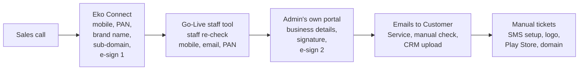
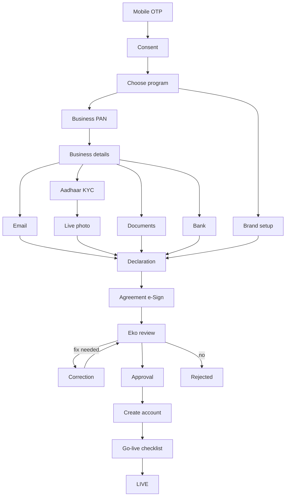
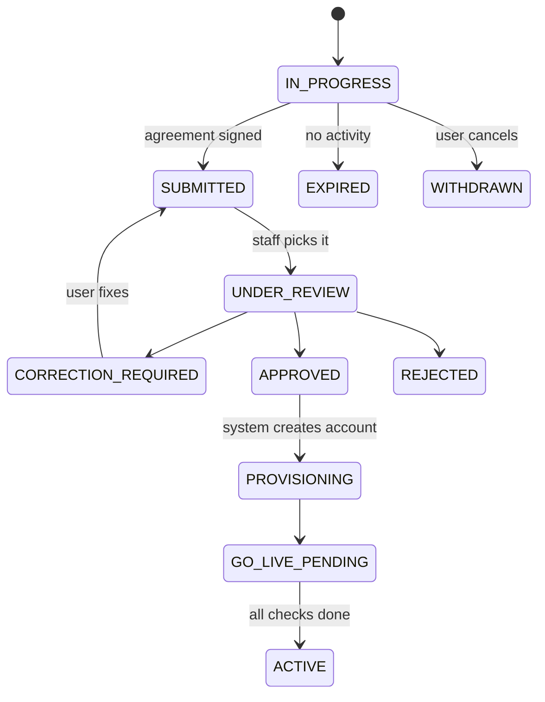
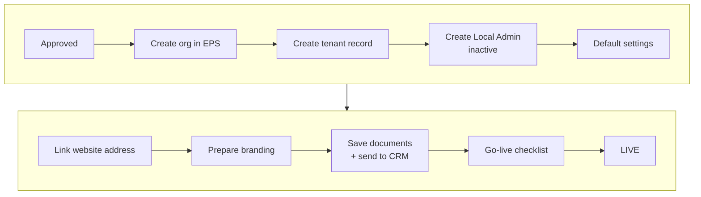
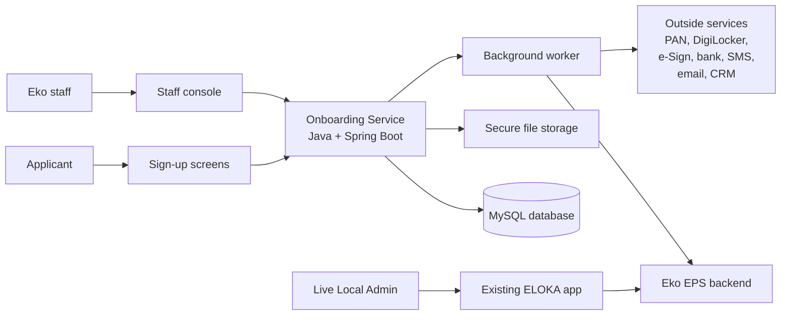

# 1. What this guide is

This is the short, easy version of the full blueprint (`ELOKA_Local_Admin_Onboarding_Blueprint.pdf`).

It explains how a new business customer becomes an **ELOKA Local Admin**: from the first sales call, through checks and approval, until their own branded portal goes live.

What this guide is and is not:

- It is a **plan only**. No code has been written yet.
- It covers what exists today, what we suggest, how the system will work, and what we still need to know.
- Anything marked **NEW** is our suggestion. It is not yet agreed by the business.

> **Updated 14 October 2026.** Two decisions were made:
>
> - **Database: MySQL** (team choice).
> - **Backend language: Java with Spring Boot** (instead of TypeScript with NestJS).
>
> The sign-up journey, stages, data rules and security rules did not change. Only the tools changed (sections 8, 9, 13 and 16).

# 2. Key words in simple language

| Word | Meaning |
|---|---|
| ELOKA | Eko's white-label platform. Businesses run their own branded portal on it. |
| White label | The customer's own name, logo and colours on our platform |
| Lead | A business that sales has spoken to and that may join |
| Applicant | The person filling in the sign-up form for the business |
| Onboarding | The full sign-up process, from start to going live |
| `onboarding_id` | A unique number for one sign-up application |
| Tenant | One customer's separate space on ELOKA (their data, brand and website address) |
| Local Admin | The main admin user of that tenant. Runs their own network of distributors and retailers. |
| EPS | Eko's existing main backend. It already handles logins, payments and many checks. |
| KYC | "Know Your Customer": identity checks such as PAN and Aadhaar |
| e-Sign | Signing the agreement online with Aadhaar OTP |
| DigiLocker | Government app used to check Aadhaar safely |
| Sub-domain | The default website address, for example `yourbrand.finstore.app` |
| Custom domain | The customer's own address, for example `pay.yourbrand.com` |
| Go-live | The day the tenant and Local Admin start working |

# 3. What we found today

## 3.1 The current web app (`wlc-webapp`)

- The app is built with **Next.js**. It serves every existing customer from one codebase, based on the website address.
- It has **no Local Admin sign-up** today. The `/signup` page is only for agents (retailers and distributors) joining a customer that already exists.
- An "Enterprise Partner" option exists in the code but is hidden.
- Many parts can be reused:
  - business details form,
  - bank details form,
  - DigiLocker step,
  - selfie step,
  - agreement signing step,
  - theme / colour settings.

## 3.2 How sign-up works today (from the onboarding document)

Today a Local Admin is created across four different places:

## 3.3 Problems we found

| Problem | Why it is bad |
|---|---|
| The portal and website address are created **before** Eko approves the customer | A rejected customer may still have a portal |
| The agreement is signed **twice**, with two different providers | Confusing, costly, legally unclear |
| Mobile, email and PAN are checked twice (once by the customer, again by staff) | Wasted time; staff act on the customer's behalf |
| Unclear whether the company PAN or the admin's PAN is needed | The sample in the document is a personal PAN |
| One "Onboarding Complete" click sent **7 copies** of the same email | No protection against repeat actions |
| Agreements and documents are emailed to one named staff member | Not secure; depends on one person |
| SMS setup, logo, Play Store app and domain are manual tickets | Not tracked; easy to forget |
| The app trusts the browser when it says "agreement signed" | Can be faked; the server must check with the provider |
| No proper saving of progress | If the user leaves, the state is not stored properly |

## 3.4 What the whiteboard and notes ask for

- A simple journey: **Mobile → Choose option → PAN → Aadhaar → Live photo → Agreement**, "similar to SBI"
- **"Build bank grade"**, follow RBI guidelines, and respect the Data Protection Act
- Products after go-live: DMT, AePS, BBPS, QR, PG, Travel, Insurance

# 4. The new sign-up journey

## 4.1 The steps

| # | Step | What the user does | NEW? |
|---|---|---|---|
| 0 | Lead and invite link | Sales adds the lead and sends a link | NEW (invite link) |
| 1 | Mobile OTP | Enters mobile, gets OTP. An `onboarding_id` is created. | — |
| 2 | Consent | Agrees to terms and to data use | NEW |
| 3 | Choose program | Picks "Enterprise" and "White Label portal" | — |
| 4 | Business PAN | Enters PAN; we check it and look for duplicates | Duplicate check is NEW |
| 5 | Business details | Company name, type, signatory, address, signature | — |
| 6 | Email | Enters email, confirms with OTP (done by the user, not staff) | NEW (moved to the user) |
| 7 | Aadhaar KYC | Verifies the signatory through DigiLocker | — |
| 8 | Live photo | Takes a selfie (face match is optional) | Face match NEW; step still open |
| 9 | Documents | Uploads the required papers | List still open |
| 10 | Bank account | Adds bank details; we verify them | Still open |
| 11 | Brand setup | Brand name, website address (reserved only), logo, colours | — |
| 12 | Declaration | Reviews everything and confirms it is correct | NEW (moved to the user) |
| 13 | Agreement e-Sign | Signs **once** | Single signing is NEW |
| 14 | Eko review | Eko staff check everything; may ask for corrections | Correction loop NEW |
| 15 | Approval | A **second** staff member approves (two-person rule) | NEW |
| 16 | Account creation | System creates the tenant and Local Admin (not live yet) | Automatic creation NEW |
| 17 | Go-live checklist | Branding, SMS setup, app, domain are tracked | Tracking NEW |
| 18 | Go live | Local Admin can log in and start work | Welcome message NEW |

Steps 6 to 11 can be done in any order once the business details are filled.

## 4.2 The journey as a picture

# 5. Application stages

Every application is always in **one** stage. The **backend** decides the stage, never the browser.

| Stage | Meaning in simple words |
|---|---|
| `IN_PROGRESS` | The user is still filling in the steps |
| `SUBMITTED` | The user finished and signed. Data is locked. |
| `UNDER_REVIEW` | An Eko staff member is checking it |
| `CORRECTION_REQUIRED` | Staff asked the user to fix some steps |
| `ON_HOLD` | Paused for a risk or compliance check |
| `APPROVED` | Eko said yes |
| `REJECTED` | Eko said no (a reason is saved) |
| `PROVISIONING` | The system is creating the tenant and admin |
| `GO_LIVE_PENDING` | Account exists but is not live yet |
| `ACTIVE` | Live. The Local Admin can work. |
| `EXPIRED` / `WITHDRAWN` | Stopped (too long idle, or cancelled) |

Each step also has its own small status: not started, in progress, waiting for provider, done, failed, blocked, skipped, locked.

## 5.1 Leaving and coming back

- Progress is **saved on the server** after every step.
- The user logs in again with mobile OTP and continues exactly where they stopped, even on another device.
- If two browser tabs are open, the second tab is told to refresh instead of overwriting data.
- If the browser closes during DigiLocker or e-sign, the server still gets the result from the provider.
- Idle applications get reminders and then expire (suggested: 30 days; to be confirmed).

# 6. When things are created

| Thing | When it is created |
|---|---|
| Lead | When sales records the business |
| `onboarding_id` | Right after the mobile OTP is verified |
| Tenant (customer space) | Only **after approval** |
| Local Admin user | After approval, but **inactive** |
| Website address | **Reserved** during sign-up, made live at go-live |
| Branding | Saved as a draft, made live at go-live |
| Local Admin goes live | Only when all go-live checks pass |

**Main rule:** a half-finished or unapproved sign-up can **never** create a live Local Admin.

# 7. After approval: creating the account

The system creates everything in order. Every step is safe to repeat, so a retry never creates a second copy.

- If a step fails, the system retries it a few times.
- If it still fails, staff press **Retry** and the process continues from the failed step.
- Nothing is deleted on failure. Things are only switched off.

**Go-live checklist** (some items may be optional; to be decided):

- branding published,
- SMS sender setup (DLT),
- logo ready,
- Android app on Play Store,
- custom domain.

# 8. How the system is built

## 8.1 The big picture

- We build **one new service**, the "Onboarding Service". It sits next to Eko's existing EPS backend.
- It is written in **Java with Spring Boot** and stores its data in **MySQL**.
- It has two parts:
  - an **API part** that answers the screens,
  - a **worker part** that does slow jobs (sending SMS, waiting for providers, creating accounts).
- **EPS stays the main system** for live customers. The new service only writes to EPS after approval.
- After go-live, the Local Admin uses the **existing ELOKA app**. Nothing changes there.

## 8.2 Why one service and not many small ones

| Option | Verdict |
|---|---|
| Many small services (microservices) | Too complex for this amount of work |
| Serverless functions | Hard for long processes like account creation |
| Add it inside EPS | Possible, but we cannot see EPS code; the owner must decide |
| **One well-organised service** | **Chosen:** simple to build, test and run, and can be split later |

## 8.3 Main parts inside the service

| Part | What it does |
|---|---|
| Identity | OTP login for applicants; staff login |
| Lead | Leads and invite links |
| Onboarding | Application, steps, stages, resume, expiry |
| Verification | PAN, Aadhaar, bank, email, selfie checks |
| Documents | Upload, virus scan, review |
| Agreement | Create the agreement, e-sign, store the signed copy |
| Brand | Brand name, website address, logo, colours |
| Review | Staff queue, corrections, approval |
| Account creation | Creates the tenant and Local Admin after approval |
| Tenant | Website addresses, branding versions, go-live checklist |
| Audit | Records who did what and when |
| Notifications | SMS and email, never sent twice |

# 9. Tools we use

These were updated on 14 October 2026: the team chose **MySQL**, and the backend moved to **Java + Spring Boot**.

| Need | Our choice | Why |
|---|---|---|
| Language | **Java 25** (long-term support) | Bank-grade standard in India; strong, safe types; easy to hire for |
| Framework | **Spring Boot 4** + Spring Modulith | Mature and secure; keeps the service's parts cleanly separated |
| Database | **MySQL 8.4** (team choice) | Eko already runs MySQL, so the team knows how to operate it |
| Database changes | **Flyway** | Every change to the tables is a small, reviewed file |
| Background jobs | **JobRunr** (inside MySQL) | Retries and schedules with no extra system to run |
| Never sending twice | Spring Modulith **outbox** (inside MySQL) | A message is saved together with the change, so it is sent once |
| Input checks | Jakarta Bean Validation | Every field is checked at the server |
| API style | REST + OpenAPI | Simple, clear, easy to secure |
| Frontend link | **Orval** | Creates the screen code's types and checks from the API description, so both sides match |
| Calling outside services | Spring RestClient + **Resilience4j** | Time limits, retries and "stop calling when it is down" |
| Encryption | Google Tink + AWS KMS | Safe encryption of PAN, bank and contact details |
| File storage | S3-style storage in India | Private, encrypted, short-lived links |
| Virus scan | ClamAV | Free and runs on our own servers |
| Staff login | Company SSO + 2-step login (Google Workspace or Keycloak — to decide) | No extra passwords to manage |
| Logs and monitoring | Logback, Micrometer, OpenTelemetry, Sentry | Find problems fast; personal data is hidden in logs |
| Testing | JUnit 5, Testcontainers (real MySQL), WireMock, Playwright | Tests run against a real database and fake providers |
| Hosting | Docker containers | Already used for the frontend |
| CI/CD | GitHub Actions + security scans | Already used |
| Screens | Existing **Next.js** app (`wlc-webapp`) + a small Next.js staff console | Reuses today's frontend |

We avoided extra tools such as Redis, Kafka and Kubernetes because this system does not need them yet.

# 10. Data we keep and how we protect it

| Data | How it is stored |
|---|---|
| Mobile, email | Encrypted; shown masked (`******1234`) |
| PAN | Encrypted; masked; a hidden fingerprint is kept to find duplicates |
| Aadhaar number | **Never stored**; only a masked last 4 digits and the check result |
| Bank account | Encrypted; masked |
| Documents and photos | Private, encrypted file storage; virus-scanned; links expire in 1 minute |
| Signed agreement | Locked storage so it cannot be changed or deleted |
| OTP | Only a scrambled version; expires in 5 minutes |
| Activity history | Every important action is recorded and cannot be edited |

Main tables (simple view):

- **Before approval:** application, steps, business profile, checks, documents, bank account, agreement, e-sign, brand draft, reserved address
- **Staff work:** review actions, correction requests, account-creation runs
- **After approval:** tenant, website addresses, branding versions, Local Admin, go-live tasks
- **Support tables:** audit, job queue, repeat-request protection, provider callbacks

Duplicate rules (enforced by the MySQL database itself):

- one open application per mobile,
- one open application per PAN,
- one owner per website address,
- one tenant per application.

# 11. Main APIs (short list)

**For the applicant**

- Send OTP / verify OTP (start or resume)
- Get my application (all steps and their status)
- Save a step / submit a step / skip an optional step
- Check PAN
- Send / confirm email OTP
- Start DigiLocker / check its status
- Add bank account / check status
- Upload a document (get a secure link) / finish the upload
- Check if a website address is free
- Create the agreement / start e-sign / check the signing status
- See the application timeline

**For Eko staff**

- List applications and open one
- Pick an application for review
- Approve or reject a document
- Ask for corrections
- Recommend / approve / reject (two different people)
- Put on hold
- See a hidden value (only with permission; recorded)
- Retry account creation
- Update go-live tasks
- Make the Local Admin live
- Manage leads
- View history

**From outside providers**

- Callbacks from e-sign, DigiLocker and bank checks. Each callback is verified before it is used.

Rules for all APIs:

- Every important action carries a one-time key, so a double click never does the work twice.
- Each save is version-checked, so two tabs cannot overwrite each other.
- Errors come back in a clear, standard format.

# 12. Outside services

| Service | Used for | Status |
|---|---|---|
| EPS (Eko backend) | Creating the org and admin; many checks | Account-creation APIs unknown, must ask the EPS team |
| Org settings service | Linking the website address to the tenant; theme | Partly known |
| SMS / OTP | Mobile OTP and messages | Through EPS (already approved SMS templates) |
| Email | Email OTP and updates | Provider to be decided (not Gmail) |
| PAN check | Verify the business PAN | Through EPS; exact API to confirm |
| DigiLocker (Karza) | Aadhaar check | Through EPS; callback support to confirm |
| e-Sign (Leegality / Karza / Signzy / Digio) | Agreement signing | Provider and callback details to confirm |
| Bank check | Penny-drop verification | Through EPS; details to confirm |
| File storage + virus scan | Documents | To set up |
| CRM | Leads and customer records | Which CRM and its API: unknown |
| DNS / SSL | Website addresses | DevOps to confirm |
| DLT, Play Store | SMS sender setup, Android app | Stay manual, tracked in the checklist |

# 13. Security in simple words

- **Login:** applicants use mobile OTP. Staff use company login with 2-step verification.
- **OTP safety:**
  - limited tries,
  - short expiry,
  - wait time between resends,
  - same message whether the number exists or not.
- **Each customer sees only their own data.** This is checked in **two places**: the access rules and the code that reads data.
  - MySQL cannot filter rows per customer by itself (PostgreSQL could), so we add **automatic tests** that try to read another customer's data on every API and must fail.
  - The service's database logins only have the rights they need.
- The website address **never** gives access. Access comes only from the logged-in user.
- Staff see masked data. Seeing full PAN or bank numbers needs special permission and is recorded.
- Two-person rule for approval.
- Provider callbacks are verified and double-checked with the provider.
- Files are scanned for viruses and kept private.
- Logs never contain PAN, Aadhaar, bank numbers or OTPs.
- Consent is recorded with the exact version of the text the user agreed to.

# 14. When things go wrong

| Situation | What the system does |
|---|---|
| Same mobile starts again | Continues the old application instead of making a new one |
| Mobile already belongs to a live Local Admin | Blocks it with a polite message |
| PAN already used | Blocks it; staff can see the linked application |
| Wrong OTP too many times | Locks for a short time |
| PAN name does not match | Sends it to staff to decide |
| Provider is slow or down | Marks it "waiting" and checks again later |
| Browser closed during e-sign | Server still gets the result |
| Same callback arrives twice | The second one is ignored |
| Two tabs open | The second tab is asked to refresh |
| Document rejected | User is asked to upload a new one |
| CRM or email is down | Retries later; does not block approval |
| Website address taken | Shows other suggestions |
| Account creation fails midway | Staff retry; it continues from the failed step |
| Double click on "Approve" | Only one approval happens |

# 15. Build plan

| Phase | What we build |
|---|---|
| 0 | Planning and architecture (done; tools updated 14 October 2026) |
| 1 | Base setup: Java + Spring Boot service, MySQL database, security tools, audit, job system, logging |
| 2 | Login: applicant OTP and staff SSO |
| 3 | Application, steps, stages, resume, expiry, leads |
| 4 | PAN check and duplicate rules |
| 5 | Email, Aadhaar (DigiLocker), live photo |
| 6 | Documents and bank check |
| 7 | Brand setup, agreement e-sign, submit (first full demo) |
| 8 | Staff console: review, corrections, approval |
| 9 | Automatic account creation |
| 10 | Go-live checklist, CRM, make live |
| 11 | Custom domains |
| 12 | Final security testing and launch readiness |

Frontend screens are built alongside, reusing existing parts where possible.

Testing:

- small unit tests (JUnit),
- API tests with a real MySQL database (Testcontainers),
- automatic "can one customer see another's data?" tests on every API,
- tests against provider sandboxes,
- full end-to-end runs (Lead → Live), including failure, retry, resume, rejection and correction cases.

# 16. Questions we need answered

**Already decided (14 October 2026):**

- Database: **MySQL**.
- Backend language: **Java with Spring Boot**.

**Most important (these block building):**

1. Which EPS APIs create an org and an admin user, and switch them live?
2. How may we check Aadhaar for a business signatory, and what may we store?
3. Which team owns this backend? It needs people with Java / Spring Boot skills.
4. Company PAN or admin PAN? Which PAN types are allowed?
5. One agreement or two? Who owns the agreement template?
6. Are live photo, bank details and which documents required?
7. Staff login: Google Workspace or Keycloak?

**Also needed:**

- Can anyone sign up, or only invited leads?
- Which user type does a Local Admin get in EPS?
- Which business types are allowed (Pvt Ltd, LLP, Partnership, Proprietor…)?
- How long can an application stay idle before it expires?
- Which website domain: `finstore.app` or `elokademo.in`?
- Which e-sign provider? Which CRM? Which email provider?
- Who reviews, and who approves?
- Which go-live tasks must be done before going live?
- Where will the sign-up screens and staff console live?
- How long must we keep data (by law)?
- Where will the MySQL database run (cloud or Eko's own servers), and who is the DBA?

The full list of 60+ questions is in the main blueprint.

# 17. Next steps

1. Share this guide and the full blueprint with product, compliance, the EPS team and DevOps.
2. Get answers to the 7 most important questions.
3. Hold an architecture review meeting and sign off.
4. Start Phase 1 (base setup in Java + Spring Boot with MySQL).
